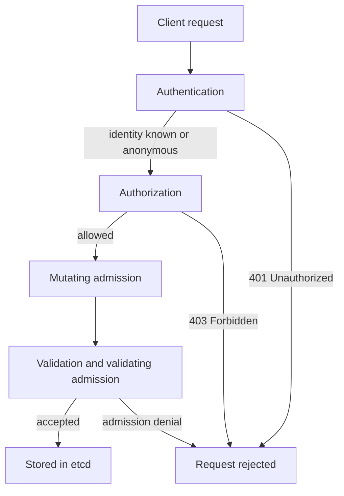

# Protecting The Cluster API

The Kubernetes application programming interface (API) controls stored cluster resources. A caller able to change workloads or permissions can affect application execution and data access. The API server is therefore a central security boundary, not merely an administrative convenience.

## Authentication And Authorization

Authentication establishes the caller's identity through configured mechanisms such as certificates or tokens. Authorization checks the requested action against the identity's grants. The resource type, API group, verb and namespace can all affect the decision. A valid identity is not automatically a trusted administrator.

A Role-Based Access Control (RBAC) configuration can grant narrow resource actions, while other supported authorization modes have their own decision behavior. Broad grants increase the consequences of credential exposure. Permission to create workloads can indirectly expose identities or storage if admission and runtime controls allow the resulting configuration.

Relevant resource changes then pass admission. Admission can mutate allowed defaults or reject disallowed specifications. A developer permitted to create Pods can still be prevented from requesting privileged execution. This is a separate policy layer, not evidence that authentication failed.

## Transport And Endpoint Exposure

Transport Layer Security (TLS) protects a connection and supports verification of the intended server. A client should validate trusted certificate identity rather than disable verification to avoid a connection error. A stolen credential remains dangerous even on an encrypted connection, so transport protection does not replace credential scope and lifetime controls.

Network restrictions reduce who can attempt API connections. A private endpoint or firewall is useful, but workloads or administrators inside the allowed network still need appropriate permission. An internet-facing endpoint with strong authentication can have different exposure and availability risks. Analyze both the network path and the API authority available to accepted callers.

Administrative credentials deserve especially careful handling. Separate routine narrow roles from emergency broad roles, avoid sharing identities and preserve evidence of sensitive changes. A client-side context selects credentials; the server's checks determine what those credentials permit.

## Stored State And Dependent Components

Accepted resources are stored in etcd. Controllers, schedulers and kubelets use the API to observe or change state according to their roles. Direct access to the datastore can bypass the ordinary API security path, so it needs a separate restricted boundary.

An admission webhook can become a dependency of resource acceptance. If required policy is unavailable, configured failure behavior determines whether requests are rejected or allowed past that check. This affects both security and availability. The webhook's identity, serving certificate, permissions and operating reliability matter to the API path.

## Evidence And Recovery

Audit records can identify API requests, caller identities, target resources and response outcomes according to the configured policy. They are different from application logs, which describe business requests to workloads. Audit content can itself be sensitive, especially if request or response bodies contain credentials or data.

Suppose an exposed deployment credential creates an unexpected workload. The API can have behaved correctly according to an excessively broad grant. Investigate the identity, granted actions, audit timeline and resulting resources. Revoke exposed authority, restore reviewed state and inspect any data or infrastructure the workload could access.

A secure API design combines trusted transport, narrow permissions, suitable admission, protected storage and useful evidence. Each part enforces or observes a particular boundary; none alone proves that every accepted declaration is harmless.

## The Order Of The Checks

The three checks run in a fixed order, and a request that fails one check stops there. This order explains most of the error messages an administrator sees, so it is worth knowing exactly.



The diagram shows that only a request that passes authentication, authorization and admission reaches the datastore. A `401 Unauthorized` answer means the server could not establish an identity. A `403 Forbidden` answer means the identity is known but no authorizer allows the action. An admission denial names the policy or webhook that refused the object.

## What The API Server Is Started With

The kube-apiserver is configured with command-line flags, and the flags decide how each check works. On a cluster built with kubeadm, including the kind cluster of the playground, the server runs as a static pod and the flags are in its pod specification. These flags matter for security:

- `--authorization-mode=Node,RBAC` selects the authorizers. `Node` authorizes kubelets for the objects of their own pods. `RBAC` evaluates roles and bindings. A value of `AlwaysAllow` would approve every request.
- `--anonymous-auth` controls whether a request with no credentials is treated as the user `system:anonymous` in the group `system:unauthenticated`. The default is true, and RBAC then decides what that user may do.
- `--client-ca-file` names the certificate authority used to verify client certificates.
- `--tls-cert-file` and `--tls-private-key-file` are the serving certificate that clients verify.
- `--enable-admission-plugins` adds admission plugins to the default set. `NodeRestriction` limits what a kubelet may change.
- `--audit-policy-file` and `--audit-log-path` switch on audit logging.

Anonymous requests are not the same as an open API. With the default flags, an anonymous caller can reach only a few public endpoints, such as `/healthz`, `/livez` and `/readyz`, through the built-in role `system:public-info-viewer`. Everything else needs an RBAC rule that names `system:anonymous` or `system:unauthenticated`. The danger is therefore a binding that someone adds, not the flag itself.

## Try It: Read The Flags And Test An Identity

Read the running configuration instead of guessing it. This command prints the API server static pod as YAML, and the `command` list holds the flags.

<!-- astrona:playground:renew -->

```sh
kubectl -n kube-system get pod -l component=kube-apiserver -o yaml
```

Look for `--authorization-mode` and `--enable-admission-plugins` in the output. Then ask the API server how an anonymous caller is treated. The `--as` flag impersonates a user, and `--as-group` adds a group.

```sh
kubectl auth can-i list pods -n starfleet --as=system:anonymous --as-group=system:unauthenticated
```

In the playground the answer is `yes`, because the ClusterRoleBinding `public-reader` gives the `view` role to the group `system:unauthenticated`. Find the binding with `kubectl get clusterrolebindings -o wide`, and read its subjects. This one binding turns a harmless default into cluster-wide read access for any caller that can reach the server.

The same request path explains why a stolen certificate or token is dangerous even over an encrypted connection. Transport Layer Security (TLS) protects the bytes in transit and lets the client verify the server. It does not limit what an accepted identity may do. That limit comes only from authorization, and from admission for the content of objects.

## Common pitfalls

> [!WARNING]
> Encryption and authentication do not imply authorization. Direct datastore access and admission dependencies require separate protection, and audit records can contain sensitive data.
