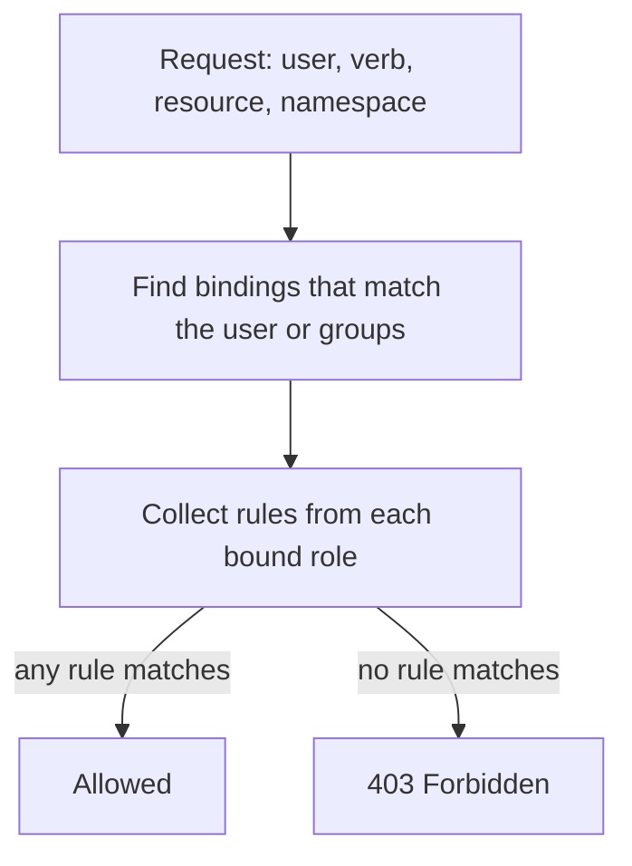

# Authorization And Least Privilege With RBAC

After the API server knows who is calling, it must decide whether that identity may do what it asks. Role-based access control (RBAC) makes that decision on almost every cluster. If RBAC is too strict, a pipeline fails with `Forbidden`. If it is too loose, one stolen token can read every Secret. This part explains how RBAC evaluates a request, how scope works, and how to find grants that give too much.

## How RBAC Evaluates A Request

RBAC works with four kinds of object. A **Role** holds rules for one namespace. A **ClusterRole** holds rules that are not tied to a namespace, such as rules for nodes, or rules that a RoleBinding reuses in many namespaces. A **RoleBinding** gives the rules of a Role or ClusterRole to subjects inside its own namespace. A **ClusterRoleBinding** gives the rules of a ClusterRole to subjects in every namespace.

A rule lists `apiGroups`, `resources` and `verbs`, and can list `resourceNames` to limit the rule to named objects. For each request the API server collects every rule from every binding that matches the caller's user name or groups. It allows the request if any rule matches the verb, the resource, the API group and the namespace. RBAC has no deny rules. A request with no matching rule is forbidden, and the answer is `403 Forbidden`.

Subjects are users, groups and service accounts. Kubernetes has no user objects: a user or group is a name that the authenticator reports, for example the common name and organization of a client certificate. A service account is a real object in a namespace, and its user name is `system:serviceaccount:<namespace>:<name>`.



The diagram shows that the result is the union of all matching rules, so adding a binding can only grant more, and removing the wrong binding can break a service without a visible error until the next request.

## Scope Comes From The Binding

A common mistake is to think the role decides where a permission applies. The binding decides. A ClusterRole used through a RoleBinding gives its rules only in the namespace of that binding. The same ClusterRole used through a ClusterRoleBinding gives the rules everywhere, and also on resources that are not namespaced, such as nodes and namespaces.

Save this as `rolebinding-developers-view.yaml`:

```yaml
apiVersion: rbac.authorization.k8s.io/v1
kind: RoleBinding
metadata:
  name: developers-view
  namespace: starfleet
subjects:
  - kind: Group
    name: developers
    apiGroup: rbac.authorization.k8s.io
roleRef:
  apiGroup: rbac.authorization.k8s.io
  kind: ClusterRole
  name: view
```

Apply it:

<!-- astrona:playground:renew -->

```sh
kubectl apply -f rolebinding-developers-view.yaml
```

Then check the result in two namespaces. The group should read pods in `starfleet` and should not read them in `outpost`.

```sh
kubectl auth can-i list pods -n starfleet --as=dev-anna --as-group=developers
kubectl auth can-i list pods -n outpost --as=dev-anna --as-group=developers
```

The first answer is `yes` and the second is `no`. The binding is namespaced even though `view` is a ClusterRole. The `roleRef` of a binding cannot be changed after it is created, so changing the role means deleting and creating the binding.

## Verbs, Resources And Subresources

The verbs map to HTTP methods: `get`, `list` and `watch` read, `create`, `update`, `patch` and `delete` change. Two details cause real incidents. First, `list` and `watch` return the full content of every object, so a role that allows `list` on `secrets` exposes every Secret value even if `get` is not allowed. Second, subresources are separate entries. `pods/exec`, `pods/log` and `deployments/scale` need their own rule, and `pods/exec` lets a caller run a command in a container.

Some verbs change the permission system itself. `escalate` lets a caller create or update a role with more rights than the caller holds. `bind` lets a caller create a binding to a role without holding its rights. `impersonate` lets a caller act as another user. The API server blocks the ordinary escalation path: a caller cannot grant rights it does not hold unless it also has `escalate` or `bind`. Never give these three verbs to a workload identity without a strong reason.

## Finding Over-Broad Grants

Over-broad grants usually come from convenience: `cluster-admin` for a pipeline, a wildcard `*` in a Role, or a binding to a large group. Search for them by listing the bindings and the subjects they name.

```sh
kubectl get clusterrolebindings -o wide
kubectl get rolebindings -A -o wide
```

Look in the `SUBJECTS` column for `system:unauthenticated`, `system:authenticated` and `system:serviceaccounts`. A role bound to one of these groups applies to every anonymous caller, every authenticated user, or every service account in the cluster. Look in the role column for `cluster-admin`, `admin` and `edit`. Then check what a suspicious identity can really do, not what its name suggests:

```sh
kubectl auth can-i --list -n starfleet --as=system:serviceaccount:starfleet:ci-deployer
```

The list shows every rule that applies to the pipeline service account in `starfleet`. In the playground, the `ci-deployer` account is bound to `cluster-admin`, so the list ends with a rule for all verbs on all resources. To fix it, delete the ClusterRoleBinding `ci-deployer-admin`, create a Role with the verbs the pipeline uses, and bind it with a RoleBinding.

## Service Accounts And Their Tokens

A pod that calls the API uses a service account. Since Kubernetes 1.22 the kubelet requests a bound token for the pod through the TokenRequest API. The token is audience-bound, expires, and stops working when the pod is deleted. It is projected into the container at `/var/run/secrets/kubernetes.io/serviceaccount/token`.

By default every pod receives this token, even when the application never calls the API. Set `automountServiceAccountToken: false` on the service account or on the pod to avoid mounting it. The pod field wins when both are set. Setting the field on a service account changes only new pods, so existing pods keep their token until they are replaced. A pod with no token cannot be used by an attacker to call the API, so this is a cheap reduction of exposure for every workload that does not need the API.

Never use the `default` service account for a workload, because every pod in the namespace that does not name another account shares it, and any right given to it is given to all of them.

## Common pitfalls

> [!WARNING]
> A RoleBinding to a ClusterRole is namespaced, but a ClusterRoleBinding to the same role is cluster-wide. `list` on Secrets reveals their values. Changing the service account of a Deployment or its automount setting affects only newly created pods. Removing a binding does not revoke a token that is already issued until it expires, so also rotate or delete the service account when a credential leaked.
