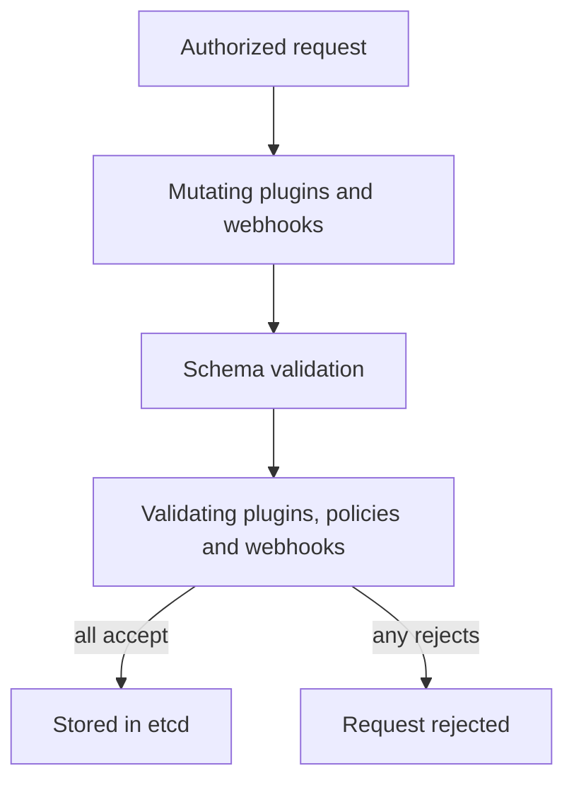

# Admission Control And Audit Evidence

Authorization decides whether a caller may submit a kind of object. It does not look inside the object. A user who may create pods can still submit a pod that mounts the node filesystem. Admission control closes this gap: it runs after authorization, looks at the object itself, and can change it or reject it. This part explains the admission steps, the built-in policy object, what happens when a policy cannot run, and how the audit log records what the server decided.

## Mutating And Validating Admission

Admission has two phases. In the **mutating** phase, plugins and webhooks can change the object, for example to add a default value or a sidecar container. In the **validating** phase, plugins and webhooks can only accept or reject the object. The server runs all mutating steps first and validates the final object, so a validating step sees the result of every mutation.

Some admission plugins are compiled into the API server. `NodeRestriction` limits what a kubelet may change, `ServiceAccount` adds the token volume to pods, and `PodSecurity` enforces the Pod Security Standards from labels on the namespace. Other checks are configured through API objects: **admission webhooks**, which call an external HTTPS service, and **ValidatingAdmissionPolicy**, which evaluates expressions inside the API server.



The diagram shows that one rejection in the validating phase stops the request, and that nothing is stored until every check accepts.

## ValidatingAdmissionPolicy

A webhook needs a running service, a serving certificate and an operations plan. A **ValidatingAdmissionPolicy** needs none of these. It is built into the API server, it is stable since Kubernetes 1.30, and it evaluates Common Expression Language (CEL) expressions on the object. It uses two objects. The policy holds the match rules and the expressions. The **ValidatingAdmissionPolicyBinding** says where the policy applies and what action to take: `Deny`, `Warn` or `Audit`.

Save this as `deny-hostpath.yaml`. The policy rejects pods that use a `hostPath` volume in namespaces that carry the label `policy=restricted`:

```yaml
apiVersion: admissionregistration.k8s.io/v1
kind: ValidatingAdmissionPolicy
metadata:
  name: deny-hostpath
spec:
  failurePolicy: Fail
  matchConstraints:
    resourceRules:
      - apiGroups: [""]
        apiVersions: ["v1"]
        operations: ["CREATE", "UPDATE"]
        resources: ["pods"]
  validations:
    - expression: "!has(object.spec.volumes) || object.spec.volumes.all(v, !has(v.hostPath))"
      message: "hostPath volumes are not allowed"
---
apiVersion: admissionregistration.k8s.io/v1
kind: ValidatingAdmissionPolicyBinding
metadata:
  name: deny-hostpath-restricted
spec:
  policyName: deny-hostpath
  validationActions: ["Deny"]
  matchResources:
    namespaceSelector:
      matchLabels:
        policy: restricted
```

Apply it:

<!-- astrona:playground:renew -->

```sh
kubectl apply -f deny-hostpath.yaml
```

Then label the namespace and test with a server-side dry run, which runs authorization and admission without storing the object:

```sh
kubectl label namespace outpost policy=restricted
kubectl run hostpath-test -n outpost --image=busybox:1.37.0 --dry-run=server -o name
```

The second command creates an ordinary pod and the API server accepts it. A pod with a `hostPath` volume, which needs a YAML file, is rejected with the message `hostPath volumes are not allowed`. A new policy needs a few seconds before the API server enforces it, so a test run right after the apply can still succeed.

Two CEL details cause errors. Reading a field that does not exist, for example `object.spec.volumes` on a pod with no volumes, is a runtime error, so guard the access with `has()`. With `failurePolicy: Fail`, a runtime error rejects the request. With `Ignore`, it lets the request through.

## Failure Policy And Availability

A policy or webhook can fail to run: a webhook service is down, its certificate expired, or an expression raised an error. The `failurePolicy` field decides what happens next. `Fail` rejects the request, which keeps the rule enforced and stops the operations the rule matches. `Ignore` accepts the request, which keeps the cluster working and silently drops the rule.

For a security-critical rule, use `Fail` and make the webhook highly available. Exclude the namespace that runs the webhook itself and the `kube-system` namespace from the rule, or a failed webhook can block its own repair. For an optional rule, `Ignore` is acceptable if monitoring shows when the rule did not run.

## Audit Evidence

Audit logging records what the API server did. The **audit policy** is a file that sets a level for each kind of request: `None` records nothing, `Metadata` records the user, verb, resource and response code, `Request` adds the request body, and `RequestResponse` adds the response body too. The server writes events to a log file or sends them to a webhook backend. It reads the policy from `--audit-policy-file` at start.

Audit events answer the question "who changed what, and when". For example, an event shows that the service account `ci-deployer` created a Deployment in `starfleet` and that the API server returned status 201. They do not show what the application did after it started, because application logs record that. Bodies in the audit log can contain Secret values and tokens, so use `Metadata` for Secrets and protect the log files like credentials.

When an unexpected workload appears, the audit log gives the investigation path: find the request that created it, read the identity, check the rules that allowed it, then remove the grant and review what the workload could reach.

## Common pitfalls

> [!WARNING]
> A policy without a binding does nothing. `failurePolicy: Ignore` hides a broken rule. An expression that reads a missing field is an error, not `false`. Audit levels above `Metadata` can write Secrets into the log. Admission cannot repair an over-broad Role, because it judges objects and not permissions.
