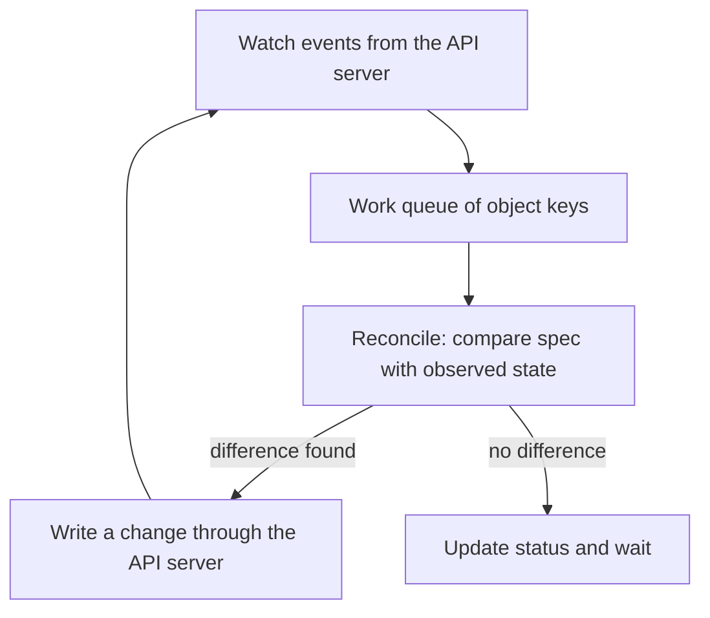

# Securing Reconciliation Components

The controller manager runs control loops that maintain cluster state. Controllers observe resources and use the Kubernetes application programming interface (API) to create or change other objects. Their ability to reconcile workloads depends on identities, permissions and access to the desired state they manage.

## Why Controller Permissions Matter

A replica controller can request replacement Pods when managed replicas disappear. Other controllers handle nodes, endpoints or related lifecycle operations according to the cluster's design. These components need permissions appropriate to their jobs, but a controller's operational purpose does not make unrestricted authority harmless.

If a controller identity is compromised, an attacker can attempt the API operations that identity permits. The consequence depends on its actual grants and the resources it can influence. A controller managing one custom application's namespace has a different expected boundary from a powerful system controller managing cluster-wide resources.

Credential files and access to the host process therefore need protection. Administrative users who can read them may be able to act as the controller. Limiting network reachability helps reduce paths to component endpoints, but does not protect a credential already exposed through disk, process or diagnostic access.

## API-Based Behavior And Transport

Controllers ordinarily use the API server rather than writing directly into etcd. API authentication, authorization and admission still matter to their requests. A misconfigured grant can cause reconciliation failures, while a broad grant can increase compromise impact. Both outcomes need evidence of the actual rejected or accepted action.

Secure connections should verify the intended API endpoint. Serving or diagnostic endpoints should not be broadly exposed without an identified need and suitable protection. An endpoint described as operational can still reveal internal state or enable unwanted behavior depending on what it serves.

## Availability And Leadership

Control plane redundancy can provide another controller-manager instance. Leader election coordinates active responsibilities so replicated components do not independently behave as unrelated managers of the same work. This supports availability, but the mechanism itself needs working API access and reliable component configuration.

Existing containers can continue while a controller is unavailable, yet recovery and new changes can stall. If a managed Pod disappears during that interval, desired replicas may not be restored promptly. Component health and workload health are therefore related but not identical observations.

## A Controller Failure Scenario

Suppose desired replica count is three, but a controller repeatedly receives forbidden responses when trying to create the replacement. The missing Pod is a consequence of insufficient controller permission, not necessarily of a failed application image. Restoring the correct scoped grant should allow object creation, after which scheduling and startup still need to succeed.

Now consider the opposite: an exposed controller credential creates unwanted workloads. The controller's normal name does not make the requests legitimate. Audit evidence, actual bindings and affected resources establish what happened. Recovery should revoke or replace the compromised credential and restore reviewed intent without ignoring external effects.

Controllers restore resource state they understand. They do not automatically undo malicious data writes inside an application or recover all external transactions. Protect their authority, observe their requests and define recovery at both resource and application boundaries.

## The Reconcile Loop

Every controller follows the same pattern. It watches objects through the API server, keeps a local cache of what it sees, and puts the key of any changed object into a work queue. A worker takes a key from the queue, reads the declared state (the `spec`) and the observed state, and writes whatever change moves the observed state toward the declared one. Then it records what it saw in the `status` field and takes the next key.



The diagram shows that a controller never changes the world directly. It only reads and writes API objects, and the API server applies authentication, authorization and admission to every one of those requests. The loop is also level-based: if a controller misses an event, the next pass compares the full states again and still reaches the correct result.

## What Runs Inside The Controller Manager

The kube-controller-manager is one binary that starts many controllers as goroutines in a single process. The ones that matter most for security are these:

- The Deployment controller creates and updates ReplicaSets.
- The ReplicaSet controller creates and deletes pods so the count matches `replicas`.
- The Job and CronJob controllers create pods and Jobs for batch work.
- The node lifecycle controller marks unreachable nodes and adds taints so pods leave them.
- The garbage collector deletes objects whose owner no longer exists.
- The ServiceAccount token controller and the certificate signing controllers create tokens and sign certificates.

The last group is the reason the process needs protection. A process that can sign certificates and create tokens holds material that other components trust. The signing key flags, `--cluster-signing-cert-file` and `--cluster-signing-key-file`, point at files on the control plane node, and `--service-account-private-key-file` names the key that signs service account tokens. Anyone who reads those files can issue identities that the API server accepts.

## Flags That Affect Security

On a kubeadm cluster the controller manager runs as a static pod, and its flags are in the pod specification. These flags matter:

- `--use-service-account-credentials=true` makes each controller use its own service account instead of the shared identity of the process.
- `--authentication-kubeconfig` and `--authorization-kubeconfig` set how the secure port checks callers of the controller manager itself.
- `--bind-address` sets the address of the secure port. A value of `127.0.0.1` keeps it on the node. A value of `0.0.0.0` exposes it on every interface.
- `--profiling` enables the profiling endpoints under `/debug/pprof`. Disable it unless a diagnosis needs it.
- `--leader-elect=true` makes replicas compete for a lease, so only one instance acts at a time.
- `--root-ca-file` sets the certificate authority that is copied into each service account token volume.

The secure port listens on 10257 and serves metrics, health checks and profiling. A workload that can reach the node address on that port can try to read the endpoints, so network policy on the host and the bind address both reduce that exposure.

## Try It: Read The Controller Manager Configuration

Read the running flags instead of guessing them. The command prints the static pod as YAML, and the `command` list holds the flags.

<!-- astrona:playground:renew -->

```sh
kubectl -n kube-system get pod -l component=kube-controller-manager -o yaml
```

Look for `--use-service-account-credentials` and `--bind-address` in the output. Then list the roles that the built-in controllers use:

```sh
kubectl get clusterroles | grep system:controller
```

There is one role per built-in controller, each with a small rule set. Next, delete a pod that a ReplicaSet owns and watch the controller restore it. Pick any pod that belongs to a Deployment in the playground:

```sh
kubectl get pods -n starfleet -o wide
```

The controller that creates the replacement is the ReplicaSet controller. It sees that the count is below `replicas` and writes a new pod. If you stop the controller manager, as happens on a real cluster during an outage, the same deletion leaves a gap until the controller returns.

## Common pitfalls

> [!WARNING]
> A trusted system role can have a large compromise impact. Controller availability does not prove application health, and reconciliation does not automatically repair every external data effect.
