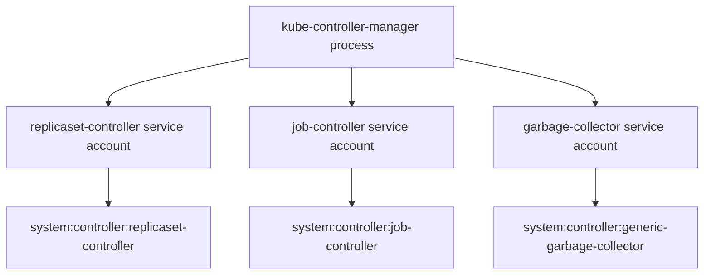

# Controller Identities And RBAC

Every controller needs permission to read the objects it watches and to write the objects it manages. Those permissions come from Role-based access control (RBAC), the same mechanism that protects human users. A controller that holds too little fails with `Forbidden` and stops reconciling. A controller that holds too much turns a bug or a stolen token into a cluster-wide incident. This part explains how built-in and custom controllers get their identities, how to scope a custom controller, and which verbs allow privilege escalation.

## Identities Of Built-In Controllers

With `--use-service-account-credentials=true`, the controller manager creates a separate client for each controller. Each client uses a service account in the `kube-system` namespace, for example `replicaset-controller`, and the API server treats the request as that service account. The matching ClusterRole is named `system:controller:replicaset-controller`, and a ClusterRoleBinding of the same name connects them.

Without the flag, every controller shares the identity `system:kube-controller-manager`, and one role must hold the union of all rights. The separate identities have two benefits. The roles stay small, so a defect in one controller cannot use the rights of another. The audit log also shows which controller made each request, because the user name contains the controller name.



The diagram shows one process with many identities. Compromising the process still exposes all of them, but a stolen token for one controller exposes only that controller's role.

## A Custom Controller Is A Normal Workload

An operator or custom controller is not part of the controller manager. It runs as a Deployment, uses a service account and reaches the API server with a token. Its permissions come only from the roles that you bind to that service account. Nothing limits it by default except RBAC, so the role is the whole security boundary.

The most common mistake is to bind a wildcard role because it makes the first run succeed. The rule `apiGroups: ["*"]`, `resources: ["*"]`, `verbs: ["*"]` allows every action on every object in every namespace. A controller with that role can read every Secret, delete every workload and create new roles for itself. Review a controller in four steps:

1. List which objects it watches and which it writes.
2. Give each object type only the verbs it uses. Watching needs `get`, `list` and `watch`. Updating needs `update` or `patch`.
3. Use a Role and a RoleBinding when the controller works in one namespace.
4. Add `resourceNames` when it changes only specific objects.

## Save A Least-Privilege Role

The playground controller reads ConfigMaps and updates one ConfigMap named `fleet-state`. Save this as `controller-role.yaml`:

```yaml
apiVersion: rbac.authorization.k8s.io/v1
kind: Role
metadata:
  name: state-writer
  namespace: starfleet
rules:
  - apiGroups: [""]
    resources: ["configmaps"]
    verbs: ["update", "patch"]
    resourceNames: ["fleet-state"]
  - apiGroups: [""]
    resources: ["configmaps"]
    verbs: ["get", "list", "watch"]
---
apiVersion: rbac.authorization.k8s.io/v1
kind: RoleBinding
metadata:
  name: fleet-controller
  namespace: starfleet
subjects:
  - kind: ServiceAccount
    name: fleet-controller
    namespace: starfleet
roleRef:
  apiGroup: rbac.authorization.k8s.io
  kind: Role
  name: state-writer
```

The second rule has no `resourceNames` on purpose. A `list` or `watch` request names a collection, and the rule matches only when the request filters by the object name with a field selector. A controller that lists all ConfigMaps therefore needs the read verbs without `resourceNames`. The write verbs act on one named object, so `resourceNames` works for them.

<!-- astrona:playground:renew -->

Apply it:

```sh
kubectl apply -f controller-role.yaml
```

Then check the result. Ask the API server what the service account may do:

```sh
kubectl auth can-i patch configmaps/fleet-state -n starfleet --as=system:serviceaccount:starfleet:fleet-controller
kubectl auth can-i patch configmaps/fleet-notes -n starfleet --as=system:serviceaccount:starfleet:fleet-controller
```

The first answer is `yes` and the second is `no`. If the playground still has the wildcard binding for this service account, both answers are `yes`, because RBAC is a union of all matching rules. Removing the wildcard ClusterRoleBinding is the step that makes the narrow role effective.

## Verbs That Allow Escalation

RBAC has a built-in guard against privilege escalation. A user can create or update a Role only if the user already holds every permission in that Role, or holds the `escalate` verb on `roles` or `clusterroles`. A user can create a binding only if the user holds the permissions of the referenced role, or holds the `bind` verb on that role.

This guard fails open for two verbs. A service account with `escalate` can write a role that grants itself anything. A service account with `bind` can bind any named role, including `cluster-admin`, to itself. The `impersonate` verb is a third path: it lets the caller send requests as another user, group or service account, and the API server then applies that identity's rights.

A narrow design uses `bind` with `resourceNames`, so the operator can bind only one reviewed role:

```yaml
rules:
  - apiGroups: ["rbac.authorization.k8s.io"]
    resources: ["clusterroles"]
    verbs: ["bind"]
    resourceNames: ["tenant-viewer"]
  - apiGroups: ["rbac.authorization.k8s.io"]
    resources: ["rolebindings"]
    verbs: ["create"]
```

The operator can create RoleBindings, but only to the role `tenant-viewer`. It cannot bind itself to `cluster-admin`.

## Secrets And Read Access

Reading Secrets is the next most useful capability after escalation. The verbs `get`, `list` and `watch` on `secrets` all return full object content. A `list` call returns every Secret in the scope, including the data fields, and a `watch` stream sends the same data when objects change. A controller that needs to read one Secret should have `get` on that Secret by name and no `list` or `watch` on the resource.

Service account tokens are also Secrets in older clusters, and a token that can list Secrets can read the tokens of other accounts. Current clusters mint short-lived tokens through the TokenRequest API instead of storing long-lived Secrets, which limits this path. A role that can create `serviceaccounts/token` can still mint tokens for the accounts it names, so treat that subresource like `impersonate`.

## Find Over-Broad Grants

Search the cluster for bindings that attach powerful roles to controller service accounts:

```sh
kubectl get clusterrolebindings -o wide | grep -E 'cluster-admin|fleet'
```

For each result, read the role and ask whether the rules match what the controller actually does. A review that compares the rules with the audit log of real requests is more reliable than a review of names, because a role named `viewer` can still hold rules that the name does not suggest.

## Common pitfalls

> [!WARNING]
> A wildcard or `cluster-admin` binding for a controller works immediately, so it often stays. The grant gives every action on every object to anything that obtains the token. Replace it with a Role that lists exact resources, verbs and names, and remove `escalate`, `bind` and `impersonate` unless a documented design needs them.
