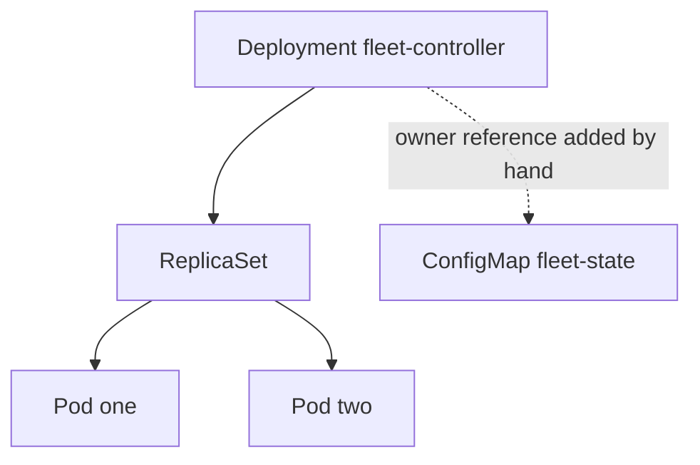

# Ownership, Recovery And Failure

Controllers connect objects with ownership, and they keep clusters tidy by removing what no owner claims. Ownership also decides what survives a deletion, and a stopped or compromised controller changes which parts of the cluster still repair themselves. This part explains owner references, the garbage collector, paused Deployments, automatic Job cleanup and the effects of controller manager downtime. It ends with a recovery sequence for a compromised controller.

## Owner References

An object can carry a list in `metadata.ownerReferences`. Each entry has four required fields: `apiVersion`, `kind`, `name` and `uid`. The entry says that another object owns this one. A ReplicaSet created by a Deployment carries an owner reference to that Deployment, and each pod created by the ReplicaSet carries one to the ReplicaSet.

The `uid` makes the link exact. If someone deletes a Deployment and creates a new one with the same name, the new object has a different `uid`, and old dependents do not match it. A namespaced dependent must be in the same namespace as its owner. A cluster-scoped object cannot have a namespaced owner.



The diagram shows two ownership chains. The first is created by controllers. The second is added by a person so that a ConfigMap follows the life of the Deployment.

## The Garbage Collector

The garbage collector is a controller inside the controller manager. It watches owner references and deletes a dependent object when all of its owners are gone. This is how deleting a Deployment also removes its ReplicaSets and pods without an explicit command for each.

Deletion has three cascading modes:

- Background is the default. The owner is deleted first, and the garbage collector removes the dependents afterwards.
- Foreground keeps the owner visible with a deletion marker until the dependents that block deletion are gone.
- Orphan deletes only the owner and removes the owner reference from the dependents, so they remain.

Choose the mode with `kubectl delete --cascade=background`, `--cascade=foreground` or `--cascade=orphan`. The orphan mode is useful when you must replace a controller but keep its pods running. It is also a way for dependents to outlive their owner without any owner watching them.

## Adding An Owner Reference By Hand

A custom controller that creates a ConfigMap should set an owner reference at creation so cleanup is automatic. You can also add one to an existing object. Read the unique identifier of the owner first, then patch the dependent.

<!-- astrona:playground:renew -->

```sh
kubectl get deployment fleet-controller -n starfleet -o jsonpath='{.metadata.uid}'
```

Save this as `owner-patch.yaml`, and replace `OWNER-UID` with the value from the command:

```yaml
metadata:
  ownerReferences:
    - apiVersion: apps/v1
      kind: Deployment
      name: fleet-controller
      uid: OWNER-UID
```

Apply it:

```sh
kubectl patch configmap fleet-state -n starfleet --type=merge --patch-file owner-patch.yaml
```

Then check the result:

```sh
kubectl get configmap fleet-state -n starfleet -o jsonpath='{.metadata.ownerReferences[0].kind}'
```

The command prints `Deployment`. If the Deployment is later deleted with the default mode, the garbage collector removes the ConfigMap. A wrong `uid` is not rejected at write time, but the garbage collector sees an owner that does not exist and may delete the dependent. Always copy the `uid` from the live object.

## Paused Deployments

A Deployment has a field `spec.paused`. When it is true, the Deployment controller does not roll out changes to the pod template. A paused Deployment that was just created does not create a ReplicaSet, so no pods start. The commands `kubectl rollout pause` and `kubectl rollout resume` change the field.

Pausing is useful to batch several edits into one rollout. It is also a quiet failure. The Deployment shows the desired replica count and zero ready pods, but the cause is not an error in a pod. The cause is that nothing reconciles the object. Check `spec.paused` and the Deployment conditions when a rollout does not start.

## Automatic Cleanup Of Jobs

Jobs and their pods stay in the cluster after they finish, together with their logs and environment values. A CronJob that runs every night adds one Job per run. Two settings limit the growth:

- `spec.successfulJobsHistoryLimit` and `spec.failedJobsHistoryLimit` on the CronJob set how many finished Jobs the CronJob controller keeps. The defaults are 3 and 1.
- `spec.ttlSecondsAfterFinished` in the Job spec, or in the CronJob's `jobTemplate`, tells the time-to-live controller to delete the Job a number of seconds after it finishes. Deleting the Job also deletes its pods through ownership.

Finished pods can contain data that you do not want to keep, such as error messages that include credentials. A short time-to-live and a small history limit reduce that exposure and keep the object count low for the API server.

## What Stops When The Controller Manager Stops

When the controller manager is unavailable, the pods that already run keep running, because the kubelet manages them on each node. The following activities stop until a controller manager returns:

- A deleted pod is not replaced, because the ReplicaSet controller does not run.
- A Deployment does not scale or roll out.
- New Jobs are not created, and finished objects are not collected.
- Nodes that fail are not marked unreachable, so pods stay assigned to them.
- Certificate requests are not signed, and expired tokens are not replaced.

With several control plane nodes, leader election lets one controller manager act and another take over when the lease expires. The lease is an object named `kube-controller-manager` in `kube-system`. Replicas reduce the outage, but they all depend on the API server and on the same flags, so a wrong flag applied to all of them stops all of them.

## Recovering From A Compromised Controller

A controller with a stolen token can create or delete objects, and its name makes the requests look normal. Use this sequence:

1. Revoke the access. Remove the bindings of the service account and rotate its token by deleting and recreating the service account, or by restarting the workload so it receives a new token.
2. Read the audit log for the controller's user name, and list the objects it created or changed.
3. Delete unwanted objects and restore the declared state from reviewed sources.
4. Rotate anything the controller could read, such as Secrets in its scope.
5. Restore a least-privilege role before the controller runs again.

Restoring the controller does not repair data written into applications, and it does not reverse external effects such as messages sent or files copied. Decide recovery for those at the application level.

## Common pitfalls

> [!WARNING]
> A controller that runs again does not prove the cluster is clean. Garbage collection removes only what ownership points at, a paused Deployment looks healthy until you check its fields, and a restored controller can reuse the same overly broad role that caused the incident.
