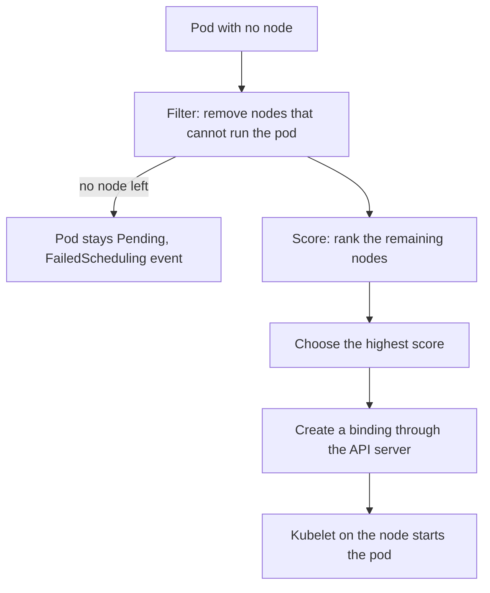

# Protecting Placement Decisions

The scheduler assigns unscheduled Pods to suitable nodes. Its decisions affect where code executes and which infrastructure it can use. It does not run the container process or enforce every isolation requirement after placement, but its configuration and permissions remain important to workload security.

## Placement As A Trust Requirement

A platform may require untrusted workloads to run only in a designated node group. A required node selector or affinity rule expresses part of that requirement. Taints and tolerations can restrict who considers the nodes, but a toleration alone does not force placement there. The policy needs both permission and a suitable selection contract.

Node labels used for security decisions need controlled ownership. If an untrusted actor can set a label that means “approved for sensitive workloads,” a selector based on that label can be misleading. The security claim depends on who can change the label and how the platform validates its meaning.

Hard constraints can also affect availability. A Pod remains Pending if no node satisfies required labels, resources and storage topology. A malicious or accidental configuration change can prevent many workloads from obtaining assignments even while existing containers keep running.

## Scheduler Identity And Configuration

The scheduler observes workload and node state and records placement through the application programming interface (API) using its configured identity. Protect the credentials and the process environment. Excessive authority can increase the consequences of compromise, while insufficient permission can prevent placement decisions from being recorded.

Scheduling plugins and configuration can influence filtering and scoring. Treat those inputs as trusted operational configuration. A compromised extension or host can distort decisions or block progress. Network protection for component endpoints and controlled administrative access reduce opportunities to alter that behavior.

Transport verification protects the connection to the intended API server. It does not establish that every requested placement rule is safe. Admission can reject disallowed workload placement declarations before they reach scheduling where the platform implements such policy.

## Scope And Limits Of Placement Isolation

Separate node groups can reduce co-location, but they can still share a cluster administrator, infrastructure account and external network. A required affinity rule does not create a separate management plane or encrypt application data. Runtime and network controls remain necessary after the Pod receives a node.

Suppose a sensitive workload lands on the correct node but runs privileged with broad host mounts. The placement rule worked, yet the process can still weaken the node boundary. Conversely, a strongly restricted container on an unsuitable shared node may violate the platform's trust contract. Both placement and execution settings matter.

## Reading A Failure Scenario

If new Pods stay unassigned across the cluster, inspect the scheduler's operating state, API access and reported placement constraints. If only one workload is affected, its required rules and resource demands can be the more relevant scope. A compromised label or misapplied taint can produce a targeted placement failure without a broken scheduler binary.

Security reasoning should connect the intended location, authority over its identifying metadata and the controls enforced there. Correct placement is a necessary condition for some designs, but it is not a universal guarantee of secure execution.

## The Scheduling Cycle

The kube-scheduler watches for pods whose `spec.nodeName` is empty. For each one it runs a scheduling cycle and then a binding cycle.



The diagram shows two outcomes. Filtering removes nodes by hard rules: not enough CPU or memory, a taint the pod does not tolerate, a node selector that does not match, or a volume that lives elsewhere. Scoring ranks what is left by soft preferences, such as spreading replicas. The scheduler then writes a Binding, which sets `spec.nodeName` on the pod. The scheduler never starts a container.

## What Placement Rules Are Made Of

Four pod fields and one node field express placement. The `nodeSelector` field lists labels that a node must have. Node affinity does the same with operators and with required or preferred rules. Pod affinity and anti-affinity place a pod relative to other pods. Tolerations let a pod run on a node that has a matching taint. A taint on a node repels every pod that does not tolerate it.

Each rule is a filter, not a guarantee of isolation. A node selector keeps a pod on matching nodes, but it does not stop other pods from using those nodes. A taint keeps other pods away, but it does not attract the pod that tolerates it. A sensitive workload needs both a selector or affinity to attract it and a taint to repel the rest.

## The Scheduler Identity And Its Flags

The scheduler authenticates to the API server as the user `system:kube-scheduler` and receives its rights from the ClusterRole of the same name. Those rights let it read pods, nodes and volumes and create bindings. On a kubeadm cluster it runs as a static pod, and these flags matter:

- `--config` points at a KubeSchedulerConfiguration file. The file can enable, disable or reweight scheduling plugins, and it can add extra profiles with different behaviour.
- `--authentication-kubeconfig` and `--authorization-kubeconfig` define how the secure port checks its own callers.
- `--bind-address` and `--secure-port` set where the secure port listens. The default port is 10259.
- `--profiling` enables debug endpoints. Leave it off unless a diagnosis needs it.
- `--leader-elect=true` makes several scheduler instances take turns, so only one binds pods at a time.

The configuration file and the kubeconfig are trusted input. A changed file can disable a filter plugin, which would stop the scheduler from honouring taints or resource limits. Keep both files readable only by root on the control plane node.

## Try It: Diagnose A Pending Pod

Start with the evidence the scheduler leaves behind. Describe the pod that cannot be placed:

<!-- astrona:playground:renew -->

```sh
kubectl -n starfleet describe pod -l app=vault
```

Read the Events section. The `FailedScheduling` event lists how many nodes were rejected and why, for example a taint the pod did not tolerate or a selector that did not match. Then compare the labels and taints of the nodes:

```sh
kubectl get nodes -L tier
kubectl get nodes -o custom-columns=NAME:.metadata.name,TAINTS:.spec.taints
```

The pod needs the label `tier=restricted`, and the node that has it also has a taint the pod does not tolerate. The cause is in the placement rules and not in the scheduler. Pending is a scheduling answer, and the event states the reason.

## Common pitfalls

> [!WARNING]
> Tolerations do not force placement, and security-significant labels need trusted ownership. A scheduling rule does not supply kernel, network or management isolation by itself.
