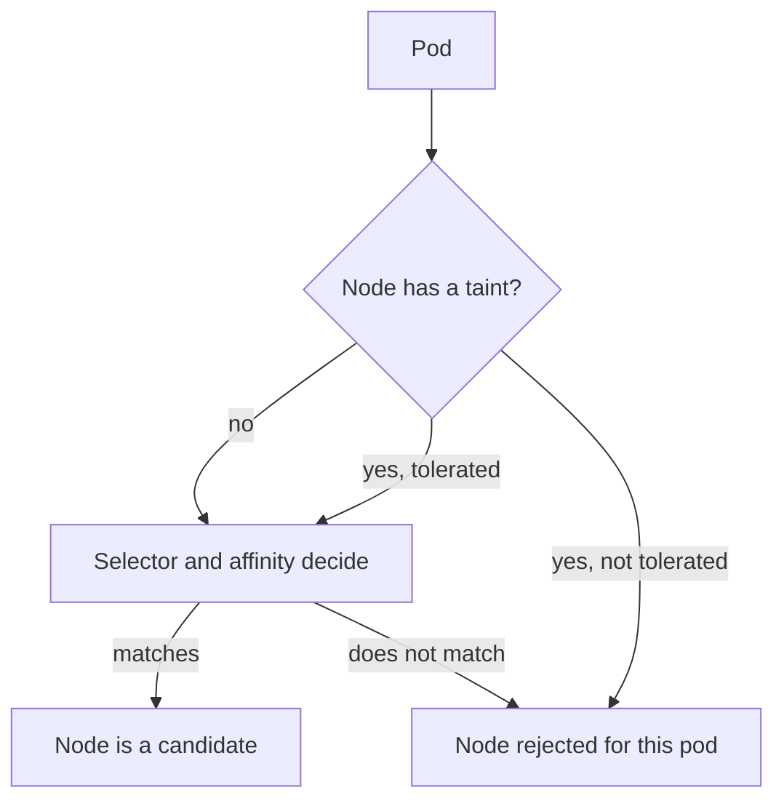

# Placement Rules, Taints And Labels

A platform often needs some workloads to run on dedicated nodes, for example workloads that handle regulated data. Kubernetes expresses this with labels, selectors, affinity, taints and tolerations. Each one does a different job, and a rule that uses the wrong one gives a false sense of isolation. This part explains what each mechanism guarantees, who can change the inputs, and how to protect them.

## Labels, Selectors And Affinity

A label is a key and value attached to an object. A node label such as `tier=restricted` describes the node. A pod `nodeSelector` of `tier: restricted` tells the scheduler to consider only nodes with that label. Node affinity has the same effect with more detail. The field `requiredDuringSchedulingIgnoredDuringExecution` is a hard filter at scheduling time, and `preferredDuringSchedulingIgnoredDuringExecution` only influences scores.

The words `IgnoredDuringExecution` matter. The rules are checked only when the scheduler places the pod. If someone removes the label from the node later, the running pod stays where it is. The rule does not evict a pod after the fact.

Pod affinity and anti-affinity place a pod by the labels of other pods in the same topology domain, for example the same node. Anti-affinity with the key `kubernetes.io/hostname` keeps replicas on different nodes. These rules read other pods' labels, so who can set pod labels also decides where pods go.

## Taints And Tolerations

A taint has a key, an optional value and an effect. The effect decides what the taint does:

- `NoSchedule` stops new pods without a matching toleration from being placed on the node.
- `PreferNoSchedule` asks the scheduler to avoid the node but allows it.
- `NoExecute` also evicts running pods that do not tolerate the taint, after an optional `tolerationSeconds`.

A toleration matches a taint by key, operator, value and effect. The operator `Equal` compares the value, and `Exists` ignores it. A toleration only permits placement. It never attracts a pod, so a pod that tolerates a taint can still run on any other node.



The diagram shows that a node is a candidate only after the taint check and the selector check both pass.

## Combining The Mechanisms

A dedicated node pool needs the taint and the selector. The taint stops ordinary pods from using the pool. The selector stops the dedicated pods from running elsewhere. Add both to the pod template.

Save this as `vault-patch.yaml`:

```yaml
spec:
  template:
    spec:
      nodeSelector:
        tier: restricted
      tolerations:
        - key: tier
          operator: Equal
          value: restricted
          effect: NoSchedule
```

<!-- astrona:playground:renew -->

Apply it:

```sh
kubectl -n starfleet patch deployment vault --type=merge --patch-file vault-patch.yaml
```

Then check the result:

```sh
kubectl -n starfleet get pods -l app=vault -o wide
```

The pod runs on the restricted node. Without the toleration the pod stays Pending, and without the selector it would be free to run on any node that it tolerates.

## Who Controls The Labels And Taints

The placement rule is only as strong as the right to change its inputs. Anyone who can patch nodes can add `tier=restricted` to a different node, remove the taint from the restricted node or add a taint that breaks scheduling elsewhere. Anyone who can set labels on pods can match an affinity rule that uses pod labels. Anyone who can create a pod in a namespace can add a toleration, unless an admission policy checks it.

Three controls keep the inputs trustworthy:

1. RBAC on nodes. Give `patch` and `update` on `nodes` to a small, named group, and test with `kubectl auth can-i patch nodes --as=...`.
2. The NodeRestriction admission plugin. It stops a kubelet from changing labels outside its own node object, and it reserves the label prefix `node-restriction.kubernetes.io/` for administrators. Use that prefix for isolation labels, because a compromised kubelet cannot set them.
3. Admission policy for tolerations. A ValidatingAdmissionPolicy can reject pods in a tenant namespace that tolerate the restricted taint.

## What Placement Does Not Provide

A dedicated node pool reduces co-location. It does not create a separate management plane, encrypt data or stop a privileged container from escaping to the node. A sensitive pod on the correct node that runs as privileged with a host mount still weakens the boundary of that node. Runtime, network and storage controls must still apply after placement.

Placement can also create availability risks. A hard rule with no matching node leaves the pod Pending. A `NoExecute` taint applied to a node evicts pods at once. Both are normal behaviours, and both are reasons to restrict who may taint nodes.

## Common pitfalls

> [!WARNING]
> A toleration does not force placement, and a node label does not prove that a node is trusted. If a user who is not an administrator can patch nodes or set a pod's tolerations, the dedicated pool gives no protection.
