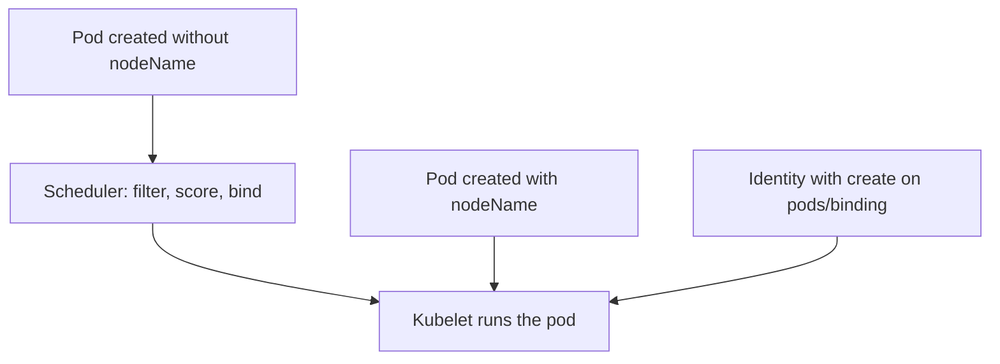

# Binding, Priority And Availability

The scheduler is not the only way a pod gets a node, and a correct placement rule does nothing for a pod that never passes through it. Availability also depends on the scheduler: resource requests, priorities and quotas decide which pods run when the cluster is full. This part explains how placement is bypassed, how to block the bypasses, how priorities and quotas protect availability and how to diagnose scheduling failures.

## Two Ways To Skip The Scheduler

The first is the pod field `spec.nodeName`. If a pod is created with this field already set, the API server treats it as assigned. The scheduler ignores it, and the kubelet on the named node runs it. Selectors, affinity and taints are checks made by the scheduler, so they are not evaluated. A pod with `nodeName` can run on a tainted node without a toleration. Its resource requests are also not checked against free capacity by the scheduler.

The second is the `pods/binding` subresource. The scheduler assigns a node by creating a Binding object on this subresource. Any identity that holds `create` on `pods/binding` can do the same for any pod that has no node. The rule `apiGroups: [""]`, `resources: ["pods/binding"]`, `verbs: ["create"]` is a placement right.



The diagram shows three routes to a kubelet. Only the first one passes the scheduler checks.

## Block The Bypasses

Reject `nodeName` with an admission policy. A ValidatingAdmissionPolicy runs inside the API server and uses Common Expression Language (CEL) to test an object. The binding of the policy decides where it applies and what happens when it fails.

Save this as `deny-node-name.yaml`:

```yaml
apiVersion: admissionregistration.k8s.io/v1
kind: ValidatingAdmissionPolicy
metadata:
  name: deny-node-name
spec:
  failurePolicy: Fail
  matchConstraints:
    resourceRules:
      - apiGroups: [""]
        apiVersions: ["v1"]
        operations: ["CREATE"]
        resources: ["pods"]
  validations:
    - expression: "!has(object.spec.nodeName) || object.spec.nodeName == ''"
      message: "spec.nodeName must not be set"
---
apiVersion: admissionregistration.k8s.io/v1
kind: ValidatingAdmissionPolicyBinding
metadata:
  name: deny-node-name-outpost
spec:
  policyName: deny-node-name
  validationActions: ["Deny"]
  matchResources:
    namespaceSelector:
      matchLabels:
        kubernetes.io/metadata.name: outpost
```

The policy matches only the `CREATE` operation. The scheduler writes the node through the binding subresource, and the kubelet writes status through the status subresource, so neither is affected. Matching `UPDATE` on pods would reject ordinary label changes on pods that already have a node.

<!-- astrona:playground:renew -->

Apply it:

```sh
kubectl apply -f deny-node-name.yaml
```

Then check the result by asking the API server to validate a pod with `nodeName` in the namespace `outpost` without saving it. The flag `--dry-run=server` runs the full admission chain:

Save this as `pinned-pod.yaml`, and replace `WORKER-NAME` with a name from `kubectl get nodes`:

```yaml
apiVersion: v1
kind: Pod
metadata:
  name: pinned-test
  namespace: outpost
spec:
  nodeName: WORKER-NAME
  containers:
    - name: test
      image: busybox:1.37.0
      command: ["sleep", "3600"]
```

```sh
kubectl apply --dry-run=server -f pinned-pod.yaml
```

The server rejects the pod with the message from the policy. It may take a few seconds after the policy is created before the rule takes effect. Remove `create` on `pods/binding` from every role that does not belong to the scheduler.

## Requests, Priority And Preemption

Every pod should declare resource requests. The scheduler uses requests, not live usage, to decide whether a pod fits. A request larger than any node offers makes the pod Pending forever. A pod with no requests fits everywhere and can crowd out others at run time.

A PriorityClass gives pods a numeric priority. When no node fits a high priority pod, the scheduler may preempt, which means it evicts lower priority pods from a node to make room. Values above one billion are reserved for system classes. If any pod in any namespace can name a high priority class, a user can evict other users' pods. Two controls limit this:

- Create classes with `globalDefault: false` and grant the class only to workloads that need it.
- Add a ResourceQuota with a `scopeSelector` on `PriorityClass`. The quota counts only pods of the named classes, so setting `pods: "0"` for a class stops anyone from creating pods with it in that namespace.

```yaml
apiVersion: v1
kind: ResourceQuota
metadata:
  name: no-urgent
  namespace: armada
spec:
  hard:
    pods: "0"
  scopeSelector:
    matchExpressions:
      - scopeName: PriorityClass
        operator: In
        values: ["urgent"]
```

## Spread And Availability

Replicas that run on one node fail together. A topology spread constraint tells the scheduler how evenly to distribute pods across a topology key such as `kubernetes.io/hostname`. The field `maxSkew` is the largest allowed difference in pod count between domains. The field `whenUnsatisfiable: DoNotSchedule` makes the rule a hard filter, and `ScheduleAnyway` makes it a preference.

A hard constraint trades availability for isolation: if only one node is free, the second replica stays Pending instead of sharing it. That is the correct behaviour when two replicas must never share a node.

## Diagnose A Pending Pod

Follow the same steps each time:

1. Run `kubectl describe pod` and read the `FailedScheduling` event. It lists each rejection reason with a node count.
2. Match the reason to the cause. `Insufficient cpu` or `Insufficient memory` points at requests. `had untolerated taint` points at taints. `didn't match Pod's node affinity/selector` points at labels.
3. Check who changed the inputs: node labels, taints, quotas and priority classes.
4. If every new pod is Pending across the cluster, check the scheduler pod and its lease.

When the scheduler is down, existing pods keep running because the kubelet manages them. New and replacement pods wait until a scheduler instance returns.

## Common pitfalls

> [!WARNING]
> A correct node selector, taint and toleration do not stop a pod that sets `nodeName` or an identity that can create bindings. Block both paths, limit high priority classes with a quota scope and give every pod realistic requests.
