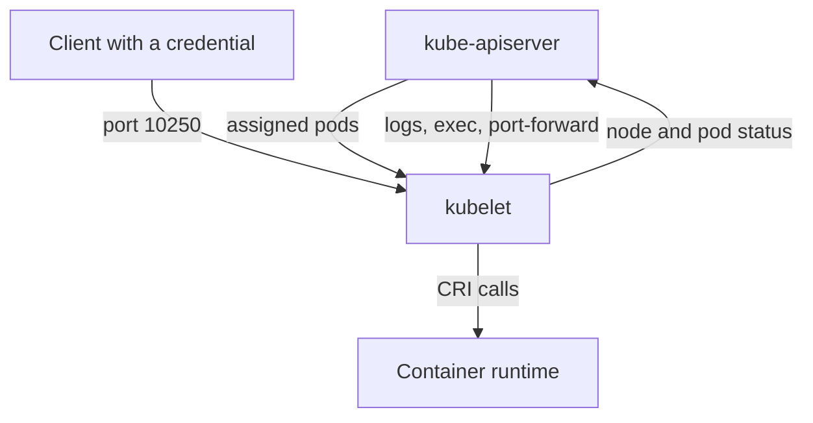

# Protecting The Node Agent

The kubelet makes assigned Pods run on a node and reports their state. It coordinates runtime, storage and preparation operations, and it can access information needed by the workloads it manages. This makes the node agent and its credentials a security boundary with direct consequences for container execution.

## Node Identity And application programming interface (API) Access

A node uses a configured identity to communicate with the API server. The control plane needs to recognize legitimate nodes while limiting what each node can do. The Node authorizer and NodeRestriction admission plugin can contribute to constraining node actions when used correctly. Their protection depends on the expected node identity format and effective configuration.

A worker should not be assumed to need unrestricted access to every Secret or workload in the cluster. The information required for assigned Pods differs from general administrative authority. Protect node certificates and bootstrap credentials because someone obtaining them can attempt to act under the corresponding identity.

Node admission and bootstrap also require a trusted process. A machine joining a sensitive cluster must be the intended machine with an approved configuration. Automatically trusting arbitrary machines or approval requests weakens the cluster's infrastructure boundary.

## Direct Kubelet Endpoints

The kubelet can expose operations and diagnostics through its own endpoint. Direct access is a different path from an ordinary application request or a user's namespace-scoped API call. Authentication, authorization and network restriction must protect that path. Anonymous or broadly trusted access can expose sensitive workload information or execution capabilities depending on the endpoint and configuration.

Operations involving logs, process execution or port forwarding deserve careful permission analysis. They can reveal application data or reach a process under circumstances different from its normal public API. A user restricted from reading a Secret object may still obtain sensitive values through another overly broad diagnostic path.

Protect serving certificates and verify the peer identity when clients communicate with the node agent. A secure channel to the wrong endpoint does not establish trusted node management. Avoid treating disabled verification as a routine solution to certificate errors.

## Host Access And Workload Data

A node administrator or attacker with host-level authority can inspect container files, mounted data and process state according to the host environment. Pod security relies on that host being trusted. A namespace boundary cannot fully protect a workload from an administrator controlling its kernel and runtime.

The kubelet also needs resources to operate. Severe disk or memory pressure can interfere with management and trigger evictions. Workload limits and host resource management reduce some availability risks, while replacement still requires suitable capacity elsewhere.

## A Node-Agent Exposure Scenario

Suppose an application cannot call the API with its own token, but it can reach an inadequately protected node-agent endpoint. The missing API grant is not enough to establish safety. The direct endpoint creates another route whose allowed operations must be evaluated.

A defensive review narrows network access, configures trusted identities and appropriate authorization, protects node credentials and checks diagnostic permissions. If compromise occurred, inspect both node-local data and cluster actions possible through the exposed identities. Restoring one Pod does not by itself restore trust in the node that runs it.

## What The Kubelet Does

The kubelet is a process that runs on every node, usually as a system service and not as a pod. It watches the API server for pods whose `spec.nodeName` is its own node. For each pod it asks the container runtime, through the Container Runtime Interface, to create the sandbox and the containers. It mounts volumes, runs probes, reports the pod status back to the API server and keeps the Node object up to date.

The kubelet also serves an HTTPS API of its own. The API server uses it to stream logs, run `exec` and `port-forward` sessions and read metrics. Monitoring agents can call it directly.



The diagram shows two directions. The kubelet connects out to the API server as the node. Callers connect in to the kubelet on port 10250, and each caller needs its own authentication and authorization.

## Ports And Configuration

The kubelet listens on these ports in a default kubeadm cluster:

- Port 10250 is the secure API. It uses TLS and needs authentication and authorization.
- Port 10248 serves a health check on the local address only.
- Port 10255 is the old read-only port. It has no authentication. The setting `readOnlyPort` defaults to 0, which keeps it disabled. Keep it at 0.

The kubelet reads a configuration file, usually `/var/lib/kubelet/config.yaml`. On a kubeadm cluster the same content is stored in the ConfigMap `kubelet-config` in the namespace `kube-system`. These fields matter for security:

- `authentication.anonymous.enabled` allows requests with no credentials when true. Set it to false.
- `authentication.webhook.enabled` lets the kubelet validate bearer tokens by asking the API server.
- `authentication.x509.clientCAFile` names the certificate authority that verifies client certificates.
- `authorization.mode` is `AlwaysAllow` or `Webhook`. Use `Webhook`.
- `readOnlyPort` should be 0.
- `rotateCertificates` makes the kubelet renew its client certificate before it expires.
- `protectKernelDefaults` makes the kubelet fail to start if kernel settings differ from its expectations.

## Try It: Read The Kubelet Configuration

Read the configuration that the cluster stores for its kubelets. The `kubelet-config` ConfigMap holds the file as text, and the fields above are in it.

<!-- astrona:playground:renew -->

```sh
kubectl -n kube-system get configmap kubelet-config -o yaml
```

Find the `authentication` and `authorization` blocks and the value of `readOnlyPort`. If the field is not in the file, the kubelet uses its default. The API server can also relay the live configuration of one node. The request needs the right `get` on `nodes/proxy`, which the administrator holds:

```sh
kubectl get --raw "/api/v1/nodes/$(kubectl get nodes -o jsonpath='{.items[0].metadata.name}')/proxy/configz"
```

The answer is a JSON document with the settings the kubelet runs with. A service account that is allowed to read this path can read the kubelet configuration of every node, which shows why that right is not harmless.

## Common pitfalls

> [!WARNING]
> Direct node-agent access is a separate security path. A namespace-scoped API role does not automatically limit every kubelet endpoint or protect data from host-level compromise.
