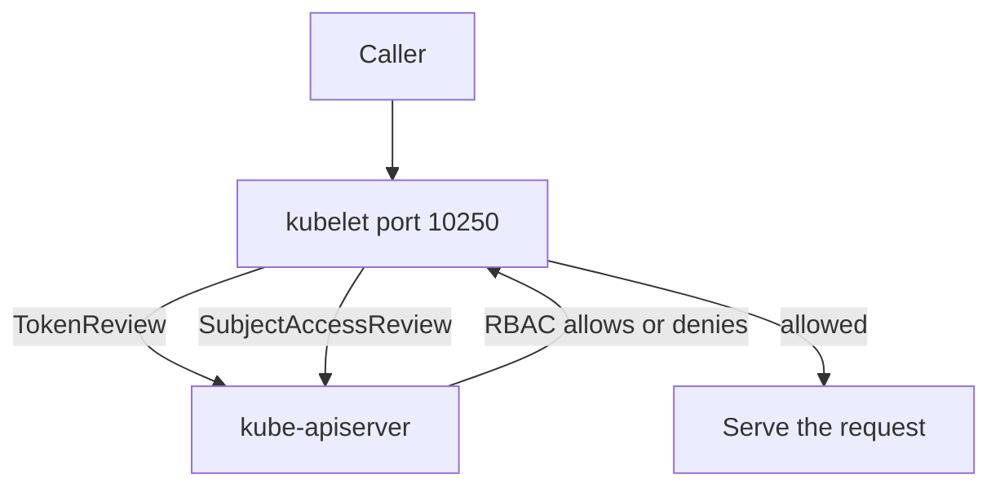

# Kubelet API Authentication And Authorization

The kubelet API gives access to logs, command execution and metrics for every pod on a node. It is a separate path from the namespaced Kubernetes API, so a rule that protects a Secret in the API may not protect the same data when it is reached through the kubelet. This part explains how the kubelet identifies callers, how it decides what they may do, and which RBAC rights end up reaching it.

## Authentication On Port 10250

The kubelet accepts three kinds of credentials. A client certificate is verified against the file in `authentication.x509.clientCAFile`. The API server presents a certificate signed by that authority when it calls the kubelet. A bearer token is verified when `authentication.webhook.enabled` is true: the kubelet sends a TokenReview to the API server and uses the user name and groups that come back. Requests with no credential are anonymous when `authentication.anonymous.enabled` is true, and the kubelet reports them as the user `system:anonymous` in the group `system:unauthenticated`.

A cluster that sets anonymous access to true and authorization to `AlwaysAllow` lets anyone who can reach port 10250 list pods and run commands in them. Both settings must be safe. Setting only one does not protect the node.

## Authorization With Webhook Mode

With `authorization.mode: Webhook` the kubelet asks the API server whether the caller may perform the action. It sends a SubjectAccessReview that names the user, the verb and a resource. The API server evaluates RBAC and answers. The verb comes from the HTTP method, and the resource is a subresource of `nodes` chosen from the request path:

| Kubelet path | Subresource |
| --- | --- |
| `/metrics` | `nodes/metrics` |
| `/stats`, `/summary` | `nodes/stats` |
| `/logs` | `nodes/log` |
| `/spec` | `nodes/spec` |
| everything else, including `/exec`, `/run`, `/pods` | `nodes/proxy` |

Any path that is not listed maps to `nodes/proxy`. That is why `nodes/proxy` is the broad right: it covers the paths that list pods and run commands. The narrow rights `nodes/metrics`, `nodes/stats` and `nodes/log` cover read-only monitoring.



The diagram shows that the kubelet does not decide alone. It relies on the API server for both identity and the RBAC answer.

## The API Server Proxy Path

The API server can forward a request to a kubelet. A request to `/api/v1/nodes/<name>/proxy/<path>` is sent to the kubelet on that node, and the API server authorizes the caller for `nodes/proxy` first. Then the kubelet authorizes the API server's own identity. A user with `get` on `nodes/proxy` can therefore reach every kubelet path through the API server, subject to what the kubelet allows the API server to do.

Streaming operations use the pod subresources. `kubectl exec` creates a request on `pods/exec`, and the API server connects to the kubelet to open the stream. The RBAC check happens on `pods/exec` in the pod's namespace. The data of the stream does not pass through the Secret rules at all.

## Save A Narrow Monitoring Role

A monitoring agent needs to read node information and metrics, and nothing more. Save this as `node-monitor.yaml`:

```yaml
apiVersion: rbac.authorization.k8s.io/v1
kind: ClusterRole
metadata:
  name: node-monitor
rules:
  - apiGroups: [""]
    resources: ["nodes"]
    verbs: ["get", "list"]
  - apiGroups: [""]
    resources: ["nodes/metrics", "nodes/stats"]
    verbs: ["get"]
```

<!-- astrona:playground:renew -->

Apply it:

```sh
kubectl apply -f node-monitor.yaml
```

Then check the result. The flag `--subresource` selects the subresource in `kubectl auth can-i`:

```sh
kubectl auth can-i get nodes --subresource=metrics --as=system:serviceaccount:starfleet:monitor
kubectl auth can-i get nodes --subresource=proxy --as=system:serviceaccount:starfleet:monitor
```

The first answer is `yes` and the second is `no`. In the playground the first role also lists `nodes/proxy`, so the second answer is `yes` until you apply the new role. Applying the file replaces the rules of the existing ClusterRole.

## Scope Exec And Port-Forward

The verbs `create` on `pods/exec`, `pods/attach` and `pods/portforward` open streams into containers. They give the caller the same view as the container's own process, including environment variables, mounted Secrets and service account tokens. A ClusterRoleBinding gives these rights in every namespace, and a RoleBinding gives them in one. Use the RoleBinding, and name the subject.

```sh
kubectl delete clusterrolebinding debugger-pod-debugger
kubectl create rolebinding debugger-pod-debugger -n outpost --clusterrole=pod-debugger --serviceaccount=starfleet:debugger
```

The command prints `rolebinding.rbac.authorization.k8s.io/debugger-pod-debugger created`. The ClusterRole is reused, but the binding limits it to the namespace `outpost`.

## Network Reachability

RBAC and certificates are the main controls, and network reachability is the second layer. Port 10250 should be reachable from the control plane and from monitoring systems, and not from pods that have no reason to call it. A pod that can reach the node address on port 10250 can try the credentials it holds. The read-only port, if it were enabled, would answer without any credential, so it must stay disabled.

## Common pitfalls

> [!WARNING]
> `nodes/proxy` is the catch-all subresource for the kubelet and includes paths that run commands. Use `nodes/metrics`, `nodes/stats` and `nodes/log` for monitoring, scope `pods/exec` by namespace, and never combine anonymous access with `AlwaysAllow` on port 10250.
