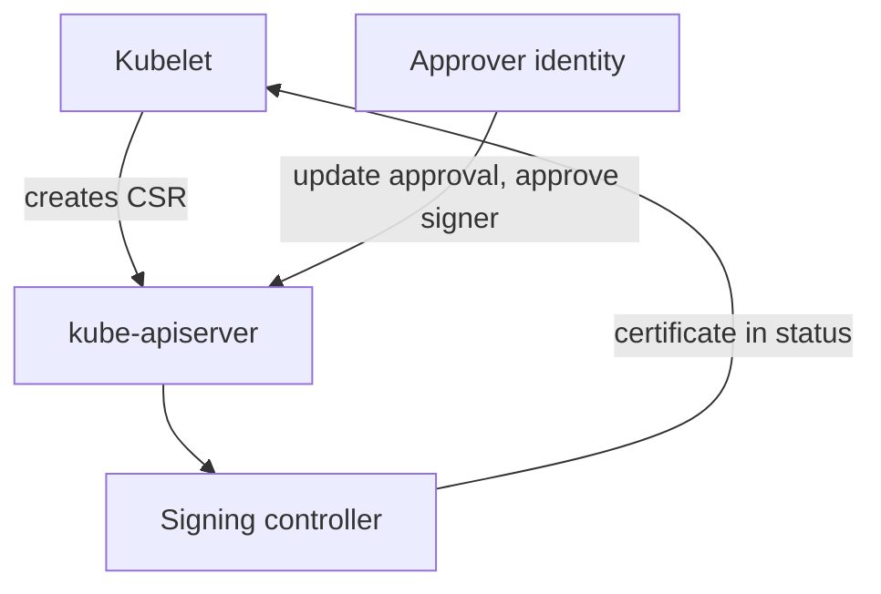

# Node Identity, Certificates And Host Access

The API server must know that a request comes from a genuine node, and it must limit what a node may do. A node that is compromised should not become an administrator of the cluster. This part explains how a node gets its identity, how the Node authorizer and NodeRestriction limit it, how certificate signing works and where the protection ends when someone controls the host itself.

## How A Node Authenticates

Each kubelet holds a client certificate. The common name of the certificate is `system:node:<node-name>` and the organization is `system:nodes`. The API server maps these to the user and the group. The certificate is signed by the certificate authority that the API server trusts through `--client-ca-file`.

A new node needs a first credential before it has a certificate. Kubeadm uses a bootstrap token, which authenticates as a user in the group `system:bootstrappers`. The kubelet uses it to submit a CertificateSigningRequest (CSR), an API object that asks the cluster to sign a certificate for a key. After approval, the kubelet receives its certificate and stops using the token. The token expires after a set time, and a leaked token that is still valid lets an attacker join a machine.

## Certificate Signing Requests

A CSR has a `signerName` that says which signer should issue the certificate, and a `usages` list. Two signers matter for nodes: `kubernetes.io/kube-apiserver-client-kubelet` issues client certificates for kubelets, and `kubernetes.io/kubelet-serving` issues the serving certificate of the kubelet API. The controller manager runs the signing controllers, and the files that hold the authority key are named by `--cluster-signing-cert-file` and `--cluster-signing-key-file`.

Approval is separate from signing. An authorized identity approves a request, and the signer then issues the certificate. Approval needs two RBAC rules:

- `update` on `certificatesigningrequests/approval`.
- `approve` on `signers`, optionally limited by `resourceNames` to one signer.



The diagram shows that the identity that approves is not the identity that requests. If the same group of users can request and approve, anyone in it can obtain a certificate for any name that the signer allows.

## Limit Approval

Give approval only to a named group, and bind it with a ClusterRoleBinding. A binding to `system:authenticated` gives approval to every logged-in identity, including every service account. Save this as `csr-approver.yaml`:

```yaml
apiVersion: rbac.authorization.k8s.io/v1
kind: ClusterRole
metadata:
  name: csr-approver
rules:
  - apiGroups: ["certificates.k8s.io"]
    resources: ["certificatesigningrequests"]
    verbs: ["get", "list", "watch"]
  - apiGroups: ["certificates.k8s.io"]
    resources: ["certificatesigningrequests/approval"]
    verbs: ["update"]
  - apiGroups: ["certificates.k8s.io"]
    resources: ["signers"]
    resourceNames: ["kubernetes.io/kubelet-serving"]
    verbs: ["approve"]
```

<!-- astrona:playground:renew -->

Apply it:

```sh
kubectl apply -f csr-approver.yaml
```

Then check the result. The role now approves only requests for the kubelet serving signer. List the requests that exist in the cluster and read their signers:

```sh
kubectl get csr
```

The `SIGNERNAME` column shows which signer each request asked for. A request for `kubernetes.io/kube-apiserver-client-kubelet` needs an approver that holds the `approve` right for that signer.

## The Node Authorizer And NodeRestriction

Two controls limit what a node identity can do once it has a certificate.

The Node authorizer is enabled with `--authorization-mode=Node,RBAC`. It allows a kubelet to read only the objects that the pods on its own node need: the Secrets, ConfigMaps, volume claims and service accounts that those pods reference. A kubelet cannot list every Secret in the cluster, even though it is trusted to run workloads.

The NodeRestriction admission plugin limits writes. A kubelet may modify only its own Node object and the pods that are bound to its node. It cannot add the label `node-restriction.kubernetes.io/...` to its Node, and it cannot change another node's labels or taints. If the plugin is not enabled, a stolen kubelet credential could relabel nodes and attract sensitive pods.

Both controls depend on the user name format `system:node:<name>`. A certificate with another name receives none of the node permissions.

## Host Access And Pod Data

Everything above protects the cluster from a node. Nothing protects pod data from the node itself. A person with root on a node can read the files of every container, the process memory, the tmpfs volumes that hold Secrets and the projected service account tokens. The kubelet stores pod volumes under `/var/lib/kubelet/pods`.

A pod can reach the same files if it mounts the directory with a `hostPath` volume. A hostPath mount of `/var/lib/kubelet` gives the container the data of every pod on that node. Reject hostPath volumes in workload namespaces with Pod Security Admission or an admission policy, and remove them from workloads that do not need them.

## Recovery After A Node Compromise

A compromised node is not repaired by restarting its pods. Use this sequence:

1. Cordon and drain the node so no new pods arrive.
2. Delete the Node object and block its credential: revoke the bootstrap token and do not approve new requests for its name.
3. Rebuild the machine from a trusted image, and rotate every Secret that pods on that node could read.
4. Review the audit log for requests made as `system:node:<name>`.

## Common pitfalls

> [!WARNING]
> A binding that gives certificate approval to every authenticated identity lets any service account obtain trusted certificates. A hostPath mount of the kubelet directory gives a pod the data of its neighbours, and restarting pods does not restore trust in a compromised node.
