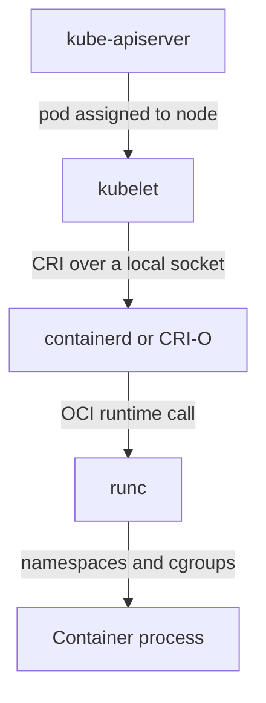

# Runtime Interfaces And Host Authority

Kubernetes does not start containers itself. On every node a container runtime pulls images, creates the isolated process and reports its state. The runtime acts with the authority of the node, so whoever can instruct it can run code on the host. This part explains which components take part in starting a container, which interfaces they use and where that authority sits.

## The Layers Between A Pod And A Process

Starting a pod involves four layers on the node:

1. The kubelet watches the API server for pods assigned to its node and decides which containers must exist.
2. The Container Runtime Interface (CRI) is a gRPC API that the kubelet calls. It has an image service for pulling and listing images, and a runtime service for creating pod sandboxes and containers.
3. A high-level runtime such as containerd or CRI-O implements the CRI. It stores images, unpacks them into a filesystem and tracks container state.
4. A low-level runtime such as runc follows the Open Container Initiative (OCI) runtime specification. It creates the Linux namespaces and control groups, sets up the filesystem and starts the process.



The diagram shows one direction of control. The API server never talks to the runtime. Only the kubelet does, through a socket file on the same machine.

## The Runtime Socket

The CRI is served on a Unix domain socket. For containerd the default path is `/run/containerd/containerd.sock`. The kubelet is told the path with the setting `containerRuntimeEndpoint`. A Unix socket is protected by file permissions, and the socket of a runtime is owned by root.

Anything that can open this socket can send CRI calls. It can list every container on the node, create a new container with any image and any mounts, and run commands in existing containers. The runtime does not ask the Kubernetes API server whether that is allowed, so Kubernetes RBAC and admission policies do not apply to calls made through the socket. This is the first reason runtime access is host authority.

## What Is Visible Through The Kubernetes API

You cannot inspect the socket from the API server, but the node reports the runtime that it uses. The field `status.nodeInfo.containerRuntimeVersion` of a Node shows the name and version, for example `containerd://` followed by a version number. The kubelet also records the container identifier of each container in the pod status, with the runtime name as the prefix.

<!-- astrona:playground:renew -->

Check which runtime the nodes use:

```sh
kubectl get nodes -o wide
```

The column `CONTAINER-RUNTIME` shows the runtime and its version. Read the same field for one node:

```sh
kubectl get nodes -o jsonpath='{.items[0].status.nodeInfo.containerRuntimeVersion}'
```

Then read the runtime's identifier for the container of a running pod:

```sh
kubectl -n starfleet get pods -l app=scout -o jsonpath='{.items[0].status.containerStatuses[0].containerID}'
```

The value starts with the runtime name, followed by `://` and a long hexadecimal identifier. That identifier is the container that the runtime created for this pod.

## Events Show The Runtime Steps

The kubelet writes an event for each step it asks the runtime to perform. Describe the pod to read them:

```sh
kubectl -n starfleet describe pod -l app=scout
```

The events list `Pulling` and `Pulled` for the image service, then `Created` and `Started` for the runtime service. If the image name is wrong, the events show `ErrImagePull` or `ImagePullBackOff` and the container never exists. If the runtime cannot create the sandbox, the events show `FailedCreatePodSandBox`. Each message points at a different layer.

## Image Handling

The runtime stores pulled images on the node, in a content store keyed by digest. A tag such as `1.0` is a name that can be moved to a different image later. A digest, written `image@sha256:...`, names exact content. The field `imagePullPolicy` controls whether the kubelet asks the runtime to pull: `Always` checks the registry each time, `IfNotPresent` reuses a local copy and `Never` only uses a local copy.

A node that has cached an image runs it even if the registry copy changed. That is useful for speed and a risk for consistency. When trust matters, reference images by digest, so every node runs the same content.

## OCI And CRI Are Different Contracts

The OCI publishes specifications for the image format, the runtime and the distribution of images. The CRI is a Kubernetes interface. A runtime that implements the CRI usually relies on OCI specifications below it. They do not replace each other, and a cluster can build images with one tool and run them with another because both follow the OCI image format.

## Failure Cases

Three failures look similar and have different causes:

- The image cannot be pulled. The events mention `ErrImagePull`. Check the registry name, the tag and the pull credentials.
- The runtime service is down. Every new pod on the node stays in `ContainerCreating`, and the node may report `NotReady`. Check the runtime service on the node.
- The process starts and exits at once. The container shows `CrashLoopBackOff`. The runtime worked, and the problem is inside the application.

## Common pitfalls

> [!WARNING]
> The runtime socket is host authority. Kubernetes RBAC does not protect calls made through it, so no workload should receive access to that socket unless it is part of node management.
