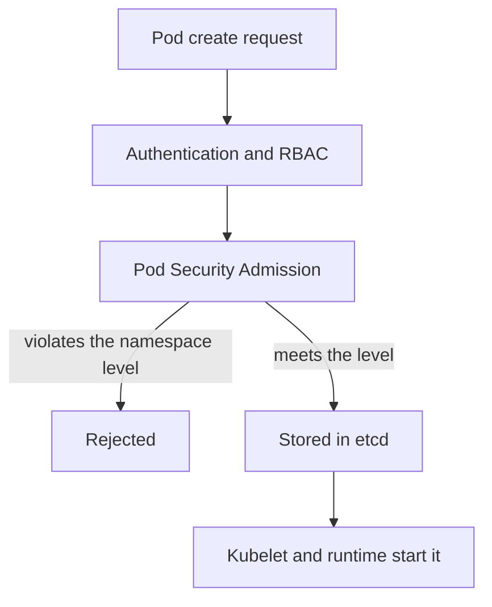

# Protecting Runtime Access And Execution Privileges

A container is a process with restricted views of the host. The restrictions come from Linux namespaces, control groups, capabilities and filters, and a pod specification can remove each one of them. This part explains which pod settings widen access to the host and the runtime, and how Pod Security Admission rejects them before a pod is created.

## Settings That Remove Isolation

These pod and container fields give a process more host authority than a normal workload needs:

- `securityContext.privileged: true` gives the container nearly all capabilities and access to host devices, and turns off most filtering.
- `hostPath` volumes mount a file or directory of the node into the container. Mounting the runtime socket or a directory such as `/var/lib` gives control over other workloads.
- `hostNetwork`, `hostPID` and `hostIPC` place the pod in the host's network, process or inter-process communication namespace. With `hostPID` a container can see and signal host processes.
- `capabilities.add` grants Linux capabilities. `SYS_ADMIN` and `NET_ADMIN` are powerful, and `SYS_ADMIN` covers many privileged operations.
- `allowPrivilegeEscalation: true` lets a process gain more privileges than its parent through setuid binaries.
- Running as user ID 0 inside the container is root inside the container. Combined with another weakness, it becomes root on the host.

A non-root user ID does not make a pod safe. A pod with `privileged: true` and a non-root user can still reach devices, and a pod that mounts the runtime socket does not need any special user at all.

## Safer Defaults

Set these fields for ordinary workloads:

- `runAsNonRoot: true` and an explicit `runAsUser`.
- `allowPrivilegeEscalation: false`.
- `capabilities.drop: ["ALL"]`, and add back only a capability that is proven necessary.
- `seccompProfile.type: RuntimeDefault`, which applies the runtime's default filter of system calls.
- `readOnlyRootFilesystem: true` where the application allows it.



The diagram shows that Pod Security Admission runs after RBAC and before the pod is stored. A pod that is rejected never reaches a kubelet.

## Pod Security Admission

Pod Security Admission is built into the API server. It reads labels on a namespace and checks each pod against one of three Pod Security Standards:

- `privileged` has no restrictions.
- `baseline` blocks known escalations: privileged containers, host namespaces, hostPath volumes, added capabilities beyond a short list and some unsafe settings.
- `restricted` follows current hardening practice. It requires non-root users, dropped capabilities, no privilege escalation and a seccomp profile.

Each standard can be used in three modes, set by label: `enforce` rejects the pod, `audit` records an audit annotation and `warn` shows a warning to the client. The label has the form `pod-security.kubernetes.io/enforce: baseline`. A level label can be paired with a version label that pins the rules to a Kubernetes release, and `latest` is the default.

Enforcement applies when a pod is created or updated. It does not stop pods that already run. A workload controller that creates pods that violate the level fails when the controller tries to create them, so a Deployment can show zero ready replicas while the error appears in the events of its ReplicaSet.

## Save A Pod That Breaks The Rules

Save this as `socket-pod.yaml`:

```yaml
apiVersion: v1
kind: Pod
metadata:
  name: socket-test
  namespace: outpost
spec:
  containers:
    - name: test
      image: busybox:1.37.0
      command: ["sleep", "3600"]
      securityContext:
        privileged: true
      volumeMounts:
        - name: runtime-socket
          mountPath: /run/containerd
  volumes:
    - name: runtime-socket
      hostPath:
        path: /run/containerd
        type: Directory
```

<!-- astrona:playground:renew -->

The playground cluster does not label the namespace, so the API server accepts this specification. Check by asking the server to validate it without saving it:

```sh
kubectl apply --dry-run=server -f socket-pod.yaml
```

The server accepts it, because no standard is enforced. Now label the namespace to enforce the baseline standard:

```sh
kubectl label namespace outpost pod-security.kubernetes.io/enforce=baseline --overwrite
```

Then check the result by running the same dry run again:

```sh
kubectl apply --dry-run=server -f socket-pod.yaml
```

This time the server rejects the pod and the message names the violated checks, such as the privileged container and the hostPath volume. The label can take a few seconds to take effect, so repeat the command once if the first answer is still an acceptance.

## What PSA Does Not Cover

Pod Security Admission checks pod fields. It does not decide who may create pods, and it does not look at images. It also gives one level per namespace, so a namespace that needs one privileged agent must either hold only that agent or use an exemption. For finer rules, an admission policy written in CEL can reject or require specific fields. Node-level protection, such as a locked-down runtime socket, remains a host task that no pod field replaces.

## Responding To Exposed Runtime Control

If a workload ever had access to the runtime socket or ran privileged, treat the node as exposed. Delete the workload, but also review the other containers on the node, the host files that the workload could write and the credentials that it could read. Rebuild the node from a trusted image when integrity cannot be shown, and rotate the Secrets of the pods that ran there.

## Common pitfalls

> [!WARNING]
> A non-root user does not make a privileged container or a runtime-socket mount safe. Enforce a Pod Security level on every workload namespace, and remember that the label does not remove pods that already run.
