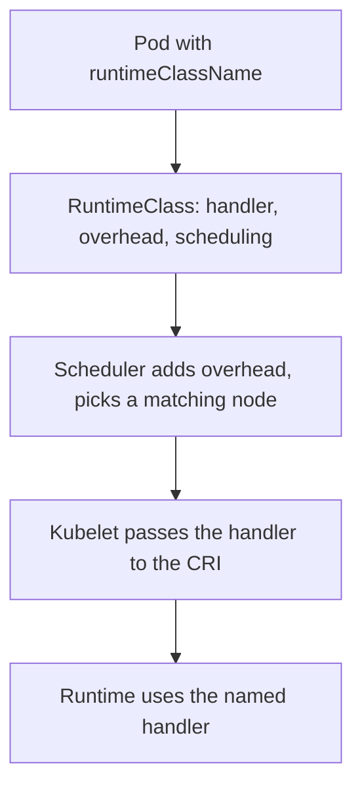

# Runtime Classes And Stronger Isolation

Ordinary containers share the kernel of the node. A flaw in the kernel, or in a feature a container may use, can let a compromised process escape to the host. Some workloads justify a stronger boundary. This part explains how Kubernetes selects a different runtime for a pod, what that costs and which decisions stay with the cluster operator.

## What Containers Share

A pod started by runc runs as a process on the node's kernel. Namespaces hide other processes, mounts and network interfaces, and control groups limit resources. The system calls still go to the same kernel as every other container. A bug in a system call handler is therefore reachable from every container on the node, and a seccomp filter only narrows the set of calls.

Two families of runtimes add a boundary:

- A user-space kernel, such as gVisor, intercepts the system calls of the container and implements them itself, so the host kernel sees far fewer calls.
- A lightweight virtual machine, such as Kata Containers, runs each pod with its own guest kernel.

Both trade performance and compatibility for isolation. Some system calls, devices and volume types behave differently or are unavailable.

## RuntimeClass

A RuntimeClass is a cluster-scoped object that names a runtime configuration. The fields are:

- `handler` is the name of the runtime configuration in the CRI implementation on the node, for example a handler defined in the containerd configuration.
- `overhead.podFixed` lists the resources that the runtime itself needs for each pod, such as memory for a guest kernel.
- `scheduling.nodeSelector` and `scheduling.tolerations` limit pods to nodes that have the runtime installed.

A pod selects the class with `spec.runtimeClassName`. The kubelet passes the handler name to the CRI when it creates the sandbox. The RuntimeClass object does not install anything. If the named handler does not exist on the node, the sandbox cannot be created and the pod stays in `ContainerCreating` with the event `FailedCreatePodSandBox`.



The diagram shows two uses of the class. The scheduler reads overhead and node selection, and the kubelet reads the handler.

## Save A Runtime Class

Save this as `sandboxed-class.yaml`:

```yaml
apiVersion: node.k8s.io/v1
kind: RuntimeClass
metadata:
  name: sandboxed
handler: runsc
overhead:
  podFixed:
    cpu: 100m
    memory: 64Mi
scheduling:
  nodeSelector:
    sandbox: "true"
```

<!-- astrona:playground:renew -->

Apply it:

```sh
kubectl apply -f sandboxed-class.yaml
```

Then check the result:

```sh
kubectl get runtimeclass
```

The class appears with its handler. The playground nodes do not have a handler named `runsc`, and no node carries the label `sandbox=true`. A pod that names this class would stay Pending because no node matches the node selector. Save this as `sandboxed-pod.yaml` to see the effect without creating a pod:

```yaml
apiVersion: v1
kind: Pod
metadata:
  name: sandboxed-test
  namespace: starfleet
spec:
  runtimeClassName: sandboxed
  containers:
    - name: test
      image: busybox:1.37.0
      command: ["sleep", "3600"]
```

```sh
kubectl apply --dry-run=server -f sandboxed-pod.yaml
```

The API server accepts the pod, because the class exists. The admission step for runtime classes also adds the overhead from the class to the pod, so the pod's resource accounting includes it. The field `spec.overhead` is set on the stored pod, and quotas count it.

## Who May Choose A Class

Any user who can create pods can write `runtimeClassName` in the specification. That is useful when the class is stronger, and harmful when a class is weaker. Two rules help. Do not create a class that removes protections, such as a handler that runs without isolation. If only some namespaces should use the stronger class, scope it by node selector and by an admission policy that sets or checks the field.

A class with a node selector also works as a placement rule, so keep the label on nodes under the same control as other node labels. A user who can set labels on a node can pull sandboxed workloads onto the wrong machines or push them away.

## Other Hardening Inside The Node

A stronger runtime is one layer. Others apply to ordinary containers too:

- A seccomp profile of type `RuntimeDefault` removes dangerous system calls with little compatibility cost.
- An AppArmor or SELinux profile limits file and process access.
- Dropped capabilities remove kernel privileges the process does not need.
- A read-only root filesystem prevents an attacker from writing tools into the container.
- Keeping the node operating system, the kernel and the runtime patched closes known escapes. The runtime and kernel are part of the trusted base, and nothing inside a pod can repair them.

## Reasoning About A Choice

Use a stronger boundary when the workload runs code the cluster owner does not control, such as customer builds, or when the data it can reach is highly sensitive. Do not choose it only because it adds a layer. A sandbox does not decide which database rows a process may read, and a stolen credential works the same inside a sandbox. Combine isolation with network rules and with narrow service credentials.

## Common pitfalls

> [!WARNING]
> A RuntimeClass names a handler and does not install it. A pod that selects a class whose handler is missing stays in `ContainerCreating`, and a class with a weak handler gives users a way to opt out of isolation.
