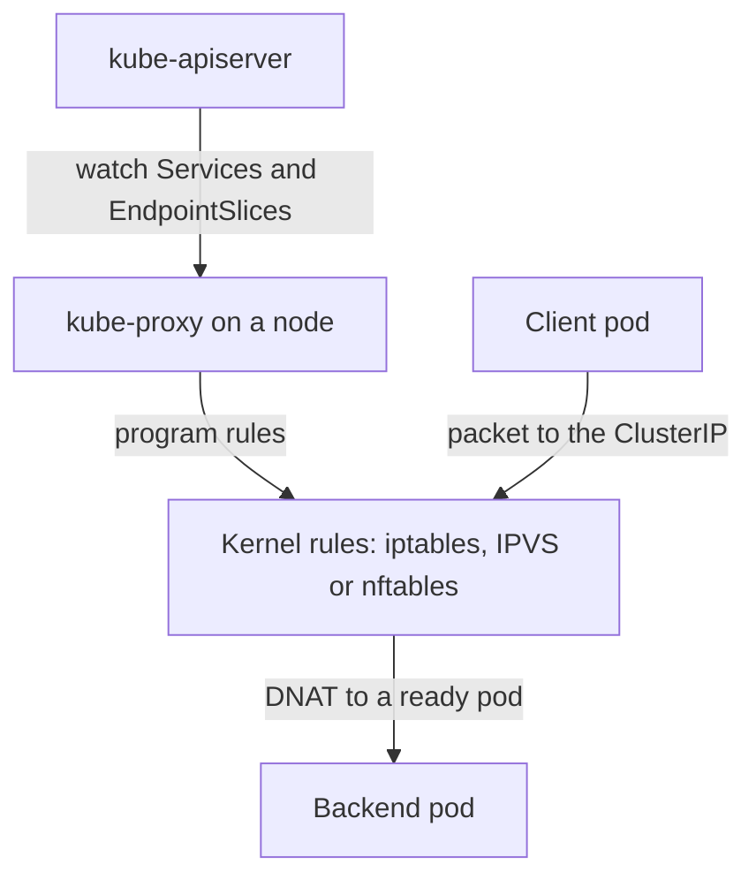

# Protecting The Service Traffic Path

A Service gives a group of pods one stable address, but the address belongs to no network interface. Something on every node must turn a connection to the Service address into a connection to one pod. In most clusters that job belongs to kube-proxy. This part explains what kube-proxy does, which data it reads, how it changes traffic on the node and why its credentials and its host access matter.

## What A Service Address Is

A ClusterIP is allocated from the Service address range that the API server holds in the flag `--service-cluster-ip-range`. No pod and no interface owns that address. A client pod sends a packet to it, and a rule in the kernel of the client's node rewrites the destination to the address of a real pod. The rewrite is called destination network address translation (DNAT).

Which pods are real backends comes from EndpointSlices. The EndpointSlice controller in the controller manager watches the pods that match the selector of a Service and writes their addresses and readiness into EndpointSlice objects. A pod that is not ready is left out of the list that receives traffic.

## What kube-proxy Does

Kube-proxy runs on each node, usually as a DaemonSet. It watches two kinds of objects through the API server: Services and EndpointSlices. When either changes, it rewrites the packet rules of its node. It does not carry the traffic itself, which stays in the kernel.



The diagram shows that the control path and the data path are separate. Kube-proxy changes rules, and the kernel moves the packets.

The proxy mode decides which kernel facility holds the rules. The `iptables` mode writes chains of iptables rules and chooses a backend with random probabilities. The `ipvs` mode uses the kernel IP virtual server, with a hash table and several balancing algorithms. The `nftables` mode writes nftables rules. Some network plugins replace kube-proxy and implement Service forwarding themselves. In that case no kube-proxy runs, and the same questions apply to the plugin.

## Rules Exist On Every Node

Each node holds a full copy of the rules for every Service, so a client pod reaches a Service through its own node and not through a central load balancer. A consequence is that a wrong or missing rule affects one node at a time. If kube-proxy stops on a node, the existing rules stay in the kernel and still forward traffic. New Services, changed endpoints and removed pods are not applied on that node until kube-proxy runs again, so traffic can reach stale pod addresses.

## What The Cluster Shows

<!-- astrona:playground:renew -->

List the kube-proxy pods. A kubeadm-based cluster, including kind, runs them with the label `k8s-app=kube-proxy`:

```sh
kubectl -n kube-system get pods -l k8s-app=kube-proxy -o wide
```

There is one pod per node, and the node column differs for each. Then compare a Service with its EndpointSlice:

```sh
kubectl -n starfleet get service scout
kubectl -n starfleet get endpointslices -l kubernetes.io/service-name=scout
```

The Service shows a ClusterIP. The EndpointSlice lists the address of the scout pod and its port. Kube-proxy turns the first into a rule that sends traffic to the second. Delete nothing here, but notice that the pod address changes whenever the pod is replaced and the Service address does not.

## Credentials And Host Access Of kube-proxy

Kube-proxy needs two powers. It reads Services and EndpointSlices through the API server, and it changes kernel rules on its host. For the first it uses a Kubernetes identity. In kubeadm clusters that identity is the service account `kube-proxy` in the namespace `kube-system`, bound to the ClusterRole `system:node-proxier`. For the second the pod runs with `hostNetwork: true` and a privileged container, and it mounts host paths such as `/run/xtables.lock` and `/lib/modules`.

Read the role to see how narrow the API rights are:

```sh
kubectl get clusterrole system:node-proxier -o yaml
```

The role lists read verbs on Services, EndpointSlices and Nodes, and a few write rights to create events. It does not list Secrets or Pods. A copy of the kube-proxy token therefore does not read Secrets, but it still shows every Service and endpoint of the cluster.

The privileged container is the larger exposure. Anyone who can run commands in a kube-proxy pod, or who can edit the DaemonSet, runs code as root on every node. Treat the namespace `kube-system` as a control-plane namespace: only trusted administrators may create or edit pods and workload controllers there.

## What Kube-proxy Does Not Do

Kube-proxy does not enforce NetworkPolicy. Policies are enforced by the network plugin. It does not authenticate or encrypt traffic, and it does not decide which pods may call a Service. A Service address that any pod can reach is reachable for every pod in the cluster unless a policy blocks the connection. Kube-proxy is also not a firewall for the node's own addresses, except for the ports it opens for NodePort Services.

## Following One Packet In iptables Mode

In `iptables` mode kube-proxy keeps a chain named `KUBE-SERVICES` and sends every new connection through it. A rule in that chain matches the ClusterIP and the port of a Service and jumps to a chain for that Service. The Service chain then holds one rule per endpoint. Each rule matches with a fixed probability, so the connection lands on one pod, and the next chain rewrites the destination to the pod address and port.

The kernel remembers the choice in its connection tracking table. Later packets of the same connection follow the same entry and are not matched again. A pod that is removed from the EndpointSlice therefore stops receiving new connections, but connections that already exist keep their entry until they end or time out.

## Fields Of An EndpointSlice

An EndpointSlice carries the data that kube-proxy needs:

- `addressType` is `IPv4`, `IPv6` or `FQDN`.
- `endpoints` lists the backends. Each has `addresses`, `conditions` and the `nodeName` of the pod.
- `conditions.ready` is true when the pod passes its readiness check. Kube-proxy sends traffic only to ready endpoints. The condition `terminating` marks pods that are shutting down, and `serving` shows whether they can still answer.
- `ports` lists the port numbers and protocols.

A slice holds up to 100 endpoints by default, and a large Service is split across several slices. The label `kubernetes.io/service-name` ties each slice to its Service, and the label `endpointslice.kubernetes.io/managed-by` shows which controller owns the slice.

## Failure Of The Data Source

Kube-proxy does not cache the cluster forever. It keeps a watch on the API server and applies each change. If the watch breaks, it reconnects and lists everything again. While the API server is unreachable, kube-proxy keeps the last rules, so Services continue to work with the data it already has. This is the same stale-but-working behaviour as a stopped proxy, and it shows why the control plane being down does not at once break traffic between running pods.

## Common pitfalls

> [!WARNING]
> Kube-proxy is not a policy engine. It forwards traffic to every ready endpoint, runs privileged on every node and its DaemonSet is a path to root on those nodes. Restrict who can edit workloads in `kube-system` and use NetworkPolicy to limit which pods may connect.
