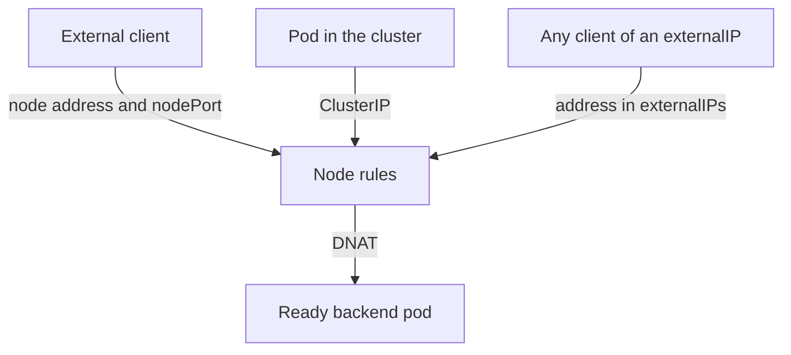

# Service Exposure And Endpoint Trust

A Service can be reached from inside the cluster only, from the nodes' addresses, or from outside through a cloud load balancer. Each type opens a different path, and each object that defines a Service or its backends can redirect traffic. This part explains Service types, the fields that widen exposure, and the rights that let a user redirect traffic that belongs to other users.

## Service Types And What They Open

- `ClusterIP` is reachable only from inside the cluster, through the virtual address.
- `NodePort` also opens a port, from the range 30000 to 32767 by default, on every node. The range is set by the API server flag `--service-node-port-range`. Anyone who can reach a node address can use that port.
- `LoadBalancer` builds on NodePort. A cloud controller creates an external load balancer that forwards to the node ports.
- `ExternalName` returns a DNS name and forwards nothing.
- A headless Service has `clusterIP: None`. It has no virtual address, and DNS returns the pod addresses.

Each step outward widens who can send traffic to the pods. If the workload has no authentication of its own, every client that can reach the NodePort has the same access as a client inside the cluster.

## Fields That Change Exposure

- `externalIPs` is a list of addresses on which the Service accepts traffic. Kubernetes does not allocate or verify them. Kube-proxy simply adds rules for them on every node.
- `loadBalancerSourceRanges` limits which client addresses a cloud load balancer accepts, if the cloud supports it.
- `externalTrafficPolicy: Cluster` is the default. A node that receives traffic may forward it to a pod on another node and replaces the client address with its own. `Local` sends traffic only to pods on the receiving node, keeps the client address and drops traffic on nodes without a local pod.
- `internalTrafficPolicy: Local` has the same effect for traffic from inside the cluster.
- `sessionAffinity: ClientIP` sends the same client address to the same pod for a time.



The diagram shows three entry paths that lead to the same rules. A change that opens one of them affects all nodes.

## Why externalIPs Is Risky

Because `externalIPs` is not verified, a user who can create or edit a Service can list an address that belongs to something else, for example an address of an external service that other pods call. Kube-proxy then installs rules on every node that capture traffic from pods to that address and send it to the user's backend. The user does not need any right on the other pods. This is a known man-in-the-middle weakness of multi-tenant clusters.

Two controls reduce it. The API server has an admission plugin named `DenyServiceExternalIPs` that rejects Services that set `externalIPs`. An admission policy can do the same for chosen namespaces. The second control is RBAC: only trusted identities should be able to create or edit Services, and the `status` subresource of Services, which cloud controllers write, needs the same care.

## Save A Policy That Rejects externalIPs

A ValidatingAdmissionPolicy tests an object with a Common Expression Language (CEL) expression. Save this as `deny-external-ips.yaml`:

```yaml
apiVersion: admissionregistration.k8s.io/v1
kind: ValidatingAdmissionPolicy
metadata:
  name: deny-external-ips
spec:
  failurePolicy: Fail
  matchConstraints:
    resourceRules:
      - apiGroups: [""]
        apiVersions: ["v1"]
        operations: ["CREATE", "UPDATE"]
        resources: ["services"]
  validations:
    - expression: "!has(object.spec.externalIPs) || size(object.spec.externalIPs) == 0"
      message: "spec.externalIPs must not be set"
---
apiVersion: admissionregistration.k8s.io/v1
kind: ValidatingAdmissionPolicyBinding
metadata:
  name: deny-external-ips-starfleet
spec:
  policyName: deny-external-ips
  validationActions: ["Deny"]
  matchResources:
    namespaceSelector:
      matchLabels:
        kubernetes.io/metadata.name: starfleet
```

<!-- astrona:playground:renew -->

Apply it:

```sh
kubectl apply -f deny-external-ips.yaml
```

Then check the result. Save this as `ip-service.yaml`:

```yaml
apiVersion: v1
kind: Service
metadata:
  name: ip-test
  namespace: starfleet
spec:
  selector:
    app: scout
  externalIPs: ["203.0.113.10"]
  ports:
    - port: 80
      targetPort: 9898
```

```sh
kubectl apply --dry-run=server -f ip-service.yaml
```

The server rejects the Service and prints the message of the policy. It can take a few seconds for a new policy to become active, so repeat the command once if the Service is accepted at first.

## Endpoints Decide Where Traffic Goes

The addresses behind a Service come from EndpointSlices, and the EndpointSlice controller writes them for Services that have a selector. A Service without a selector gets no automatic slices, and a person or controller writes them by hand. Whoever can write EndpointSlices, or the older Endpoints objects, chooses where traffic for the Service goes, including addresses outside the cluster or the address of the Kubernetes API.

Consequently, `create`, `update` and `patch` on `endpoints` and `endpointslices` should not appear in a role for ordinary users. Controllers hold that right. Read access is enough for a person who debugs. The Kubernetes guidance on RBAC lists write access to Endpoints and EndpointSlices as a way to redirect traffic.

## Read The Rights Of A User

Check what a service account can do with Services and endpoints:

```sh
kubectl auth can-i create endpointslices.discovery.k8s.io -n starfleet --as=system:serviceaccount:starfleet:intern
kubectl auth can-i patch services -n starfleet --as=system:serviceaccount:starfleet:intern
```

In a cluster where the account holds no such right, both answers are `no`. If an account that only needs to read Services can answer `yes`, it can redirect or expose traffic.

## NodePort Port Ownership

A NodePort number is allocated cluster-wide, so each port belongs to one Service. A user can ask for a specific port in the range and keep other users from getting it. Fixed node ports also bypass the normal review of which Services are exposed. Prefer an Ingress or Gateway controller with reviewed routes over many node ports, and use admission policy to limit node port Services to chosen namespaces.

## Common pitfalls

> [!WARNING]
> Services and EndpointSlices decide where traffic flows. A user who can create Services with `externalIPs` or write EndpointSlices can capture traffic that belongs to others. Reject `externalIPs` with admission, and keep write rights on endpoints with controllers.
