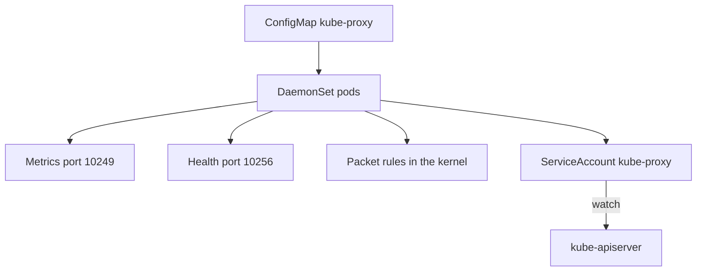

# Proxy Configuration, Health And Failure

Kube-proxy has a configuration file, two network ports of its own and a defined way to fail. This part explains the settings that matter for security, how to read them from the cluster, what happens when kube-proxy is missing or wrong and how to diagnose a Service that does not forward.

## Where The Configuration Lives

Kube-proxy reads a `KubeProxyConfiguration` file. In kubeadm-based clusters, including kind, the file is stored in the ConfigMap `kube-proxy` in the namespace `kube-system`, under the key `config.conf`. The DaemonSet mounts it into each pod and starts kube-proxy with `--config`. A second key, `kubeconfig.conf`, holds the API server address and the path of the service account token.

<!-- astrona:playground:renew -->

Read the configuration:

```sh
kubectl -n kube-system get configmap kube-proxy -o jsonpath='{.data.config\.conf}'
```

Find these fields in the answer. Some may be empty, which means the built-in default applies:

- `mode` selects `iptables`, `ipvs` or `nftables`. An empty value uses the platform default.
- `metricsBindAddress` is where the Prometheus metrics endpoint listens. The default is `127.0.0.1:10249`.
- `healthzBindAddress` is where the health endpoint listens, by default port 10256.
- `nodePortAddresses` limits the node addresses on which NodePort Services listen. An empty list means all local addresses.
- `clusterCIDR` is the pod network range. Kube-proxy uses it to decide which traffic is from inside the cluster.
- `conntrack` holds limits for the connection tracking table.

## Ports And Who May Reach Them

Two ports serve plain information:

- The metrics port, 10249 by default, shows counters about rule syncing and connections. If it is bound to `0.0.0.0`, any machine that can reach the node can read it. The data does not include Secrets, but it describes the Services of the node and the sync health.
- The health port, 10256 by default, answers whether the proxy is alive. External load balancers use it for health checks with `externalTrafficPolicy: Local`.

Keep the metrics address on the loopback interface unless a monitoring agent on the node scrapes it, and limit the health port to the ranges that need it with node firewall rules.



The diagram shows that the ConfigMap is an input to every node. A change in it affects all kube-proxy pods when they restart.

## Who Can Change The Configuration

The ConfigMap is a normal API object. A user who can update it in `kube-system`, or who can edit the DaemonSet, can change the mode, open the metrics port to the network or point the proxy to another API server. These changes apply when the pods restart, which makes them hard to notice. Protect the ConfigMap, the DaemonSet and the `kube-proxy` service account with RBAC, and review changes through the audit log.

Check who may update it in the cluster:

```sh
kubectl auth can-i update configmaps/kube-proxy -n kube-system --as=system:serviceaccount:starfleet:intern
```

The answer is `no` for an account without rights in `kube-system`. A `yes` means that account can change the proxy for every node.

## How Kube-proxy Fails

Kube-proxy fails in three ways, and each has its own symptom:

1. The pod is not running on a node. Existing rules keep working. New Services and endpoint changes are missing on that node, so clients on that node reach stale pod addresses or get no answer for new Services.
2. The pod runs but cannot sync. It logs errors from the iptables, IPVS or nftables commands. This happens when the node lacks a kernel module or when another program rewrites the rules.
3. The configuration is wrong. A wrong `clusterCIDR` changes how traffic from outside and inside is treated, and a wrong `mode` can leave the node without rules.

## Diagnose A Service That Does Not Answer

Work from the object to the node:

1. Check that the Service selector matches the labels of the pods: `kubectl get endpointslices -l kubernetes.io/service-name=NAME`. An empty slice means no ready pod matches.
2. Check that the pods are ready. A pod that fails its readiness probe is removed from the slice and receives no traffic.
3. Check that kube-proxy runs on the node of the client: `kubectl -n kube-system get pods -l k8s-app=kube-proxy -o wide`.
4. Read the logs of that pod for sync errors: `kubectl -n kube-system logs POD`.
5. If the Service uses a NetworkPolicy path, check the policy: a network plugin may drop traffic after kube-proxy has forwarded it.

Each step rules out one layer. Without step 1 many problems are blamed on kube-proxy that are really selectors or readiness.

## Hardening Summary

Keep the proxy image and the kernel up to date. Run only the access it needs: the node-proxier role and the host access of its own pod. Keep its ports off the public interfaces. Reject Service fields that widen exposure and review who can edit workloads in `kube-system`.

## Common pitfalls

> [!WARNING]
> Existing forwarding rules survive a stopped kube-proxy, so a failure can go unnoticed while Services slowly point at stale pods. Monitor the DaemonSet and keep its metrics and health ports away from untrusted networks.
