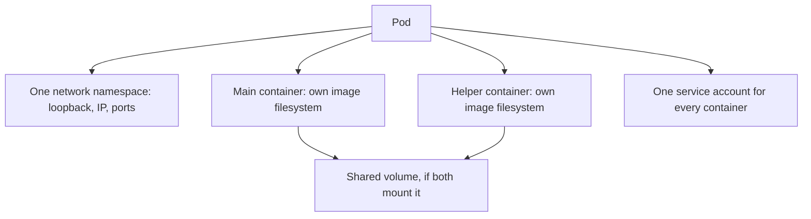

# Pod-Level Privileges And Application Access

A Pod groups containers for placement and shared networking. The grouping is useful for tightly coupled processes, but it also creates security consequences: helpers can talk to each other locally, share selected volumes and influence the environment of the main application. This part explains what the containers in one Pod share, which Pod settings remove the isolation of a container, and how a namespace label makes the API server reject those settings.

## What Containers In One Pod Share

All containers in a Pod run inside one network namespace. A network namespace is the kernel object that holds interfaces, addresses, routes and the port space. Every container in the Pod sees the same loopback interface and the same IP address, and two containers cannot listen on the same port.

The effect is that a listener bound to `127.0.0.1` in the main container is reachable from a helper container in the same Pod. Network policy cannot separate them, because their traffic never leaves the Pod. An application that trusts "local callers" therefore trusts every container that the Pod specification adds.

Filesystems are separate by default. Each container has its own image layers, and only the volumes named in `volumeMounts` are shared. A shared volume is writable by every container that mounts it without `readOnly: true`. A helper that can write the volume can change the files the main container reads.

Process namespaces are separate by default as well. The field `spec.shareProcessNamespace: true` puts all containers in one process namespace. Each container can then list the processes of the others, and a user with enough rights can read their environment through the `/proc` filesystem. Use it only for debugging helpers.



The diagram shows what is shared in a Pod: the network, the mounted volumes and the identity. Everything else stays separate unless the specification says otherwise.

## Settings That Remove Container Isolation

A container is a process with limits. The settings below remove limits, so each one needs a reason.

- `securityContext.privileged: true` gives the container nearly every capability and access to host devices. It removes most of the separation from the node.
- `hostNetwork: true` puts the Pod in the network namespace of the node. The container can bind node addresses and see node traffic.
- `hostPID: true` and `hostIPC: true` share the process list and inter-process memory of the node.
- A `hostPath` volume mounts a path of the node filesystem into the container.
- `capabilities.add` gives selected kernel rights, for example `SYS_ADMIN`, which is close to administrator rights on the node.
- `allowPrivilegeEscalation: true` lets a process gain more rights than its parent, for example through a setuid binary.
- Running as user ID 0 inside the container is root in the container. Without a user namespace it is also user ID 0 on the node, limited by capabilities and the other settings.

Each setting is part of the Pod specification, so an API server can inspect it before the Pod is stored. A permission error on startup is rarely a reason to use `privileged`. It usually needs a correct file owner or one narrow capability.

## The Restricted Settings

A hardened container sets four things. The Pod level sets `runAsNonRoot: true` and `seccompProfile.type: RuntimeDefault`. The container level sets `allowPrivilegeEscalation: false` and `capabilities.drop: ["ALL"]`. The seccomp profile limits which system calls the process may make, and `RuntimeDefault` selects the profile that the container runtime ships.

Every container needs them, including init containers and helper containers. A Pod is only as strict as its weakest container.

## Pod Security Admission

Pod Security Admission is a built-in admission controller. It reads labels on a namespace and checks each new Pod in it against one of three Pod Security Standards. The `privileged` standard allows everything. The `baseline` standard blocks the known escalations, such as `privileged`, host namespaces and host paths. The `restricted` standard adds the four hardened settings above and limits volume types.

Each standard can be applied in three modes through three labels. The label `pod-security.kubernetes.io/enforce` rejects a Pod that violates the standard. The label `pod-security.kubernetes.io/audit` records a violation in the audit log. The label `pod-security.kubernetes.io/warn` returns a warning to the client. Pods that already run are not stopped when the label is added.

The playground has a namespace `starfleet` with ordinary workloads and no labels. The first step is to see that the API server accepts a privileged Pod there.

<!-- astrona:playground:renew -->

Save this as `privileged-test.yaml`:

```yaml
apiVersion: v1
kind: Pod
metadata:
  name: privileged-test
  namespace: starfleet
spec:
  serviceAccountName: shuttle
  containers:
    - name: test
      image: busybox:1.37.0
      command: ["sleep", "3600"]
      securityContext:
        privileged: true
```

Check it without storing it. The flag `--dry-run=server` runs the full admission chain on the server and then discards the object:

```sh
kubectl apply --dry-run=server -f privileged-test.yaml
```

Then check the result. The namespace has no Pod Security labels, so the server accepts the Pod. Now add the label that enforces the baseline standard and repeat the command:

```sh
kubectl label namespace starfleet pod-security.kubernetes.io/enforce=baseline
kubectl apply --dry-run=server -f privileged-test.yaml
```

The second dry run fails with an error that mentions `PodSecurity` and names the violated rule, which is the `privileged` setting. The label can take a moment to be seen by the admission controller, so repeat the command once if the first attempt is still accepted.

## What A Namespace Label Does Not Do

The label checks the Pod specification. It does not check what the process does, and it does not change workloads that already run. Controllers still create Pods from an old template until the template is fixed, and a rejected Pod shows up as a failed ReplicaSet event rather than an error at `kubectl apply` of the Deployment.

Pod Security Admission also does not cover credentials. A Pod with a perfectly hardened security context still carries a service account token unless the specification removes it. The next part covers that.

## A Reviewable Pod Decision

For each container, write down what it must read, write, connect to and administer. Then compare that with the Pod specification: shared volumes, shared namespaces, added capabilities, host paths and the service account. The strongest explanation covers what a compromised process could still do through the access that the specification legitimately gives it.

Remove the labels you added when you finish, so the next part starts from a clean state:

```sh
kubectl label namespace starfleet pod-security.kubernetes.io/enforce-
```

## Common pitfalls

> [!WARNING]
> Pod Security Admission only checks Pods that are created or updated after the label exists, and it only checks the declared specification. Running Pods keep their settings, and a controller with an old template keeps trying to create rejected Pods.
