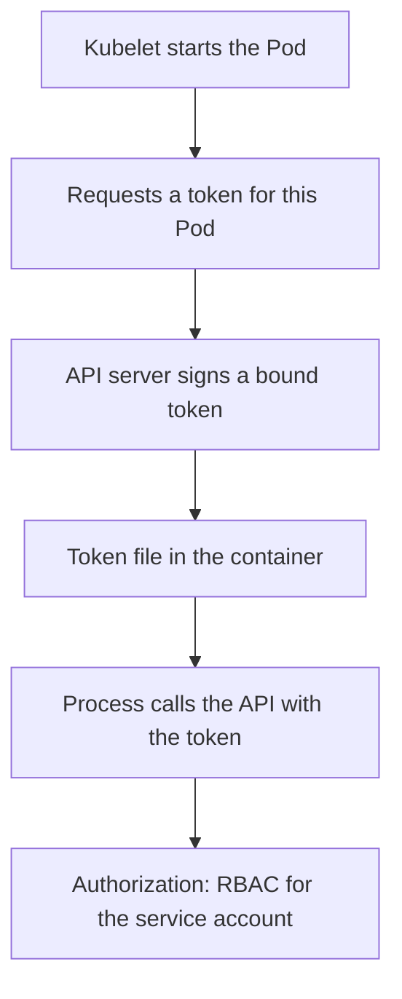

# Service Account Tokens And API Credentials

Every Pod has an identity toward the Kubernetes API, and by default that identity arrives as a file inside each container. A compromised process can read the file and call the API as the Pod. This part explains where the credential comes from, how long it is valid, how to remove it from Pods that do not need it, and how to scope what it can do.

## Where The Token Comes From

A ServiceAccount is a namespaced object that represents a workload. Every namespace has a ServiceAccount named `default`, and a Pod that names none uses it. The field `spec.serviceAccountName` selects another one.

When a Pod starts, the admission chain adds a projected volume to it, named like `kube-api-access-xxxxx`. A projected volume combines several sources into one directory. The source of interest is `serviceAccountToken`. The kubelet requests a token from the API server for this Pod and writes it to `/var/run/secrets/kubernetes.io/serviceaccount/token`, next to the cluster certificate authority file `ca.crt` and the namespace name in `namespace`.

The token is a signed JSON Web Token. It is bound to the Pod object and to the service account. It has an audience, which names the service that should accept it, and the default audience is the API server. It has an expiry. The kubelet refreshes the file before expiry, and the token stops working when the Pod is deleted.



The diagram shows that two checks follow the token. The API server verifies the signature, the Pod binding and the expiry. RBAC then decides what the service account may do.

## Long-Lived Tokens

Older clusters created a Secret with a never-expiring token for every service account. Current clusters do not do this. A long-lived token exists only when someone creates a Secret of type `kubernetes.io/service-account-token` that names the service account. That token has no expiry and no Pod binding, so it stays valid if it leaks. Prefer the short-lived tokens and avoid creating such Secrets.

A person who needs a token for a short task can request one with `kubectl create token NAME --duration 10m`. The command calls the TokenRequest API and prints a bound token that expires on its own.

## Remove The Token From Pods That Do Not Need It

Most application containers never talk to the Kubernetes API. For them the token is only an exposure. Two fields remove it.

- `automountServiceAccountToken: false` on the ServiceAccount is the default for every Pod that uses it.
- `automountServiceAccountToken: false` in the Pod specification applies to that Pod only. If both are set, the Pod field wins.

When the field is false, the admission chain does not add the `kube-api-access` volume. The process then has nothing to read and nothing to steal.

<!-- astrona:playground:renew -->

Look at the credential that a Starfleet Pod holds. The Deployment `shuttle` uses the default behaviour:

```sh
kubectl -n starfleet exec deploy/shuttle -- ls /var/run/secrets/kubernetes.io/serviceaccount
```

Then check the result. The listing shows the three files `ca.crt`, `namespace` and `token`. Now save this as `no-token.yaml`:

```yaml
apiVersion: v1
kind: ServiceAccount
metadata:
  name: shuttle
  namespace: starfleet
automountServiceAccountToken: false
```

Apply it and restart the Deployment, because the Pod volume is added only when a Pod is created:

```sh
kubectl apply -f no-token.yaml
kubectl -n starfleet rollout restart deployment shuttle
kubectl -n starfleet rollout status deployment shuttle
```

Then check the result with the same listing command as before. The new Pod has no such directory, and the command fails with a message that the path does not exist.

## A Projected Token With A Narrow Audience

Some workloads need a token, but not for the Kubernetes API. A workload that calls an external service can ask the kubelet for a token whose audience is that service. The service then accepts it, and the Kubernetes API does not, because the audience does not match.

```yaml
volumes:
  - name: vault-token
    projected:
      sources:
        - serviceAccountToken:
            audience: vault
            expirationSeconds: 600
            path: token
```

The field `expirationSeconds` sets the lifetime, with a minimum of 600. A shorter lifetime limits how long a stolen copy works, and a specific audience limits where it works. The workload that uses this volume can also set `automountServiceAccountToken: false` so that no API token is added in addition.

## What The Token Can Do

A token carries the rights of its service account, and nothing in the token narrows them. Rights come from RBAC. A RoleBinding grants a Role inside one namespace. A ClusterRoleBinding grants a ClusterRole in every namespace. The usual mistakes are broad verbs and broad resources.

Reading Secrets is a common over-grant. The verbs `get`, `list` and `watch` on `secrets` all return secret contents, and `list` returns every Secret in the namespace in one call. A role that only needs one ConfigMap should name `configmaps` and, when possible, a list of `resourceNames`.

Test a grant with `kubectl auth can-i`. The flag `--as` impersonates the service account:

```sh
kubectl auth can-i get secrets -n starfleet --as=system:serviceaccount:starfleet:crew
kubectl auth can-i create pods/exec -n starfleet --as=system:serviceaccount:starfleet:crew
```

The answer is `yes` or `no` for each. The playground gives the service account `crew` a role that grants both, so the answers show the over-grant.

## Pod Creation Is A Credential Right

Anyone who can create Pods in a namespace can use any ServiceAccount in it, and can mount any Secret of the namespace into a Pod of their own. Creating a Pod is therefore close to reading every Secret in the namespace. Grant `create` on `pods` and `use` of service accounts with the same care as direct access to Secrets.

A related risk is access from the pod outward. A container that holds a database password, a cloud credential or an API key of its own is protected by RBAC only for Kubernetes actions. Keep such credentials out of environment variables where the platform allows it, mount them read-only and scope them to the minimum.

## Common pitfalls

> [!WARNING]
> Setting `automountServiceAccountToken: false` on a ServiceAccount does not change Pods that are already running. Restart the workload so that new Pods are created without the token, and check the running Pod to confirm the directory is gone.
