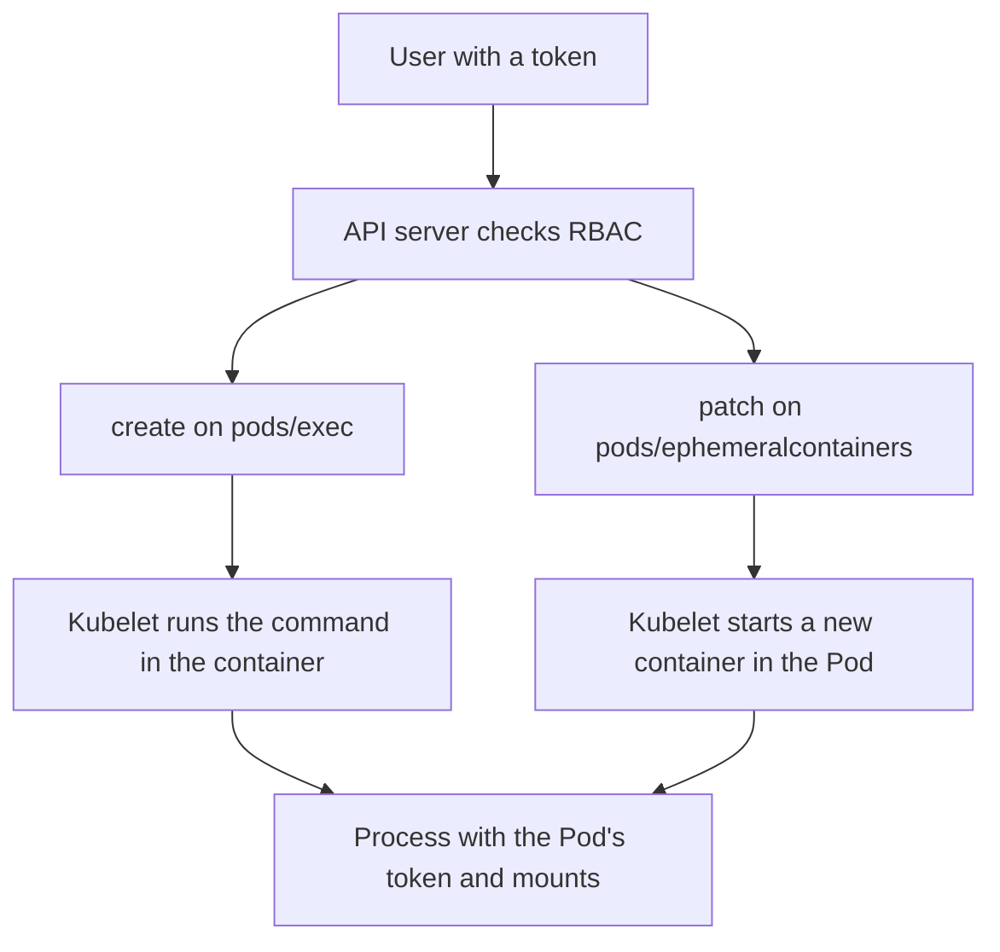

# Interactive Access And Recovery

A running Pod can be entered, copied from, forwarded to and extended with new containers, and each of those actions needs its own permission. After a compromise, deleting the Pod is only the first step. This part explains the permissions behind interactive access, how to limit them, and what recovery must replace besides the Pod.

## Interactive Access Is A Separate Permission

Reading a Pod object and entering it are different rights. RBAC models the extra actions as subresources of `pods`, and each subresource is named in a rule:

- `pods/exec` runs a command in a container. `kubectl exec` needs the verb `create` on it.
- `pods/attach` connects to the main process of a container.
- `pods/portforward` opens a tunnel from the client to a port of the Pod. It needs `create` as well.
- `pods/ephemeralcontainers` adds an ephemeral container to a running Pod through the verbs `update` and `patch`. `kubectl debug` uses it.
- `pods/log` reads container logs with `get`.

A rule that lists the resource `pods` does not cover these. A role that grants `get` on `pods` allows reading the object only. A rule that grants `pods/exec` allows a command in a container, and that command runs with everything the container holds: its service account token, mounted Secrets, environment variables and network position.



The diagram shows the two ways in. In both, the new process lands in the identity and filesystem context of the Pod.

## Ephemeral Containers

An ephemeral container is a container added to a Pod that is already running. It cannot be removed and has no ports or probes, so it is meant for debugging. The command `kubectl debug` creates one. The option `--target` joins the process namespace of an existing container, which lets the debug container see that process.

The new container shares the network namespace and the volumes it mounts of the Pod. It can have its own `securityContext`. A user who can add ephemeral containers can therefore start a root container with a chosen image inside a restricted Pod, subject to Pod Security Admission, which checks ephemeral containers as well.

Treat the right to add ephemeral containers like the right to exec. Give it only to a small operator group and only in the namespaces where it is needed.

## Limit Interactive Access

Write the role from the need. An operator who reads logs and lists Pods needs `get` and `list` on `pods` and `get` on `pods/log`. They do not need the verbs on the subresources that run commands. Production namespaces often grant no `pods/exec` at all and rely on logs, metrics and ephemeral debugging granted for a short time.

<!-- astrona:playground:renew -->

The playground has a service account `crew` that holds more than it should. Check what it can do:

```sh
kubectl auth can-i create pods/exec -n starfleet --as=system:serviceaccount:starfleet:crew
kubectl auth can-i patch pods/ephemeralcontainers -n starfleet --as=system:serviceaccount:starfleet:crew
kubectl auth can-i get secrets -n starfleet --as=system:serviceaccount:starfleet:crew
```

The three answers are `yes` in the starting state. Save this as `crew-reader.yaml`. It keeps the name of the existing role and replaces its rules, so the binding stays valid:

```yaml
apiVersion: rbac.authorization.k8s.io/v1
kind: Role
metadata:
  name: crew-ops
  namespace: starfleet
rules:
  - apiGroups: [""]
    resources: ["pods"]
    verbs: ["get", "list", "watch"]
  - apiGroups: [""]
    resources: ["pods/log"]
    verbs: ["get"]
```

Apply it:

```sh
kubectl apply -f crew-reader.yaml
```

Then check the result by running the three `can-i` commands again. Each answer is now `no`. The command `kubectl auth can-i list pods -n starfleet --as=system:serviceaccount:starfleet:crew` still answers `yes`.

## Why Deleting The Pod Is Not Recovery

A Deployment controls a ReplicaSet, and the ReplicaSet creates Pods from the template. If a process in a Pod is compromised, deleting the Pod removes one process environment. The ReplicaSet creates another from the same template within seconds. If the compromise came through the image, the template, a mounted Secret or an exposed credential, the new Pod is vulnerable in the same way.

A recovery plan has five parts.

1. Contain. Stop new damage. Scale the workload to zero, or cut its network path, but keep the old Pod object when you need evidence. Evidence in a Pod, such as files in `emptyDir` volumes, disappears when the Pod is deleted.
2. Identify the entry. Check the image reference and digest, the template changes in the audit log, recent role bindings and who held exec or debug rights.
3. Revoke exposed authority. A bound token stops working when its Pod is deleted, but a copy of a long-lived token Secret or an external credential keeps working. Delete the token Secret, rotate the external credentials and remove role bindings that were abused.
4. Restore trusted inputs. Fix the image reference, the template and the configuration in the source that applies them. A manual fix in the cluster is overwritten by the next apply of the old source.
5. Replace and verify. Start new Pods from the fixed template with `kubectl rollout restart`. Confirm that the Pods use the intended image, have no unexpected volumes and run with the expected service account.

## Data And Dependencies

Temporary volumes disappear with the Pod. Persistent volumes and external stores keep what a malicious process wrote. A claim that a replacement is clean needs a statement about each such store: whether it was read-only, whether it was written during the incident and whether it must be restored from a known good copy.

Name and identifier do not matter. A new Pod with a new name is no more trustworthy than the old one if the template and its dependencies are the same.

## Check What A Restarted Pod Holds

After a restart, inspect the new Pod specification directly:

```sh
kubectl -n starfleet get pod -l app=shuttle -o jsonpath='{.items[*].spec.volumes[*].name}'
kubectl -n starfleet get pod -l app=shuttle -o jsonpath='{.items[*].spec.serviceAccountName}'
```

The first command lists the volume names, which include a `kube-api-access` volume only when the token is mounted. The second command prints the service account name. Compare both with what the workload needs.

## Common pitfalls

> [!WARNING]
> A role that grants `pods/exec`, `pods/attach` or `pods/ephemeralcontainers` is a way into every container of the namespace, not a reading right. Do not add these subresources to a shared role, and do not treat deleting a Pod as recovery while its template, secrets and credentials are unchanged.
