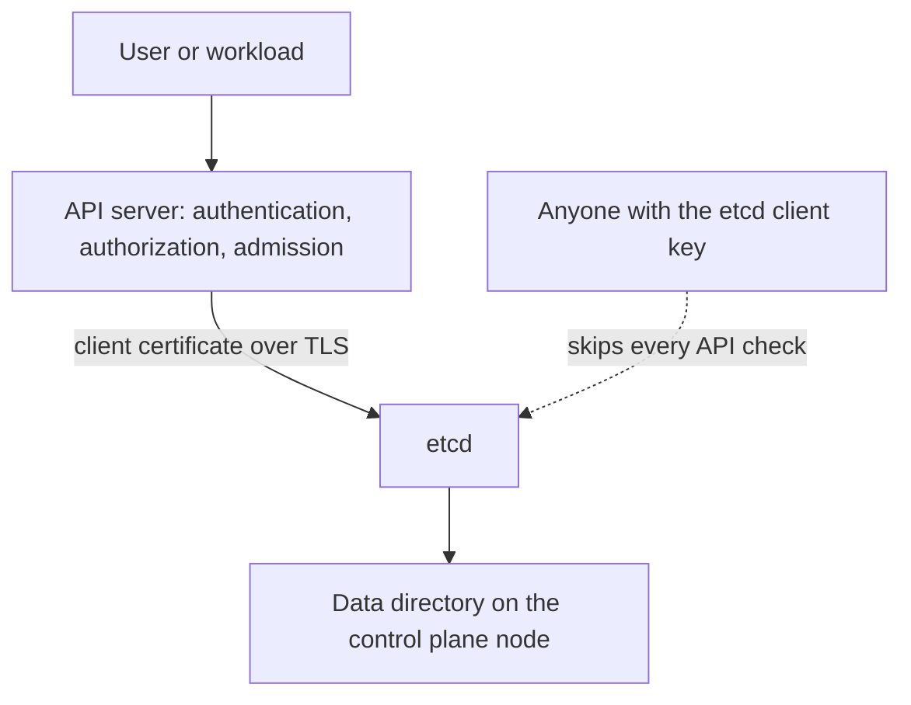

# Protecting The Cluster Datastore

Etcd is the key-value database where Kubernetes keeps every object of the cluster: Pods, Deployments, RoleBindings, ConfigMaps and Secrets. The API server is the only component that should read and write it. Every authentication, authorization and admission check happens in the API server, so a client that reaches etcd directly skips all of them. This part explains how the API server and etcd connect, which settings decide who may talk to etcd, and how a pod can leak the files that open it.

## What Etcd Holds And Who May Talk To It

Etcd stores each object under a key that starts with `/registry/`, for example `/registry/secrets/NAMESPACE/NAME`. The value is the serialized object. A Secret in etcd therefore holds its data fields as stored by the API server, in plain form unless encryption at rest is configured.

The API server is the client. It reads with a client certificate and a private key and verifies the etcd server certificate with a certificate authority file. Four flags of the API server name the connection:

- `--etcd-servers` lists the etcd addresses, normally `https://127.0.0.1:2379` on a control plane node.
- `--etcd-cafile` names the certificate authority that signed the etcd server certificate.
- `--etcd-certfile` and `--etcd-keyfile` hold the client certificate and key that the API server presents.

Other components do not need etcd. The scheduler, the controller manager and the kubelet only talk to the API server. A component outside the control plane that holds the etcd client key can read every Secret and write any object, whatever the RBAC rules say.



The diagram shows two ways to etcd. The solid one passes the API checks, and the dotted one does not.

## The Settings That Protect The Connection

Etcd authenticates its callers through TLS. Transport Layer Security (TLS) encrypts the connection, and with client certificate authentication the server also checks who connects. Three groups of etcd flags matter.

- `--client-cert-auth=true` requires every client to present a certificate that the `--trusted-ca-file` signed. Without it, anyone who reaches the port can read and write.
- `--cert-file` and `--key-file` give the server its own identity for client connections.
- `--peer-client-cert-auth=true` with `--peer-trusted-ca-file`, `--peer-cert-file` and `--peer-key-file` does the same for connections between etcd members.

The flag `--listen-client-urls` sets where etcd accepts clients. A kubeadm control plane node listens on the loopback address and on the node address. Reaching that port from a workload network is a risk even with certificate authentication, because it exposes a powerful interface to attackers who steal or guess a certificate. Restrict the port with host firewalls or security groups to the API server nodes.

Kubeadm uses a separate certificate authority for etcd, kept under `/etc/kubernetes/pki/etcd`. A separate authority means that a certificate issued for the cluster, for example a kubelet certificate, is not accepted by etcd.

## Read The Etcd Configuration

The playground cluster runs etcd as a static Pod in `kube-system`. A static Pod is defined by a file on the node, and the kubelet shows it in the API as a read-only mirror Pod. The mirror lets you read its settings without a shell on the node.

<!-- astrona:playground:renew -->

Find the etcd Pod and print its command line:

```sh
kubectl -n kube-system get pods -l component=etcd
kubectl -n kube-system get pod -l component=etcd -o jsonpath='{.items[0].spec.containers[0].command}'
```

Then check the result. The command is a list of flags. Look for `--client-cert-auth`, `--peer-client-cert-auth`, `--listen-client-urls` and `--data-dir`. A kubeadm cluster sets the two certificate flags to `true`. The second command prints the list as one line, so read it from left to right.

Next print the volumes of the Pod to see which node paths it uses:

```sh
kubectl -n kube-system get pod -l component=etcd -o jsonpath='{range .items[0].spec.volumes[*]}{.name}{" "}{.hostPath.path}{"\n"}{end}'
```

The output has one line per volume. The two paths are the certificates directory and the data directory. The data directory holds the database files, and the certificates directory holds the keys.

## Node Files That Open Etcd

Two directories on a control plane node need the same protection as the database itself. The data directory `/var/lib/etcd` contains the database, so reading it reveals every Secret. The directory `/etc/kubernetes/pki/etcd` contains the etcd server and client keys, and `/etc/kubernetes/pki` contains the API server's etcd client key. A copy of these keys works from anywhere that reaches the etcd port.

A Pod can reach them through a `hostPath` volume if it runs on a control plane node. Kubernetes does not know that the path is special. The same applies to a Pod that mounts the root directory of the node.

Save this as `etcd-peek.yaml`. The Pod only describes the risk, and the dry run stops it from being created:

```yaml
apiVersion: v1
kind: Pod
metadata:
  name: etcd-peek
  namespace: starfleet
spec:
  serviceAccountName: shuttle
  containers:
    - name: peek
      image: busybox:1.37.0
      command: ["sleep", "3600"]
      volumeMounts:
        - name: etcd-pki
          mountPath: /pki
          readOnly: true
  volumes:
    - name: etcd-pki
      hostPath:
        path: /etc/kubernetes/pki/etcd
```

Validate it on the server without storing it:

```sh
kubectl apply --dry-run=server -f etcd-peek.yaml
```

Then check the result. The server accepts the Pod, because no admission rule forbids host paths in this namespace. This is the point: the API accepts a request for the etcd keys, and only an admission control, such as a Pod Security Standard of `baseline` or higher or a policy on `hostPath`, rejects it.

## Defences Beyond Etcd Itself

Limit who can create Pods with `hostPath` volumes, using Pod Security Admission or an admission policy. Do not schedule untrusted workloads on control plane nodes, which the default control plane taint already prevents unless a Pod tolerates it. Limit node access to a small administrator group, because anyone with a shell on the node reads the same files.

Keep the etcd port reachable only by the API server nodes. Keep credentials for etcd out of backups of general configuration and out of container images. Rotate the etcd certificates when an administrator who held them leaves.

## Common pitfalls

> [!WARNING]
> Encryption in transit is not a replacement for access control. A valid etcd client certificate gives full read and write access to every object of the cluster, so keep its key off workload nodes and out of any Pod that the API server will accept.
