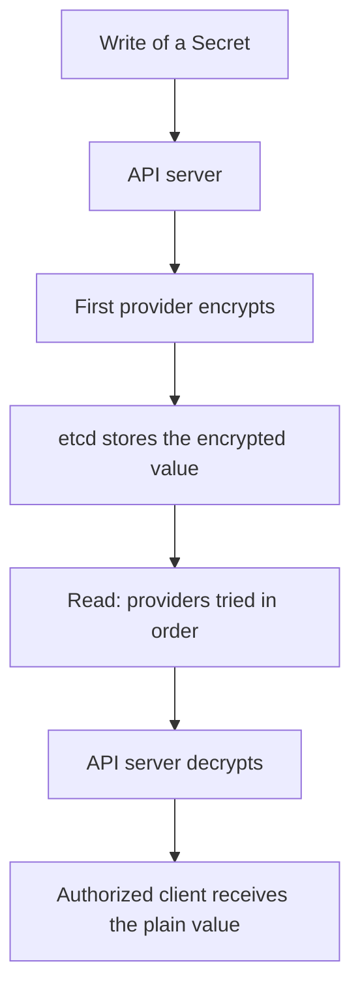

# Secrets And Encryption At Rest

A Secret object holds credentials, and Kubernetes stores it in etcd. By default, the stored value is the data of the Secret in a form that anyone who can read the database can decode. This part explains what encryption at rest does, how to configure it, who can still read the plain values through the API, and which other records deserve the same care.

## What A Secret Protects

The data of a Secret is base64 encoded in the API. Base64 is a way to write bytes as text, not encryption, and anyone can decode it. The type of the object tells Kubernetes how to treat it, for example `Opaque` for free data or `kubernetes.io/tls` for a certificate pair.

Secrets are separated from ConfigMaps by convention and by access rules. RBAC can grant ConfigMap reads to many people and Secret reads to few. The separation fails when a credential is stored in a ConfigMap, because every reader of the ConfigMap then receives it. A credential in an environment variable of a Deployment is just as readable by anyone who can read the Deployment.

Three RBAC verbs return Secret contents: `get` returns one, `list` returns all in a namespace and `watch` streams them. A rule that grants `list` on `secrets` discloses every Secret in the scope of the binding. Granting it in a ClusterRoleBinding discloses every Secret in the cluster.

<!-- astrona:playground:renew -->

The playground has a Secret named `warp-key` in `starfleet` and a service account `archivist` that can list Secrets in every namespace. Read the value as the administrator and decode it:

```sh
kubectl -n starfleet get secret warp-key -o jsonpath='{.data.key}' | base64 --decode
```

Then check the result. The command prints the plain text value of the key. Nothing in the API protects it from a reader that has `get` on the Secret.

Check what the service account can do:

```sh
kubectl auth can-i list secrets -A --as=system:serviceaccount:starfleet:archivist
kubectl auth can-i get secrets -n kube-system --as=system:serviceaccount:starfleet:archivist
```

Both answers are `yes`, which shows the cluster-wide exposure.

## Encryption At Rest

Encryption at rest means that the API server encrypts selected resources before it writes them to etcd and decrypts them when it reads. It protects the database files, snapshots and backups against a reader who has the files but not the API server or the encryption key. It does not change what an authorized API client receives, because the API server decrypts for them.

An EncryptionConfiguration file configures it. The API server reads the file named in the flag `--encryption-provider-config`. A minimal file looks like this:

```yaml
apiVersion: apiserver.config.k8s.io/v1
kind: EncryptionConfiguration
resources:
  - resources:
      - secrets
    providers:
      - aescbc:
          keys:
            - name: key1
              secret: BASE64-ENCODED-32-BYTE-KEY
      - identity: {}
```

The providers are an ordered list. The first provider encrypts all new writes. When the API server reads, it tries the providers in order until one can decode the value. The last entry, `identity`, stores plain values and lets the server read data written before encryption was enabled. Putting `identity` first turns encryption off for new writes.

Supported providers include `aescbc`, `aesgcm`, `secretbox` and `kms`. A KMS provider keeps the key outside the cluster in a key management service and encrypts a data encryption key per record. The documentation recommends it over keys written in a file on the control plane node, because the file sits next to the data it protects.

## Enabling And Rotating

Enabling encryption changes only future writes. Existing Secrets stay in plain form until they are written again. The usual way to rewrite them is to read and replace each object:

```sh
kubectl get secrets -A -o json | kubectl replace -f -
```

Key rotation follows the same pattern. Add the new key first in the list, restart every API server so that all of them can decrypt with it, rewrite the objects so they are encrypted with the new key, and only then remove the old key. Removing the old key earlier makes objects unreadable.



The diagram shows that decryption happens inside the API server, so authorization decides who sees the value.

## How To Check That It Works

The cluster does not report encryption through the API. The check is on the control plane node. A reader with access to the etcd client certificate uses the `etcdctl get` command on the key `/registry/secrets/NAMESPACE/NAME` and looks at the start of the value. An encrypted value starts with a marker such as `k8s:enc:aescbc:v1:` followed by the key name. A plain value starts with the Kubernetes storage prefix and shows readable field names. This check needs the etcd keys, so do it only on a system you own.

## What Encryption Does Not Do

- It does not stop a user who has `get`, `list` or `watch` on Secrets.
- It does not encrypt ConfigMaps, Pod specifications or other resources, unless they are listed under `resources`.
- It does not protect the key. A key file on the node, a copy in a backup or a key in the same snapshot defeats it.
- It does not protect data in memory of the API server or in the files that kubelet writes for mounted Secrets.

Secrets mounted into a Pod appear on the node in memory-backed storage, and environment variables can appear in process listings and crash reports. Mount Secrets as files with `readOnly: true`, and limit which Pods mount them.

## Immutable Secrets

Setting `immutable: true` on a Secret or ConfigMap prevents any change to its data. The only way to change the value is to delete and recreate the object. This protects workloads from an accidental or malicious update of a credential they already read, and it reduces load on the API server, because the kubelet stops watching immutable objects.

```sh
kubectl -n starfleet patch secret warp-key --type=merge -p '{"immutable":true}'
```

Then check the result by trying to patch the data field. The API server rejects the update with a message that the field is immutable. Setting the flag back to `false` is also rejected.

## Common pitfalls

> [!WARNING]
> Turning on encryption at rest does not encrypt existing Secrets until they are rewritten, and it does not limit API readers. Check the stored value and rotate keys in the order add, restart, rewrite and remove.
