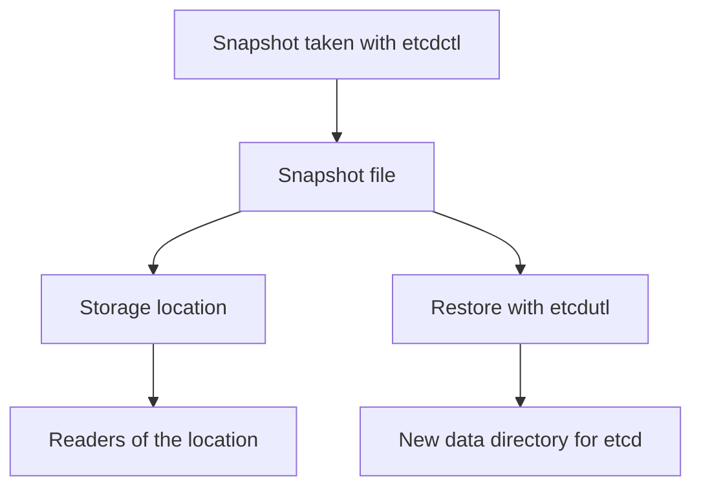

# Snapshots, Quorum And Recovery

Etcd keeps the cluster state, so its availability and its backups decide how fast a cluster returns after a failure. The same backups hold every Secret, so they decide how far an incident spreads. This part explains quorum, snapshots, who may read them, and what a restore does and does not bring back.

## Quorum And Availability

Etcd uses the Raft consensus algorithm. A group of members elects a leader, and every write must be accepted by a majority of the members, called the quorum, before it commits. The majority of N members is N divided by two, rounded down, plus one.

- Three members need two for quorum, so one failure is tolerated.
- Five members need three, so two failures are tolerated.
- Four members need three, so they tolerate one failure, the same as three members. An even number adds cost without adding tolerance.

When quorum is lost, etcd stops accepting writes. The API server can then not create, change or delete objects, while existing Pods keep running because the kubelet already has their definitions. Reads through the API server may also fail, which blocks controllers.

Members should sit in separate failure domains, such as availability zones, so that one failure removes at most one member. The certificates and the member list must stay consistent. A new member must be added with the correct peer certificate, or it cannot join. A member that is added by mistake from an untrusted system joins the trusted set and receives a copy of the data.

## Replication Is Not A Backup

Replication copies every committed write to the other members. A deleted Secret, a malicious change or a corrupt object is replicated within milliseconds. Replication protects against the loss of a member, not against a wrong write. A backup keeps an earlier state that can be restored after the wrong write.

## Snapshots

A snapshot is a point-in-time copy of the whole etcd database in one file. The command `etcdctl snapshot save FILE` creates one, and it needs the endpoint and the same three TLS flags that any etcd client needs: `--cacert`, `--cert` and `--key`. The result is a file that contains every object of the cluster.

The restore command in current etcd releases is `etcdutl snapshot restore FILE --data-dir DIRECTORY`. It writes a new data directory, which the etcd instance then uses in place of the old one. Restoring on a multi-member cluster is done for every member with the same snapshot and the new member information, so that they form a consistent group.



The diagram shows that the file leaves the control plane, so its storage location becomes part of the security boundary.

## A Snapshot Is Sensitive

A snapshot contains the data of every object as written. If encryption at rest was on when it was written, Secrets in the snapshot are encrypted with the key of that time, and the key is needed to restore. If it was off, the snapshot contains every credential in plain form.

Treat the file like the live database.

- Store it in a location that only the backup process and a small recovery group can read.
- Encrypt the storage location and protect the keys separately from the snapshot.
- Set a retention period. Old snapshots keep credentials that the cluster has since rotated, and they still work if the external system did not change.
- Log who reads the location.
- After a snapshot leaks, rotate every credential that was in it. Deleting the file does not undo disclosure.

## What A Restore Brings Back

A restore returns the cluster objects of the snapshot time. It does not return the data inside Persistent Volumes, the content of external databases, or the state of anything outside etcd. Objects created after the snapshot are lost, and the kubelets and controllers reconcile the nodes with the restored state, which may delete running Pods that the snapshot does not list.

Credentials restored from an old snapshot may be revoked in the systems they belong to. Service account tokens that were bound to deleted Pods stay invalid. Plan application data recovery separately, with its own backups and order of restoration.

## Review The Exposure In The Playground

<!-- astrona:playground:renew -->

You cannot run a snapshot from kubectl, but you can see what a snapshot reader receives, and who in the cluster can read the same data. List the Secrets in the namespace and count them:

```sh
kubectl -n starfleet get secrets
```

Every Secret in the output is also in a snapshot. Now check which accounts can read Secrets cluster wide. This command lists every binding that mentions a Secret reading role of the playground:

```sh
kubectl get clusterrolebindings -o wide | grep -i archivist
```

Then check the result. The binding for `archivist` appears. Print the role to see the rule:

```sh
kubectl get clusterrole secret-reader -o yaml
```

Replace the role with a narrow one. Save this as `secret-reader.yaml`:

```yaml
apiVersion: rbac.authorization.k8s.io/v1
kind: ClusterRole
metadata:
  name: secret-reader
rules:
  - apiGroups: [""]
    resources: ["secrets"]
    resourceNames: ["warp-key"]
    verbs: ["get"]
```

Apply it:

```sh
kubectl apply -f secret-reader.yaml
```

Then check the result:

```sh
kubectl auth can-i list secrets -A --as=system:serviceaccount:starfleet:archivist
kubectl auth can-i get secret/warp-key -n starfleet --as=system:serviceaccount:starfleet:archivist
```

The first answer is `no`, because listing is not allowed when a rule names resources. The second is `yes` in `starfleet`. A ClusterRole bound through a ClusterRoleBinding still applies in every namespace, so the name restriction is what limits it, and a Secret named `warp-key` in another namespace would still match.

## A Recovery Plan

Write down the following before an incident. Who may take snapshots and how often. Where the files go and who reads them. How you check that a snapshot restores, by restoring it in a test environment. Where the encryption keys are kept and how a restore finds them. The order in which you restore etcd, the control plane and the application data. A plan that has never been rehearsed fails at the first unexpected condition.

## Common pitfalls

> [!WARNING]
> A snapshot file is a copy of every Secret in the cluster. Do not store it where more people can read it than can read the Secrets, and do not count replication as a backup, because a wrong write is copied to every member.
