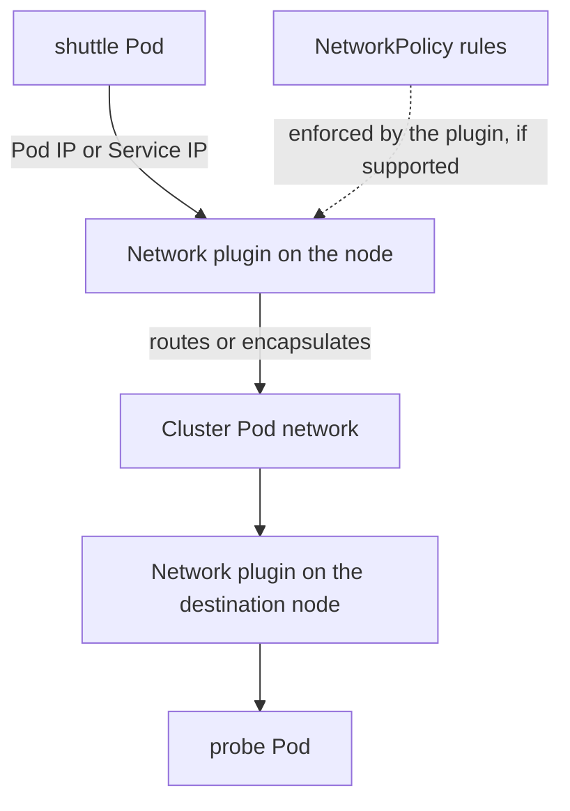

# Pod Networks And Policy Boundaries

The `shuttle` Pod sends a request to the `probe` Pod, possibly on another node. Kubernetes gives each Pod its own network identity so that applications talk to each other without knowing which node hosts the other process. This part explains the network model, what a Container Network Interface plugin contributes, what a default cluster allows, and why that default is a security decision rather than a neutral starting point.

## The Network Model

The Kubernetes network model has three rules. Every Pod gets its own IP address. A Pod can reach every other Pod using that address, across nodes, without address translation. Agents on a node, such as the kubelet, can reach all Pods on that node.

The rules describe connectivity, not security. Nothing in the model says that a Pod should be allowed to talk to every other Pod. The default is open: unless a NetworkPolicy isolates a Pod, any Pod in any namespace can connect to any port that the Pod listens on.

Containers in one Pod share a network namespace, so they reach each other on the loopback address. Containers in different Pods use Pod addresses or Service addresses. A Pod address belongs to one Pod instance, and a replacement Pod gets a new one. A Service gives a stable address and name for a changing set of Pods, and its forwarding rules are written by kube-proxy or by the network plugin.

## What The Network Plugin Does

The Container Network Interface (CNI) is a specification for programs that set up the network of a container. When the kubelet starts a Pod, the runtime creates the network namespace and calls the CNI plugin. The plugin creates the virtual network interface in the Pod, assigns an address from the Pod range of the node and sets routes, so that traffic leaves the node toward the right destination.

Between nodes, the plugin either routes Pod address ranges through the underlying network or encapsulates Pod packets inside other packets. Encapsulation wraps the original packet so that the underlying network only sees traffic between node addresses.

A plugin may also enforce NetworkPolicy. This is a separate feature that not every plugin has. The API server accepts a NetworkPolicy object whatever plugin is installed. A cluster whose plugin does not enforce policy stores the object and applies nothing, and the Pods stay open without any error message.



The diagram shows that the plugin sits on both ends of the path. A policy is enforced there only when the plugin supports it.

## See The Default

The playground runs Calico as the network plugin, which enforces NetworkPolicy. No policies exist at the start. Find the Pod addresses and nodes first.

<!-- astrona:playground:renew -->

```sh
kubectl get pods -A -o wide
```

The output shows a Pod IP and a node for every Pod. Now send a real request from `shuttle` to the Service of `probe`. The container image `curl` has the `curl` command, and the options make the output short: `-sS` shows errors, `--max-time 3` limits the wait to three seconds, and `-w` prints the HTTP status code:

```sh
kubectl -n starfleet exec deploy/shuttle -- curl -sS --max-time 3 -o /dev/null -w '%{http_code}\n' http://probe.starfleet.svc/get
```

Then check the result. The command prints `200`. Repeat the request from `drifter`, which runs in the other namespace:

```sh
kubectl -n outpost exec deploy/drifter -- curl -sS --max-time 3 -o /dev/null -w '%{http_code}\n' http://probe.starfleet.svc/get
```

The answer is `200` again. A Pod in `outpost` reaches a Pod in `starfleet` because nothing says otherwise. A namespace is not a network boundary, and the same applies to the `scout` service:

```sh
kubectl -n outpost exec deploy/drifter -- curl -sS --max-time 3 -o /dev/null -w '%{http_code}\n' http://scout.starfleet.svc/healthz
```

## Why The Open Default Matters

A compromised Pod that is allowed to reach every other Pod can scan the network, call internal services that expect only trusted callers and reach databases that have no authentication of their own. Many internal services rely on the network for trust, for example admin interfaces that listen on a Pod port and expect that only trusted clients can connect. The default network model offers them no protection.

Three layers fit together here. Network policy limits who can open a connection. Authentication and authorization in the application limit who can do what after the connection is open. Encryption in transit protects the content of the connection. A policy does not replace the other two.

## Addressing Across Nodes

Consider `shuttle` on node A and `probe` on node B. The client process sends a packet from its own network namespace, and the plugin moves it across the host and infrastructure boundaries to the destination namespace. The scheduler does not relay packets, and neither does the API server.

Infrastructure still matters. Host routing, firewall rules, address allocation and packet size limits can break a design that works on paper. A failure that occurs only between nodes points at the plugin or the infrastructure, while a failure between two containers of one Pod points at the application.

## Pods And Services In A Policy

A Service address is virtual. When `shuttle` connects to the Service address of `probe` on port 80, the connection is rewritten to a Pod address on port 8080, the container port. The plugin evaluates policies against the Pod address and the Pod port, after the rewrite. A rule that names the Service port 80 therefore does not match, and a rule that names the container port 8080 does.

## Read A Failing Path Step By Step

When a request fails, name each step of the path and test it separately. This turns a vague network symptom into a short list of questions.

1. Name resolution. Does the Service name resolve to an address? A resolution error from the client points at DNS, and a timeout after a successful resolution does not.
2. Service forwarding. Does the Service have ready endpoints? An empty endpoint list means no Pod matches the selector or none is ready.
3. Pod connectivity. Does the connection work with the Pod address and the container port? If it works there and fails through the Service, the problem is in forwarding.
4. The listener. Does the process listen on the expected port and on a reachable address? A process bound to the loopback address accepts only local callers.
5. Policy. Does a NetworkPolicy select the source or the destination, and does some rule allow this connection?

Each step excludes a group of causes. A timeout usually means a dropped packet, from a policy or a firewall. A connection refused answer means that the packet arrived and nothing listens on the port.

## Common pitfalls

> [!WARNING]
> Supporting CNI does not guarantee NetworkPolicy enforcement, and a NetworkPolicy object on a plugin that ignores it protects nothing. Namespaces do not isolate traffic, and policy ports are Pod ports, not Service ports.
