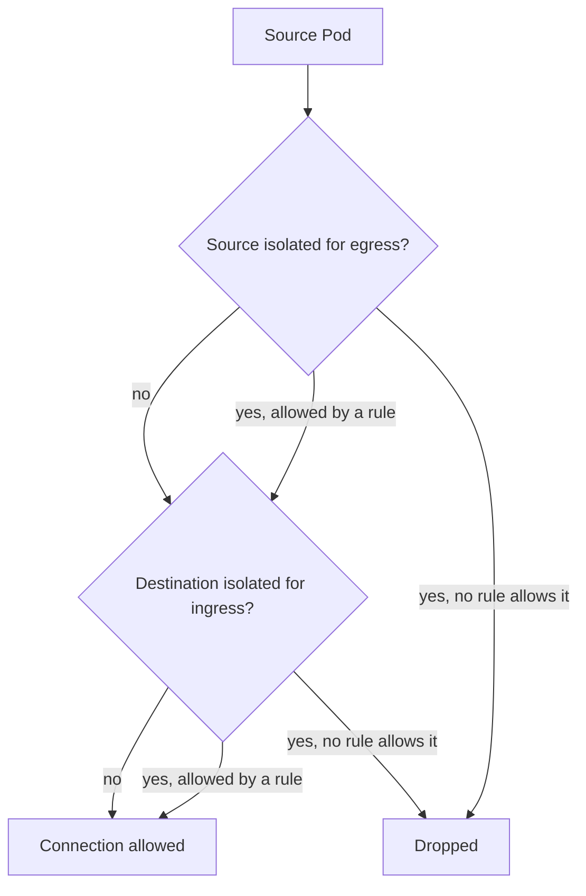

# Allowed Connections And Enforcement

The `probe` application should accept traffic from `shuttle` and reject unrelated callers. A NetworkPolicy selects Pods and describes which traffic they may send or receive. This part explains how isolation starts, how rules combine, how to write a default deny policy with a precise allowance, and how to prove with real requests that the policy works.

## How Isolation Works

A NetworkPolicy lives in a namespace. Its field `podSelector` chooses the Pods of that namespace to which the policy applies. The field `policyTypes` says which directions it covers: `Ingress` for incoming traffic and `Egress` for outgoing traffic.

A Pod is open in a direction until a policy selects it for that direction. After that, the Pod is isolated in that direction and only traffic that some policy allows is permitted. Policies never subtract. Each policy only adds allowed traffic, so the allowed set is the union of all rules of all policies that select the Pod.

When both ends are isolated, both must agree. The source needs an egress rule that allows the connection, and the destination needs an ingress rule that allows it. Return packets of an allowed connection are allowed automatically, so no reverse rule is needed.



The diagram shows the two checks in order. A drop at either point stops the connection.

## Default Deny

An empty `podSelector` selects every Pod in the namespace. A policy that selects every Pod, lists `Ingress` in `policyTypes` and has no `ingress` rules isolates all Pods for ingress and allows nothing. This is the default deny policy for a namespace, and it is the starting point of a least-privilege design.

Save this as `default-deny.yaml`:

```yaml
apiVersion: networking.k8s.io/v1
kind: NetworkPolicy
metadata:
  name: default-deny-ingress
  namespace: starfleet
spec:
  podSelector: {}
  policyTypes: ["Ingress"]
```

## Allow One Caller

Add an allowance after the deny. Save this as `allow-shuttle-to-probe.yaml`:

```yaml
apiVersion: networking.k8s.io/v1
kind: NetworkPolicy
metadata:
  name: allow-shuttle-to-probe
  namespace: starfleet
spec:
  podSelector:
    matchLabels:
      app: probe
  policyTypes: ["Ingress"]
  ingress:
    - from:
        - podSelector:
            matchLabels:
              app: shuttle
      ports:
        - protocol: TCP
          port: 8080
```

The policy selects the Pods with the label `app: probe`. Its `from` list names Pods with the label `app: shuttle` in the same namespace, and `ports` lists the container port 8080 of go-httpbin. A request to any other port, or from another Pod, finds no matching rule.

<!-- astrona:playground:renew -->

Apply the deny policy first and test that `shuttle` is cut off:

```sh
kubectl apply -f default-deny.yaml
kubectl -n starfleet exec deploy/shuttle -- curl -sS --max-time 3 -o /dev/null -w '%{http_code}\n' http://probe.starfleet.svc/get
```

Then check the result. The request does not complete. Curl waits three seconds and ends with a timeout error, and the exit code is 28. A policy takes a short time to be applied by the plugin, so repeat the request once if the first attempt still prints `200`. A dropped packet gives no error answer, which is why the symptom is a timeout and not a refusal.

Now apply the allowance and repeat the request:

```sh
kubectl apply -f allow-shuttle-to-probe.yaml
kubectl -n starfleet exec deploy/shuttle -- curl -sS --max-time 3 -o /dev/null -w '%{http_code}\n' http://probe.starfleet.svc/get
```

The request prints `200` again. Test the caller that should stay blocked:

```sh
kubectl -n outpost exec deploy/drifter -- curl -sS --max-time 3 -o /dev/null -w '%{http_code}\n' http://probe.starfleet.svc/get
```

The result is a timeout. The caller in `outpost` has no rule that allows it. `drifter` is not in the namespace of the policy, and the `from` entry has only a `podSelector`, which selects Pods in the namespace of the policy.

## Selectors And Their Structure

The `from` and `to` lists hold peers. A peer can have a `podSelector`, a `namespaceSelector` or an `ipBlock`. The structure of the list decides the meaning.

- One peer with both a `namespaceSelector` and a `podSelector` matches Pods that match the Pod selector in the namespaces that match the namespace selector. Both conditions apply.
- Two peers, one with a `namespaceSelector` and one with a `podSelector`, are alternatives. The first allows every Pod in the matching namespaces, and the second allows matching Pods in the policy namespace.

A single dash in the YAML decides this. A common error adds a dash before `podSelector` and opens the policy to every Pod of the namespace. Namespaces carry the automatic label `kubernetes.io/metadata.name` with the namespace name, so a namespace selector can match one namespace by name.

## Limits Of Standard Policy

A NetworkPolicy works on addresses, ports and protocols. It cannot allow a request by HTTP path, HTTP method or user identity. It does not encrypt traffic and it does not authenticate the caller, because an allowed source address is only an address. Features beyond the standard API, such as policies with DNS names or HTTP rules, depend on the plugin.

## Diagnose A Blocked Request

Work through the questions in order. Which policies select the destination Pod, and in which direction? Which policies select the source Pod? Which peers and ports do they allow? Is the port the container port, not the Service port? Is the plugin enforcing policies at all? A look at `kubectl -n starfleet get networkpolicy` and `kubectl -n starfleet describe networkpolicy NAME` answers the first three.

## Common pitfalls

> [!WARNING]
> Policy rules only add allowed traffic. A single dash in a `from` list changes a narrow rule into a broad one, and a drop produces a timeout, not a refusal. Test both the caller that must work and the callers that must fail.
