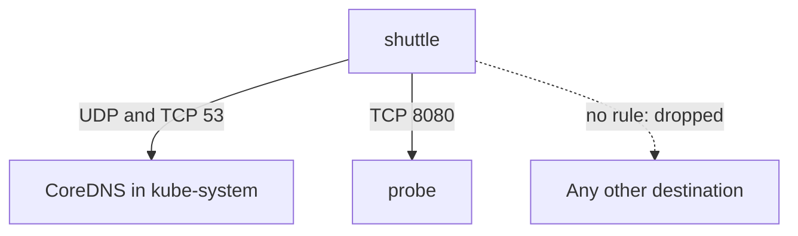

# Egress, DNS And Traffic Outside Policy

Ingress rules protect a service from its callers. Egress rules limit where a compromised Pod can send data and which internal services it can reach. This part explains how to write egress policy without breaking name resolution, how to limit traffic by namespace, and which kinds of traffic a NetworkPolicy does not cover.

## Why Restrict Egress

A Pod that is taken over wants to do three things: scan the network, reach services that trust internal callers, and send data out. Ingress policy on the destinations limits the first two only for destinations that have a policy. Egress policy on the source limits all three at the place where the traffic starts, even for destinations that nobody has protected.

Egress rules also protect against a dependency that was forgotten. A Pod that has an egress policy must list each destination it needs, which turns the network requirements of an application into a reviewable document.

## DNS Needs An Explicit Rule

Applications connect by name. The name is resolved by a DNS server, usually CoreDNS in the `kube-system` namespace, and the Pod asks it on port 53 over UDP, and over TCP for large answers. An egress policy that selects a Pod blocks this traffic like any other, and the symptom is that the application cannot find any host, not even an allowed one.

Save this as `shuttle-egress.yaml`:

```yaml
apiVersion: networking.k8s.io/v1
kind: NetworkPolicy
metadata:
  name: shuttle-egress
  namespace: starfleet
spec:
  podSelector:
    matchLabels:
      app: shuttle
  policyTypes: ["Egress"]
  egress:
    - to:
        - namespaceSelector:
            matchLabels:
              kubernetes.io/metadata.name: kube-system
          podSelector:
            matchLabels:
              k8s-app: kube-dns
      ports:
        - protocol: UDP
          port: 53
        - protocol: TCP
          port: 53
    - to:
        - podSelector:
            matchLabels:
              app: probe
      ports:
        - protocol: TCP
          port: 8080
```

The first rule combines a namespace selector and a Pod selector in one peer, so it allows only the DNS Pods in `kube-system`. The second allows `probe` on its container port. Nothing else leaves `shuttle`.



The diagram shows the two allowed paths of `shuttle`. Everything else is dropped.

<!-- astrona:playground:renew -->

Apply it:

```sh
kubectl apply -f shuttle-egress.yaml
```

Then check the result. `shuttle` can still reach `probe` by name, because both the DNS lookup and the connection are allowed:

```sh
kubectl -n starfleet exec deploy/shuttle -- curl -sS --max-time 3 -o /dev/null -w '%{http_code}\n' http://probe.starfleet.svc/get
```

The request prints `200`. Now try a destination without a rule, the `scout` Service:

```sh
kubectl -n starfleet exec deploy/shuttle -- curl -sS --max-time 3 -o /dev/null -w '%{http_code}\n' http://scout.starfleet.svc/healthz
```

The request ends with a timeout. The name resolves, because DNS is allowed, and the connection to the Pod is dropped. If the egress policy had no DNS rule, the failure would be a resolution error from curl, and the diagnosis would start at the name, not at the port.

## Allow By Namespace And By Address Range

A `namespaceSelector` alone allows every Pod in the matching namespaces. It is the right tool for "any Pod of the monitoring namespace may scrape". The namespace labels then matter for security. A user who can label namespaces can add a namespace to the allowed set, so restrict the right to edit namespace labels.

An `ipBlock` allows an address range in CIDR notation, with an optional `except` list. It is meant for addresses outside the cluster. A typical use is allowing egress to the internet and excluding the cloud instance metadata address `169.254.169.254`, from which a Pod could request node credentials. Pod addresses change, so do not use `ipBlock` for addresses of Pods.

## What Policy Does Not Cover

- Traffic of Pods that use `hostNetwork: true`. These Pods share the network of the node, and implementations treat them as node traffic. Whether policy applies depends on the plugin, so do not rely on it.
- Traffic from the node to its own Pods. Plugins allow it, so that the kubelet probes work.
- Content of a connection. A policy that allows port 8080 allows every request on it.
- Identity. An allowed source is an IP address that belongs to a Pod today. It does not prove who the caller is.
- Confidentiality and integrity on the wire. Traffic between Pods is plain unless the application or a layer such as a service mesh or the plugin encrypts it.

Combine policy with application authentication, with authorization of requests and with TLS between services that carry sensitive data.

## Plan A Policy Set

Start from the traffic you need, not from the traffic you want to block. For each namespace, add a default deny for ingress. Add allowances that name a source Pod, a port and a protocol. For Pods that handle sensitive data or that run untrusted code, add default deny for egress and list their destinations including DNS. Test each rule with a request that must work and a request that must fail, because a rule that is too narrow breaks the application, and a rule that is too broad leaves it exposed.

## Common pitfalls

> [!WARNING]
> An egress policy without a DNS rule makes every name lookup fail, and a policy does not cover host network Pods, node traffic or the content of an allowed connection. Treat NetworkPolicy as one layer, and verify it with real requests.
