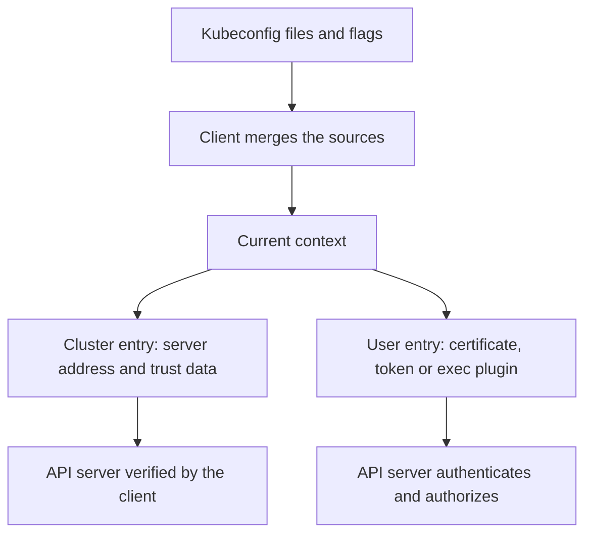

# Kubeconfig, Contexts And Client Trust

Every `kubectl` command, pipeline job and script that talks to the cluster reads a small file before it sends anything. That file tells the client which server to call, how to check the server and which credential to present. Anyone who can read the file, or who can change it, controls what the client does. This part explains the structure of a kubeconfig file, how a client decides whom to trust, what leaks when the file is shared, and why a file from an unknown source is a risk before it is used.

## The Structure Of A Kubeconfig File

A kubeconfig file is a YAML document with three lists and one pointer. The `clusters` list holds server addresses and the data needed to verify them. The `users` list holds credentials. The `contexts` list pairs one cluster entry with one user entry and may add a default namespace. The field `current-context` names the context that the client uses when the command line does not say otherwise.

Nothing in the file grants access. The file only selects an address and a credential. The API server decides what the credential may do by running authentication and then authorization. Changing the context changes which server and which identity a command uses. It never changes what that identity is allowed to do.

Many sources can be combined. The `KUBECONFIG` environment variable holds a list of file paths, and the client merges them. When the variable is not set, the client reads the file in the `.kube` directory of the home directory. Command line flags such as `--kubeconfig`, `--context`, `--user` and `--cluster` override the merged result for one command.



The diagram shows that the context only selects two entries. The server checks of identity and permission happen after the request leaves the client.

## What Makes The Client Trust A Server

The cluster entry decides how the client verifies the server. Three fields matter. The field `certificate-authority` points to a file with the certificate authority that signed the server certificate. The field `certificate-authority-data` holds the same certificate as base64 text inside the kubeconfig file. The field `insecure-skip-tls-verify` set to `true` tells the client to accept any certificate.

With the certificate authority set, the client completes a Transport Layer Security (TLS) handshake and accepts the server only when its certificate chains to that authority and matches the host name or address in the `server` field. With verification skipped, the connection is still encrypted, but the client cannot tell the real API server from a machine that answers on the same address. The client then sends its credential to whoever answered.

A person who sees a certificate error and sets `insecure-skip-tls-verify` to make the error disappear has removed the only check that identifies the server. The correct response is to find the reason for the error. Common reasons are a server address that is not in the certificate, an expired certificate, a changed cluster authority, or a context that points at a different cluster.

## What The User Entry Can Contain

The user entry holds one of several credential types. A client certificate and key, given as `client-certificate-data` and `client-key-data` or as file paths, prove an identity through TLS. A `token` field holds a bearer token, which proves the identity of whoever presents it. A `tokenFile` field names a file that holds the token and is read again when it changes. An `exec` block names a program that the client runs to obtain a credential, for example a cloud provider helper that fetches a short-lived token.

A bearer token and a client key work for any process that holds them, not only for the person who first received them. The API server cannot tell a stolen copy from the original. For this reason the first protection is to keep credential material out of places where it spreads: chat messages, tickets, shared drives, container images, source repositories and build logs.

## Seeing What The File Contains

The command `kubectl config view` prints the merged configuration and replaces secret values. Tokens are printed as `REDACTED`, and embedded certificate data is shown as `DATA+OMITTED`. The flag `--raw` removes this masking and prints everything. The flag `--minify` limits the output to the current context.

The playground has a working kubeconfig for the cluster. Look at the active context first. The renew marker below restores the playground to a clean state before the hands-on steps.

<!-- astrona:playground:renew -->

```sh
kubectl config current-context
kubectl config view --minify
```

Then check the result. The output has one cluster, one user and one context, and the embedded certificate data is shown as `DATA+OMITTED` instead of the real value. Now ask for the unmasked form of only the server address and the size of the embedded authority data:

```sh
kubectl config view --minify --raw -o jsonpath='{.clusters[0].cluster.server}{"\n"}'
kubectl config view --minify --raw -o jsonpath='{.clusters[0].cluster.certificate-authority-data}' | wc -c
```

The first line prints the API server address. The second line prints a number larger than zero, which shows that the file embeds the authority. The same `--raw` flag would print the client key if you asked for it, which is why the output of `--raw` must never go into a ticket or a log.

## Build A Weak File And Read It Back

To see how little the file protects by itself, create a separate kubeconfig that skips verification and holds a token. The flag `--kubeconfig` makes every command write to this file instead of the real one, so the playground configuration is not touched. The server address is only an example, and no request is sent to it.

```sh
kubectl config set-cluster demo --server=https://203.0.113.10:6443 --insecure-skip-tls-verify=true --kubeconfig=demo.kubeconfig
kubectl config set-credentials deployer --token=example-token-value --kubeconfig=demo.kubeconfig
kubectl config set-context demo --cluster=demo --user=deployer --kubeconfig=demo.kubeconfig
kubectl config view --kubeconfig=demo.kubeconfig
ls -l demo.kubeconfig
```

Then check the result. The view shows `insecure-skip-tls-verify: true` and the token as `REDACTED`, while `--raw` would print the token as written. The file listing shows the permission bits. Files that the client creates are normally readable by the owner only. A file that other users can read exposes its credentials to them. Set the permissions yourself when a file arrives by another route:

```sh
chmod 600 demo.kubeconfig
```

## Files From Another Source Can Run Programs

An `exec` block in the user entry makes the client start a program. The program, its arguments and its environment come from the file. A kubeconfig that arrives from an untrusted source can therefore start any program that the person who uses it can run, at the moment the client needs a credential. The same applies to configuration kept in a shared repository when many people can change it.

Treat a kubeconfig like a script. Read the `exec` entries before using it, prefer files that you or your platform team generated, and restrict who may change shared configuration. The kubeconfig of a build job deserves extra care because the job usually has network access and credentials for several systems.

## Contexts, Namespaces And Mistakes

A context names a cluster, a user and an optional namespace. Two contexts can point to different clusters while using resource names that look the same. A command that deletes a Deployment named `api` works the same in a test cluster and in production. The only difference is the context, which a prompt or a script may not display.

Practical controls reduce this risk. Show the current context in the shell prompt. Keep administrative credentials in a separate file that is loaded only for a deliberate task. Give automation its own context with its own limited user instead of a copy of a person's administrator file. A namespace in the context saves typing, but cluster-scoped objects such as nodes, namespaces and certificate requests ignore it, so it is not a safety boundary.

## What To Do When A File Leaks

When a kubeconfig has been exposed, find the credential type and remove its power. A client certificate cannot be revoked in Kubernetes, because the API server has no revocation list. The reliable response is to delete the role bindings for the name and groups in the certificate and to rotate the certificate authority if the key was a high-value one. A leaked token that belongs to a service account stops working when the service account or the token's bound object is deleted. A leaked token from an external identity provider is revoked at the provider.

Record which identities were used from which machines. Request logs in the audit trail show the user name for each call, so a separate identity per person or per job allows you to see which credential was used.

## Common pitfalls

> [!WARNING]
> Setting `insecure-skip-tls-verify` to silence a certificate error removes the only check that identifies the API server, and sharing a kubeconfig or the output of `--raw` hands the credential to everyone who sees it. Selecting a context changes the target, not the permissions, and a file with an `exec` entry can start programs on the machine that uses it.
