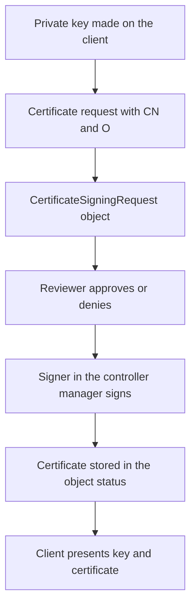

# Client Certificates And Signing Requests

A person who needs access to the cluster for a few days needs an identity that the API server accepts and that expires on its own. Kubernetes has no user database, so that identity usually comes from a client certificate. The CertificateSigningRequest API lets a person ask the cluster to sign a certificate, and an administrator decides whether the request is approved. This part explains how a certificate becomes an identity, how the signing request flow works, who holds the power to approve, and what no step in the flow can undo.

## How A Certificate Becomes An Identity

The API server is started with a client certificate authority, set by the flag `--client-ca-file`. When a client presents a certificate during the TLS handshake, the server checks that the certificate chains to that authority and has not expired. If it does, the server takes the identity from the subject. The common name (CN) becomes the user name. Each organization (O) entry becomes a group name.

A certificate with `CN=ensign` and `O=bridge` therefore authenticates as the user `ensign` in the group `bridge`. The server holds no list of such users. Anyone who has a certificate from the trusted authority is a valid user, and the only thing that limits them is authorization. Role bindings that name the user `ensign` or the group `bridge` give the identity its permissions. Without a binding the identity can authenticate and nothing else.

Two facts follow from this design. First, the group names in the certificate are part of the identity, so a certificate with `O=system:masters` is mapped to the group that the default cluster-admin binding grants every permission. The API server does not check whether a person should be an administrator. It trusts the subject that the authority signed. Second, the API server has no revocation list. A certificate stays valid until its expiry date, so the only controls are a short lifetime and the removal of role bindings.



The diagram shows that the private key never leaves the client. Only the request and the signed certificate travel through the API.

## The CertificateSigningRequest Object

The object lives in the API group `certificates.k8s.io` and has no namespace. The fields that matter are these:

- `spec.request` holds the PEM encoded certificate request, base64 encoded again for the API.
- `spec.signerName` names the signer that should handle it. The signer `kubernetes.io/kube-apiserver-client` signs certificates for clients of the API server.
- `spec.usages` lists the allowed key usages. For a client certificate the list is `client auth`.
- `spec.expirationSeconds` is the requested lifetime. The smallest value is 600 seconds. The signer may issue a shorter lifetime than asked and never a longer one than its own limit.

The fields in `spec` cannot be changed after creation. The state moves forward through conditions. A new request has no condition and is pending. A reviewer adds the condition `Approved` or `Denied`. After approval, the signer writes the certificate to `status.certificate`. The controller manager removes old requests: pending ones after a day, approved, issued and denied ones after about an hour. Read the certificate soon after it is issued and keep a copy.

## Create A Request

The playground needs `openssl` on the machine where you run the commands. The first command creates a private key. The second command creates a certificate request with the subject `CN=crew` and `O=bridge`. The third command turns the request into one line of base64 text for the API.

<!-- astrona:playground:renew -->

```sh
openssl genrsa -out crew.key 2048
openssl req -new -key crew.key -subj "/CN=crew/O=bridge" -out crew.csr
REQUEST="$(base64 < crew.csr | tr -d '\n')"
```

The key file `crew.key` is the secret. Keep it readable only by you. Now write the object. The shell expands `REQUEST` when it creates the file:

```sh
cat > crew-csr.yaml <<YAML
apiVersion: certificates.k8s.io/v1
kind: CertificateSigningRequest
metadata:
  name: crew
spec:
  request: ${REQUEST}
  signerName: kubernetes.io/kube-apiserver-client
  expirationSeconds: 3600
  usages:
    - client auth
YAML
kubectl apply -f crew-csr.yaml
kubectl get csr crew
```

Then check the result. The listing shows the request with the condition `Pending`, and the requestor column shows the identity that created it. No certificate exists yet, because a request that nobody has approved is never signed.

## Review Before You Approve

Approval is the moment where identities are created. A reviewer must look at what the request asks for, not only at its name. Print the subject from the request that is stored in the object:

```sh
kubectl get csr crew -o jsonpath='{.spec.request}' | base64 --decode | openssl req -noout -subject
kubectl get csr crew -o jsonpath='{.spec.expirationSeconds}{"\n"}'
```

The first command prints the subject. Check three things before approving. The common name must be a user you expected. The organization entries must be groups that the person should have, and a group such as `system:masters` or any group bound to a broad role is a reason to deny. The requested lifetime must be as short as the need. The requestor in the object tells you who submitted the request, which can differ from the name in the subject.

Approve the request, which makes the signer issue the certificate:

```sh
kubectl certificate approve crew
kubectl get csr crew
```

A request that must not be signed is denied with `kubectl certificate deny NAME`. A denied request stays in the list and is deleted later, so the decision is visible in the audit trail.

## Use The Certificate

Read the signed certificate from the status and check its subject and expiry date:

```sh
kubectl get csr crew -o jsonpath='{.status.certificate}' | base64 --decode > crew.crt
openssl x509 -in crew.crt -noout -subject -enddate
```

Then add the credential as a new user entry in the playground kubeconfig and make one request. The flag `--user=crew` selects the new user entry and keeps the current cluster entry:

```sh
kubectl config set-credentials crew --client-certificate=crew.crt --client-key=crew.key --embed-certs=true
kubectl --user=crew get pods -n starfleet
```

The second command is rejected with a `Forbidden` error that names the user `crew` and the group `bridge`. The request proves two things. The certificate authenticates, because the error names the identity and does not say `Unauthorized`. The identity has no permissions, because no binding exists. Authentication and authorization are separate decisions.

## Who May Approve

Three permissions control the flow, and each one is a privilege. The verb `create` on `certificatesigningrequests` lets a user submit requests. The verb `update` on `certificatesigningrequests/approval` lets a user approve or deny. The verb `approve` on the resource `signers` with the signer name as the resource name lets a user decide for that signer. A user needs both the second and the third permission to approve a client certificate.

Granting `approve` for `kubernetes.io/kube-apiserver-client` is close to granting administrator access. The holder can approve a request with any subject and thereby create an identity in any group, including a group that has full rights. Limit this permission to a small group, keep it out of broad roles, and use signer names in the rule instead of wildcards. The same applies to the verb `sign`, which lets a user write a certificate into the status.

## What The Flow Cannot Undo

The cluster does not revoke a certificate. After approval, the certificate is valid until its end date, even when the request object is deleted. The reliable controls are a short `expirationSeconds`, removal of every role binding for the user and groups, and reviewing at approval time. Names in certificates are also not unique. Two people can hold certificates for the same common name, and the cluster treats both as the same user.

Check what the identity can do now, and remove the request after the test:

```sh
kubectl auth can-i list pods -n starfleet --as=crew --as-group=bridge
kubectl delete csr crew
```

The answer is `no`. The deletion removes the object. It does not invalidate the certificate that you already hold.

## Common pitfalls

> [!WARNING]
> Approving a request without reading its subject can create an administrator, because the group in the certificate is trusted as written. A signed certificate cannot be revoked, so the protection is a short lifetime, narrow role bindings and a small list of users who may approve.
