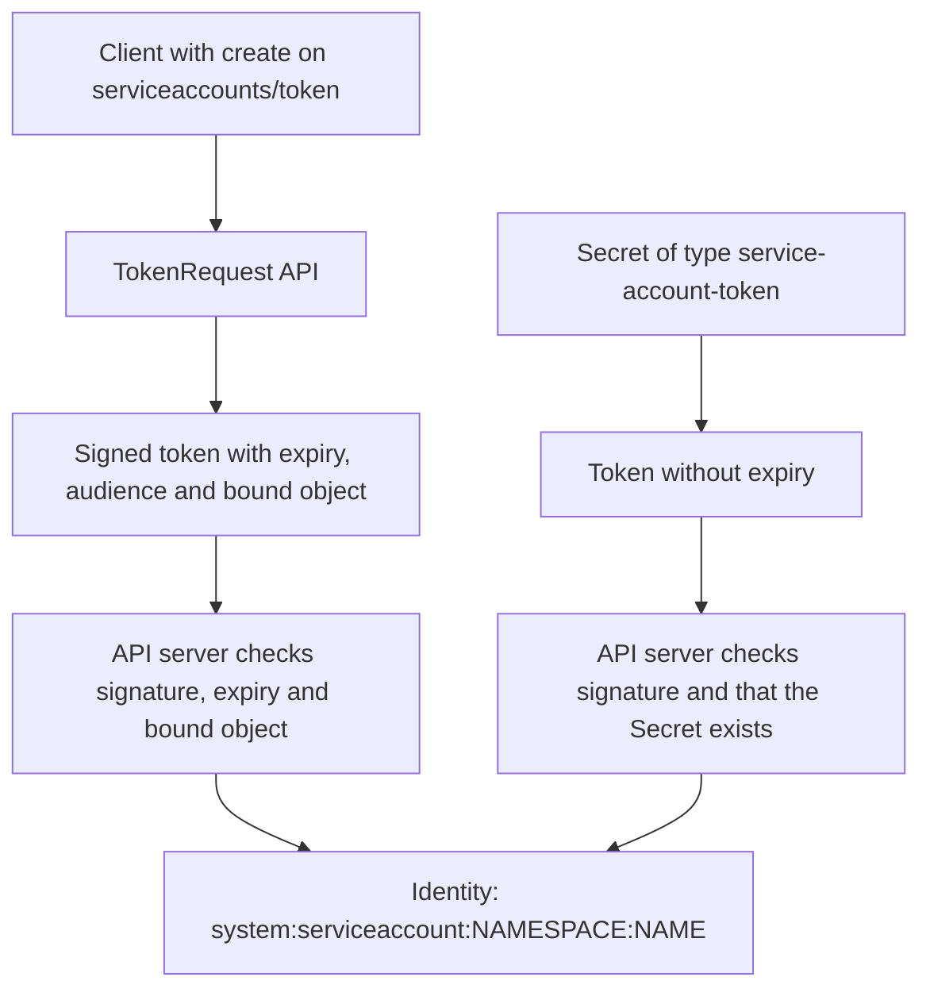

# Service Account Tokens And Automation Credentials

A deployment job, a monitoring tool or a script outside the cluster needs a credential that no person has to type. In Kubernetes that credential is usually a token that belongs to a service account. Tokens come in two kinds that behave very differently: short-lived tokens that the API server issues on request and long-lived tokens stored in Secrets. This part explains how each kind is issued and checked, what binds a token to an object, how to give a job a narrow credential, and how to take access away.

## Two Kinds Of Service Account Tokens

A service account is a namespaced identity for software. Its user name has the form `system:serviceaccount:NAMESPACE:NAME`, and it is also a member of the groups `system:serviceaccounts` and `system:serviceaccounts:NAMESPACE`. A token is a signed JSON Web Token (JWT) that carries this identity. The API server verifies the signature with its service account key, so no database lookup of the identity is needed for a short-lived token.

The first kind is requested through the TokenRequest API. The client sends a request for a token for one service account, and the API server returns a token with an expiry time. The token can be limited to an audience, which names the service that may accept it, and can be bound to an object, such as a pod or a Secret. When the bound object is deleted, the token stops working. Kubelet uses this API to place a projected token in pods, and `kubectl create token` uses it for people.

The second kind is the legacy token. A Secret of type `kubernetes.io/service-account-token` with an annotation that names a service account makes the control plane fill the Secret with a token. This token has no expiry. It works until the Secret or the service account is deleted. Since Kubernetes 1.24 the control plane no longer creates these Secrets automatically, and they exist only where someone creates them on purpose, or in clusters that were upgraded from older versions.



The diagram shows that both kinds end in the same identity, while only the first kind expires by itself.

## Request A Short-Lived Token

The playground has a service account `runner` in `starfleet` that may read pods in that namespace. The command below asks the TokenRequest API for a token that lasts ten minutes. The shell keeps the value in a variable, so it does not appear in the shell history of the next commands.

<!-- astrona:playground:renew -->

```sh
TOKEN="$(kubectl -n starfleet create token runner --duration=10m)"
kubectl --token="$TOKEN" auth whoami
```

Then check the result. The command `auth whoami` prints the user name `system:serviceaccount:starfleet:runner` and its groups. Use the token for a real request and then for one that the role does not allow:

```sh
kubectl --token="$TOKEN" get pods -n starfleet
kubectl --token="$TOKEN" get pods -n outpost
kubectl --token="$TOKEN" get secrets -n starfleet
```

The first request returns the pods. The second and third are rejected with `Forbidden`, because the role of `runner` covers only pods in `starfleet`. The token proves identity and the role limits it. A token that lasts ten minutes limits the time in which a leak is useful, while the role limits what can be done during that time.

## Audience And Bound Objects

The audience restricts where a token is accepted. The API server accepts tokens whose audience includes its own identifier, which is the default. A token requested with `--audience=vault` is intended for a service called vault, and the API server does not accept it for its own requests when the audiences do not match. A service that validates tokens must check the audience, otherwise any token for any service is accepted.

Bound objects tie the token to something that can be removed. With `--bound-object-kind=Secret` and `--bound-object-name=NAME`, the token is valid only while that Secret exists. A token bound to a pod ends when the pod is deleted. This is how projected tokens behave. They are valid only for the lifetime of the pod, and kubelet refreshes them before they expire.

The permission to ask for a token is a right of its own: the verb `create` on the resource `serviceaccounts/token`. A user who can create tokens for a service account can act as that account. If the account has strong permissions, such as a service account bound to `cluster-admin`, this right makes the holder an administrator. Review rules with `serviceaccounts/token` as carefully as rules that grant `escalate` or `bind`.

## The Legacy Token Secret

Create the long-lived kind and see how it differs. Save this as `runner-token.yaml`:

```yaml
apiVersion: v1
kind: Secret
metadata:
  name: runner-legacy-token
  namespace: starfleet
  annotations:
    kubernetes.io/service-account.name: runner
type: kubernetes.io/service-account-token
```

Apply it:

```sh
kubectl apply -f runner-token.yaml
```

Then check the result. The control plane fills the Secret within a moment. Read the token, and confirm that it works:

```sh
LEGACY="$(kubectl -n starfleet get secret runner-legacy-token -o jsonpath='{.data.token}' | base64 --decode)"
kubectl --token="$LEGACY" auth whoami
```

The output shows the same identity as before. This token has no expiry time. Anyone who copies the Secret, for example from a backup, a manifest repository or a `get secret` request, holds a credential that works until someone removes it. Now delete the Secret and try the same token again:

```sh
kubectl -n starfleet delete secret runner-legacy-token
kubectl --token="$LEGACY" auth whoami
```

The second request fails with an authentication error, because the API server checks for the Secret when it validates a legacy token. Deleting the Secret is the revocation. Creating a new one gives a different token for the same account.

## Tokens In Automation

A job that runs inside the cluster needs no Secret. The pod receives a projected token through its service account, and the account's role limits it. Workloads that never call the API should not receive any token, which the field `automountServiceAccountToken: false` prevents. A job outside the cluster has two safe options. It can request a short-lived token at the start of each run, with an identity that has the right to create tokens for one account. It can also use a credential from its own platform that the cluster accepts, such as an identity provider token.

Where a stored credential cannot be avoided, apply these rules. Use one service account per job, so that audit entries and revocation are specific. Bind the account to a Role in the namespaces it needs, not to a ClusterRole across the cluster. Keep the token in the secret store of the platform and not in the repository or the job log. Set an expiry that matches how often the job runs, and rotate it.

## Take Access Away

The order of steps matters when a credential may have leaked. First remove the permissions, so that a copy of the token is worthless even while it is valid. Delete the role bindings for the service account. Second, remove the credential itself: delete the legacy Secret, delete the service account if it is not needed, or wait for a short-lived token to expire. Third, check the audit log for the user name and the time window to see what the token did.

Short-lived tokens cannot be revoked one by one. The signing key is shared by all tokens, and rotating it invalidates every token the cluster has issued, which is a cluster-wide event. For this reason a short lifetime and a narrow role are the main controls, and bound objects are the way to end a token early.

Remove the test objects when you are finished:

```sh
unset TOKEN LEGACY
```

## Common pitfalls

> [!WARNING]
> A legacy token Secret never expires and works anywhere the token is copied, and the right to create tokens for an account equals the permissions of that account. Remove the role bindings first when a credential may have leaked, and then remove the credential.
