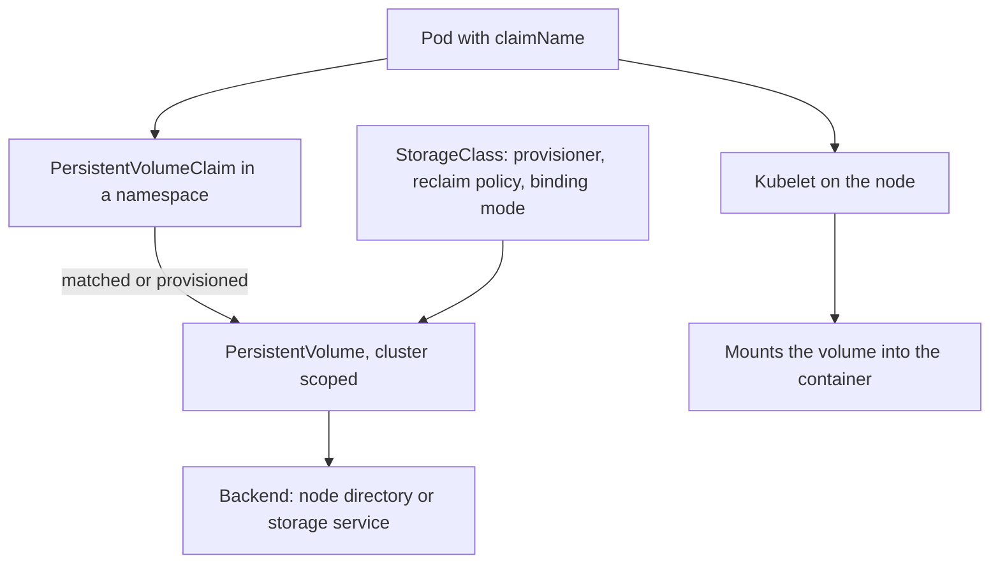

# Volumes, Claims And Who Reaches The Data

An application that keeps records needs storage that survives the replacement of its pod. Kubernetes separates the request for storage from the storage itself, and that separation decides who can reach the data. This part explains the three storage objects, how a claim becomes a volume, which permission gives access to stored data and which does not, and why the boundary of a claim is the namespace.

## The Three Storage Objects

A PersistentVolume (PV) represents a piece of storage. It has no namespace, and it records the size, the access modes, the reclaim policy and a pointer to the backend, such as a directory on a node or a volume at a cloud provider. A PersistentVolumeClaim (PVC) is a request for storage in one namespace. It asks for a size, an access mode and optionally a storage class. A StorageClass describes how storage is created on demand. It names a provisioner, a reclaim policy and a binding mode.

A pod never references a PV. It references a claim by name in `spec.volumes[].persistentVolumeClaim.claimName`, and it mounts that volume into containers with `volumeMounts`. The claim belongs to the namespace of the pod, so a pod can only reference claims in its own namespace.

The binding is one to one. The control plane matches a claim to a volume that satisfies its request, writes the volume name into the claim as `spec.volumeName`, and writes the claim into the volume as `spec.claimRef`. While the pair exists, no other claim can use that volume. When a class is set and no matching volume exists, the provisioner creates one.



The diagram shows that the pod reaches the backend through the claim, and that the node component of the kubelet performs the mount.

## Binding Modes And The Default Class

A class has a `volumeBindingMode`. The value `Immediate` creates and binds the volume as soon as the claim exists. The value `WaitForFirstConsumer` waits until a pod uses the claim, so that the volume is created where the pod is scheduled. The default class of the playground cluster is called `standard` and uses a local path provisioner that stores data in a directory on the node.

<!-- astrona:playground:renew -->

```sh
kubectl get storageclass
```

Then check the result. The listing shows the class `standard` marked as the default, with its provisioner, its reclaim policy and its binding mode. These three columns are the ones that matter for security. The provisioner decides where the data lives, the reclaim policy decides what happens to it when the claim is deleted, and the binding mode decides when the volume appears.

Now create a claim. Save this as `records.yaml`:

```yaml
apiVersion: v1
kind: PersistentVolumeClaim
metadata:
  name: records
  namespace: starfleet
spec:
  accessModes: ["ReadWriteOnce"]
  storageClassName: standard
  resources:
    requests:
      storage: 64Mi
```

Apply it and look at the claim:

```sh
kubectl apply -f records.yaml
kubectl -n starfleet get pvc records
```

With a class that waits for the first consumer, the claim stays in the state `Pending` because no pod uses it yet. That state is normal and does not mean that anything is broken.

## Mounting The Claim

A pod makes the claim real. Save this as `writer.yaml`. The container writes one file to the mounted directory and then waits:

```yaml
apiVersion: v1
kind: Pod
metadata:
  name: writer
  namespace: starfleet
spec:
  containers:
    - name: writer
      image: busybox:1.37.0
      command: ["sh", "-c", "echo quarterly figures > /data/report.txt && sleep 3600"]
      volumeMounts:
        - name: data
          mountPath: /data
  volumes:
    - name: data
      persistentVolumeClaim:
        claimName: records
```

Apply it and wait until the pod is ready:

```sh
kubectl apply -f writer.yaml
kubectl -n starfleet wait --for=condition=Ready pod/writer --timeout=120s
kubectl -n starfleet get pvc records
```

The claim now shows the state `Bound`, and the volume name in the output belongs to a PV that the provisioner created. The file written by the container is stored in the backend and not in the pod. Replacing the pod keeps the file as long as the claim stays.

## Which Permission Reads The Data

Reading the claim object and reading the data are different permissions. The verbs `get` and `list` on `persistentvolumeclaims` return the claim record: its size, class and volume name. They return no file content. File content is reachable only through a process that mounts the volume. A person who can start such a process can therefore read the data, even when the person has no right on the claim.

Start a second pod that mounts the same claim, and read the file:

```sh
kubectl -n starfleet run reader --image=busybox:1.37.0 --restart=Never --overrides='{"spec":{"containers":[{"name":"reader","image":"busybox:1.37.0","command":["sleep","3600"],"volumeMounts":[{"name":"data","mountPath":"/data"}]}],"volumes":[{"name":"data","persistentVolumeClaim":{"claimName":"records"}}]}}'
kubectl -n starfleet wait --for=condition=Ready pod/reader --timeout=120s
kubectl -n starfleet exec reader -- cat /data/report.txt
```

The last command prints the line that `writer` stored. The second pod never asked the owner of the data for anything. It named the claim, the claim is in the same namespace, and the kubelet mounted it. Nothing in the Kubernetes API checks whether the creator of a pod is the owner of the claim that the pod uses.

The consequence is a rule for permissions. In a namespace, the rights to create pods, and to create anything that creates pods, are rights on every claim in that namespace. This includes Deployments, StatefulSets, DaemonSets, Jobs and CronJobs, because their controllers create the pods. The right to run `kubectl exec` into a pod that mounts the volume is also a right on the data. Check what a service account can do:

```sh
kubectl auth can-i create pods -n starfleet --as=system:serviceaccount:starfleet:runner
kubectl auth can-i get persistentvolumeclaims -n starfleet --as=system:serviceaccount:starfleet:runner
```

Both answers are `no`, because the account `runner` can only read pods. If the first answer were `yes`, the account could read every claim in the namespace through a pod, whatever the second answer says.

## Claims And Volumes Across Namespaces

A claim is bound to one namespace, but a PV is cluster scoped. The `claimRef` of a volume names the one claim that may use it, by namespace and name. A user with the right to create or edit PVs can create a volume that points at a directory on a node and bind it to any claim by writing the matching `claimRef`. For this reason the rights `create`, `update` and `patch` on `persistentvolumes` belong to storage administrators and the provisioner, not to application teams.

A claim can also name a volume directly with `spec.volumeName`. If an unbound volume exists, a user who can create claims in a namespace can request it. The `claimRef` of the volume prevents this when it is set on purpose. A volume with no `claimRef` is available to any claim that matches it.

## What To Look For In A Review

When you review the storage of a namespace, ask the following questions in order. Which pods mount each claim, including pods of helper containers and jobs? Which identities can create pods or workloads in the namespace? Which identities can exec into those pods? Which volumes have a `claimRef`, and which are free to be claimed? Which class and reclaim policy does each claim use? The answers describe the real readers of the data.

Clean up the objects that you created:

```sh
kubectl -n starfleet delete pod writer reader --wait=false
kubectl -n starfleet delete pvc records
```

## Common pitfalls

> [!WARNING]
> Permission on a claim object does not control the data, because any pod in the same namespace can mount the claim and read it. Treat the rights to create pods, workloads and `exec` sessions as rights on every volume in the namespace.
