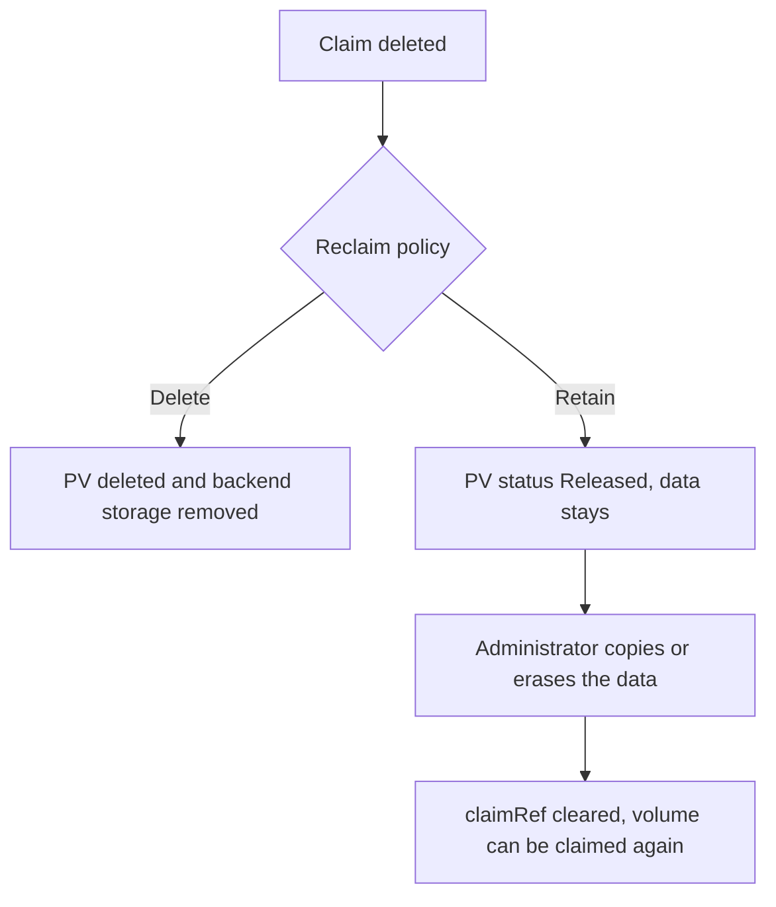

# Mount Options, Access Modes And Reclaim Behavior

Once a pod mounts a volume, three settings decide what the process can do with it: whether the mount is read-only, which identity owns the files, and what the access mode of the claim promises. A fourth setting, the reclaim policy, decides what happens to the data when the claim goes away. This part explains each setting at the level of the object field, shows which of them is enforced by the kubelet and which is not, and follows a volume through the deletion of its claim.

## Read-Only Mounts

A container mounts a volume with `volumeMounts`. The field `readOnly: true` on a mount makes the kubelet mount the volume into that container as read-only. Writes then fail inside the container with the error `Read-only file system`. The setting applies per container, so one pod can have a writer and a reader on the same volume.

A claim reference has its own flag: `persistentVolumeClaim.readOnly: true` in the `volumes` list. It marks the whole volume as read-only for the pod. Use both when a pod must never change the data. The mount flag is checked when the container starts and cannot be changed by the process inside the container. A process that is root inside the container still sees a read-only mount, because the restriction is set on the mount itself and not on file permissions.

The read-only flag limits modification and not disclosure. The process still reads every file in the volume. A reporting helper that needs the data must be trusted to read it, and one that does not need it must not mount it.

## Prove The Difference

Save this as `auditor.yaml`. It mounts the claim `records` with both flags:

```yaml
apiVersion: v1
kind: Pod
metadata:
  name: auditor
  namespace: starfleet
spec:
  containers:
    - name: auditor
      image: busybox:1.37.0
      command: ["sleep", "3600"]
      volumeMounts:
        - name: data
          mountPath: /data
          readOnly: true
  volumes:
    - name: data
      persistentVolumeClaim:
        claimName: records
        readOnly: true
```

The claim must exist first. Create it with the same size and class as before and apply both objects. The renew marker restores a clean playground, which removes objects from earlier practice:

<!-- astrona:playground:renew -->

```sh
kubectl -n starfleet create -f - <<'YAML'
apiVersion: v1
kind: PersistentVolumeClaim
metadata:
  name: records
spec:
  accessModes: ["ReadWriteOnce"]
  storageClassName: standard
  resources:
    requests:
      storage: 64Mi
YAML
kubectl apply -f auditor.yaml
kubectl -n starfleet wait --for=condition=Ready pod/auditor --timeout=120s
```

Then check the result. Read a file and try to write one:

```sh
kubectl -n starfleet exec auditor -- ls /data
kubectl -n starfleet exec auditor -- sh -c 'echo changed > /data/report.txt'
```

The listing works, and the write fails with a message that the file system is read-only. The data is protected from change by this pod and still readable by it.

## Ownership And Permissions Inside The Volume

A volume has files with an owner, a group and mode bits. Which process can read them depends on the user and group of the container process. Two fields of the pod security context affect this. The field `runAsUser` sets the user of the container process. The field `fsGroup` makes the kubelet change the group ownership of supported volumes to the given group when it mounts them, and it adds that group to the processes of the pod.

The effect is that `fsGroup` can make data writable for a group that did not own it before. It changes the ownership recursively for many volume types, so on a large volume it can take a long time to start a pod. The field has no effect on some volume types. It is not an access control against other pods, because another pod that sets the same `fsGroup` receives the same group.

The field `subPath` mounts a sub-directory of the volume instead of the root. It is useful to give a container only one directory of a shared volume. It is a convenience and not a security boundary, because a pod that mounts the volume without `subPath` sees everything.

## Access Modes

An access mode on a claim states how many nodes or pods can use the volume at the same time. `ReadWriteOnce` means that the volume can be mounted read-write by a single node. Several pods on that node can mount it together. `ReadOnlyMany` allows many nodes to mount it read-only. `ReadWriteMany` allows many nodes to mount it read-write. `ReadWriteOncePod` restricts the volume to one pod across the cluster.

An access mode is a capability that the volume supports, and the scheduler and the attach step use it. It does not decide which applications may use the data, and it does not check identities. A pod from another application in the same namespace on the same node can mount a `ReadWriteOnce` claim next to the owner. When exclusive use matters, `ReadWriteOncePod` is the mode that enforces one pod at a time, if the storage driver supports it.

## The Reclaim Policy

When a claim is deleted, the policy `persistentVolumeReclaimPolicy` of its volume decides the next step. With `Delete`, the control plane deletes the PV and asks the provisioner to remove the backend storage. With `Retain`, the PV and the backend data stay, and the PV moves to the status `Released`. A volume provisioned from a class receives the reclaim policy of the class, and the default class of the playground uses `Delete`.

Each value has a risk. `Delete` removes the data when a claim is deleted by mistake, including through the deletion of a namespace. `Retain` keeps the data, and that data now belongs to nobody in the cluster. A `Released` volume still holds the old content. It cannot be claimed again until an administrator clears its `claimRef`, and an administrator who does that for a new owner must first remove the old data. Otherwise the new owner receives a volume full of someone else's files.



The diagram shows that Retain keeps the data and moves the duty of cleaning it to an administrator.

## Follow A Volume Through Deletion

Find the volume behind the claim, and see its policy and status:

```sh
PV="$(kubectl -n starfleet get pvc records -o jsonpath='{.spec.volumeName}')"
kubectl get pv "$PV" -o jsonpath='{.spec.persistentVolumeReclaimPolicy}{"\n"}'
```

The value is `Delete`. Change it to `Retain`, then remove the pod and the claim:

```sh
kubectl patch pv "$PV" -p '{"spec":{"persistentVolumeReclaimPolicy":"Retain"}}'
kubectl -n starfleet delete pod auditor
kubectl -n starfleet delete pvc records
kubectl get pv "$PV"
```

The listing now shows the volume with the status `Released` and with a claim reference that still names the deleted claim. The backend directory with the file remains. Remove the leftover volume object when you are done:

```sh
kubectl delete pv "$PV"
```

Because the policy is `Retain`, deleting the object removes only the record in the cluster. The directory with the file stays on the node until someone with access to the node removes it, which is the duty that `Retain` hands to the administrator.

## Choosing A Policy

Use `Delete` for scratch and cache data that the application can rebuild. Use `Retain` for data that would be costly to lose and that has a clear owner, and add a process that reviews and cleans released volumes. Whichever you choose, the policy is part of the data lifecycle. Deleting the pod, the claim or the namespace does not by itself prove that the bytes were erased, and a retained volume or a backup copy keeps them readable by whoever manages the backend.

## Common pitfalls

> [!WARNING]
> A read-only mount stops writes and not reads, and an access mode of `ReadWriteOnce` still lets other pods on the same node mount the claim. A retained volume keeps its data after the claim is gone, so clean it before it is claimed again.
