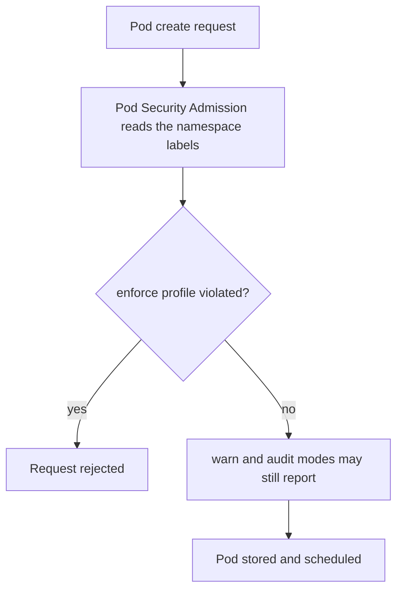

# Host Paths, Backups And The Data Lifecycle

Some volume types do not hide the node at all. A pod that mounts a directory of the node reads whatever the node keeps there, and a copy of a volume that sits in a backup is a second place where the data can leak. This part explains the volume types that open the node, how the Pod Security Admission controller limits them, what encryption and snapshots do and do not protect, and why deleting a pod, a claim or a volume does not prove that data is gone.

## Volume Types That Reach The Node

The volume type `hostPath` mounts a file or directory of the node into the pod. A pod with `hostPath: /` reads the whole file system of the node. A pod with `hostPath: /var/lib/kubelet` reads the volumes and service account tokens of every other pod on that node. A pod with the path of the container runtime socket can start containers outside the control of the Kubernetes API. The type can also be written to, so a pod can change files that the node trusts, such as scripts and configuration.

The type `local` is a PV type that points at a directory or device of one node. Unlike `hostPath`, it is meant for administrators to define as a PV, and the scheduler knows which node holds the data. A claim to a local volume still exposes a node directory to the pod that binds it. The types `emptyDir`, `configMap`, `secret`, `projected` and `downwardAPI` do not expose the node. An `emptyDir` lives for the life of the pod and is removed with it, which makes it suitable for temporary data.

The risk of `hostPath` is not limited to attackers. A mistaken path in a manifest is enough to give a workload more access than its authors intended. For this reason the cluster should refuse the type in application namespaces, and allow it only for a few node agents in a namespace that is administered separately.

## Refusing The Type With Pod Security Admission

Pod Security Admission is a built-in admission controller. It checks each pod against one of three profiles at creation time. The profile `privileged` allows everything. The profile `baseline` blocks known privilege escalations, including `hostPath` volumes. The profile `restricted` follows current hardening practice and allows only a short list of volume types, among them claims, `emptyDir`, `configMap`, `secret`, `projected`, `downwardAPI` and ephemeral volumes.

A namespace chooses the profile with labels in the form `pod-security.kubernetes.io/MODE=PROFILE`. The mode `enforce` rejects violating pods. The mode `warn` lets them in and prints a warning to the user. The mode `audit` lets them in and records an audit event. Using `warn` and `audit` first shows what an `enforce` label would stop.



The diagram shows that the check happens when the pod is created, before it is stored or scheduled.

## Try It In A Scratch Namespace

Create a namespace, label it with the baseline profile in enforce mode and ask the API server to validate a pod with a `hostPath` volume. A dry run runs admission without storing the pod.

<!-- astrona:playground:renew -->

```sh
kubectl create namespace scratch
kubectl label namespace scratch pod-security.kubernetes.io/enforce=baseline
```

Save this as `peek.yaml`:

```yaml
apiVersion: v1
kind: Pod
metadata:
  name: peek
  namespace: scratch
spec:
  containers:
    - name: peek
      image: busybox:1.37.0
      command: ["sleep", "3600"]
      volumeMounts:
        - name: node
          mountPath: /host
  volumes:
    - name: node
      hostPath:
        path: /var/log
```

Ask the server to validate it:

```sh
kubectl apply --dry-run=server -f peek.yaml
```

Then check the result. The request is rejected with a message that mentions `PodSecurity`, the profile `baseline` and the `hostPath` volume. The label takes effect within moments, so repeat the command once if the pod is admitted on the first attempt. Now replace the volume with a claim and an `emptyDir`, and the same namespace admits the pod. The profile restricts the type of volume and does not decide whether the claim itself should be used.

## Backups, Snapshots And Copies

A snapshot is a point-in-time copy of a volume. Kubernetes offers a snapshot API through the `VolumeSnapshot` resources, which an add-on installs together with a driver that supports it. A snapshot is stored by the storage backend. A new claim can be created from a snapshot, and the new volume contains all the data of the original.

This is a second path to the data. The permission to create a claim from a snapshot, the permission to read the snapshot objects and the access to the backend where the snapshot lives are each a way to read the original data. A person who cannot mount the original claim may still be allowed to restore a snapshot into a namespace of their own. Review the rights `create` on `persistentvolumeclaims` with a data source, and the rights on `volumesnapshots` and `volumesnapshotcontents` like rights on the data itself.

Backups outside the cluster add more copies. A backup tool needs credentials that can read volumes, and those credentials are as sensitive as the data. The retention of backups also matters. Data that was deleted from the cluster for a legal reason may live on in last month's backup. Record where copies are held, who can read them and how long they stay.

## What Encryption Protects

Encryption at rest, provided by the storage backend or by an encrypted file system, protects the bytes on the physical medium. It defends against a stolen disk, a discarded device or a snapshot read by someone without the key. It does not defend against a process that mounts the volume, because the file system decrypts the data for the mount. The same holds for the node administrator, who can read mounted data through the node.

Encryption keys need an owner. Where keys are held by a cloud key management service, access to the key is an access to the data. If the same identity can read the volume and the key, the key adds no separation. Keep the roles of key administrator and storage administrator apart when the platform allows it.

## Deleting Is Not Erasing

Each deletion in the chain has a limited meaning. Deleting a pod does not touch a persistent volume. Deleting a claim with the policy `Delete` asks the provisioner to remove the volume, and with the policy `Retain` it leaves the data in place. Deleting a PV object with `Retain` leaves the backend data. Backends reuse blocks, and a removed volume may remain in snapshots, replicas and backups until those expire.

When a requirement says that data must be gone, define the proof. Name each copy, delete or expire each one, and where the backend offers it, use a secure erase or destroy the encryption key so that remaining bytes cannot be read. A statement that the claim was deleted is not evidence that the data was erased.

## Integrity And Recovery

A compromised application with write access can corrupt or replace the data, whatever the encryption. Replicated storage copies the damage to every replica. A restore needs a point in time before the change, and application data that spans several volumes needs a consistent recovery point across them. Read-only mounts for the components that only read, and separate claims for data with different owners, reduce how much one compromised container can change.

Clean up the scratch namespace after the practice:

```sh
kubectl delete namespace scratch
```

## Common pitfalls

> [!WARNING]
> A `hostPath` volume gives a pod the files of the node, and a snapshot or backup gives a second way to read the same data. Encryption at rest does not hide data from a process that mounts the volume, and deleting a claim does not prove that every copy is erased.
